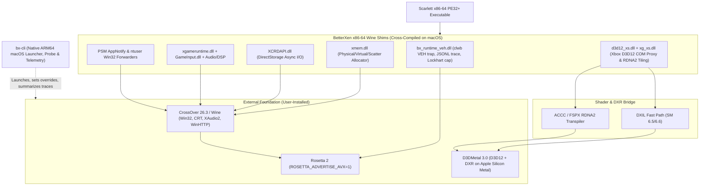

<div align="center">

# BetterXen

**Modular Xbox Series (`Scarlett`) compatibility layer for Apple Silicon macOS — built on CrossOver, Rosetta 2, and D3DMetal 3.0.**

[](https://github.com/MacosPorters/betterxen/actions/workflows/hybrid-ci.yml)
[](https://github.com/MacosPorters/betterxen/actions/workflows/hygiene.yml)
-1f6feb?logo=apple&logoColor=white)


-d29922)


</div>

> [!IMPORTANT]
> **Experimental status.** BetterXen is an active, open-source compatibility engineering project currently at **Milestone M0** (cross-compiled shim foundation and live CrossOver/Rosetta smoke tests verified on synthetic PE32+ workloads). **Commercial Xbox game execution is not yet supported.** CrossOver, Rosetta 2, and D3DMetal are externally installed dependencies and are never bundled or redistributed.

BetterXen builds the missing Xbox Game OS layer around **CrossOver 26.3+**, **Rosetta 2**, and **D3DMetal 3.0** on Apple Silicon:
- **Native ARM64 macOS tooling** (`launcher/`, Rust) for host diagnostics, PE32+ static probing, CrossOver bottle orchestration, and structured trace aggregation.
- **Cross-compiled x86-64 Windows PE32+ shim DLLs** (`shims/`, C++20 via `mingw-w64`) implementing Xbox runtime APIs (`xmem`, `XCRDAPI`, `d3d12_xs`, `xg_xs`, `xgameruntime`, `GameInput`, `AcpHal`/`xapu`/`chad`, Win32/PSM forwarders, and a `clwb` Vectored Exception Handler).
- **Shader pipeline** (`shader-transpiler/`, Rust) for classifying `DXBC` containers (`DXIL` vs. `ACCC`/`FSPX` RDNA 2 machine code) and handling console shader translation where required.

> [!CAUTION]
> **Clean-room and anti-piracy policy.** BetterXen strictly opposes piracy and does not distribute copyrighted game files, firmware, decryption keys, or DRM circumvention tooling. Zero proprietary binaries, assets, or leaked materials are permitted in this repository or its Git history. All in-repo tests use independently authored synthetic PE32+ workloads.

---

## Architecture

Rosetta 2 executes x86-64 CPU code (including AVX/AVX2/FMA/F16C/BMI1/BMI2/128-bit VAES when launched with `ROSETTA_ADVERTISE_AVX=1`), CrossOver/Wine provides Win32/NT/CRT/XAudio2/WinHTTP, and D3DMetal 3.0 translates Direct3D 12 + DXR onto Metal. BetterXen supplies the modular Xbox Game OS shims, `clwb` exception handling, shader bridge, and ARM64 orchestration around that stack.



---

## Repository Layout

The repository is organized into disjoint track directories around a single frozen `abi/` contract so **5–8+ contributors (and coding agents)** can work concurrently with minimal merge conflicts.

| Directory | Track | Stack | Contents |
| --- | --- | --- | --- |
| [`abi/`](abi/README.md) | Shared (frozen) | C headers + `.def` | Versioned cross-DLL headers (`bx_config.h`, `bx_log.h`, `bx_xmem_internal.h`, `bx_shader_bridge.h`) and canonical export tables for all 16 shim DLLs |
| `launcher/` | Track A | Rust (`arm64`) | `bx-cli` (`doctor`, `probe`, `shader`, `trace`, `run`), `bx-probe` (PE32+ import classifier), `bx-telemetry` (JSONL trace aggregator) |
| `shims/runtime_veh/` | Track A | C++20 (`x86_64` PE) | `bx_runtime_veh.dll`: `clwb` VEH trap, `adcx`/`adox` tripwire, Lockhart/Anaconda memory profile config, structured JSONL logging |
| `shims/win32_bridge/` | Track A | C++20 (`x86_64` PE) | `api-ms-win-core-psm-appnotify-l1-1-0/1.dll` stubs and `ext-ms-win-rtcore-ntuser-*` → `user32.dll` forwarders |
| `shims/xmem/`, `shims/xcrdapi/` | Track B | C++20 (`x86_64` PE) | `xmem.dll` (13 Xbox memory APIs + internal region stats) and `XCRDAPI.dll` (`DStorageGetFactory` async I/O) |
| `shims/d3d12_xs/`, `shims/xg_xs/`, `shims/ffx_bvh_hooks/` | Track C | C++20 (`x86_64` PE) | Xbox D3D12 COM proxy over D3DMetal 3.0, RDNA 2 texture tiling (`XG`), and future FidelityFX/BVH4 hooks |
| `shader-transpiler/` | Track D | Rust (`arm64`) | `dxbc-accc` (`DXBC`/`DXIL`/`ACCC`/`FSPX` classifier), future RDNA 2 transpiler & `d3dmetal-native` isolation harness |
| `shims/xgameruntime/`, `shims/gameinput/`, `shims/audio/` | Track E | C++20 (`x86_64` PE) | Offline GDK runtime (`xgameruntime.dll`), `GameInput.dll` (`@1`), and `AcpHal.dll`/`xapu.dll`/`chad.dll` |
| [`tests/conformance/`](tests/conformance/README.md) | Track F | C++20 (`x86_64` PE) | Auto-discovered clean-room synthetic PE32+ test binaries (`test_*/CMakeLists.txt`) |

---

## Progress Tracker

> *Tracks engineering milestones and synthetic conformance progress only — not commercial game compatibility percentages.*

```mermaid
flowchart LR
    M0["M0: Foundation & Shims\n(Merged #406)"]:::done
    M1["M1: Boot to D3D12\n(Active — Milestone #17)"]:::active
    M2["M2: First Frame &\nShader Gate"]:::planned
    M3["M3: Shaders &\nTexture Tiling"]:::planned
    M4["M4: 3D, DXR/BVH\n& Input"]:::planned
    M5["M5: Audio, Saves\n& Stability"]:::planned
    M6["M6: Cache & 16 GB\nOptimization"]:::planned

    M0 --> M1 --> M2 --> M3 --> M4 --> M5 --> M6

    classDef done fill:#dafbe1,stroke:#1a7f37,color:#0f5323,stroke-width:2px
    classDef active fill:#ddf4ff,stroke:#0969da,color:#0a3069,stroke-width:2px
    classDef planned fill:#f6f8fa,stroke:#8c959f,color:#57606a
```



Legend: 🟢 **Done / Merged** · 🔵 **Active Milestone** · ⚪ **Planned**

### Active Milestone — [M1: Startup Shims to `D3D12XboxCreateDevice`](https://github.com/MacosPorters/betterxen/milestone/17)

| Track | Focus | Visual Status | Live Issues |
| --- | --- | --- | --- |
| **Track A** | `bx-cli` supervision, `clwb` VEH + crash dumper, Win32 bridge | `🟨🟨🟨` *(3/3 PRs open)* | [View Track A](https://github.com/MacosPorters/betterxen/issues?q=is%3Aopen+label%3A%22track%3A+A%22) |
| **Track B** | `xmem.dll` core + physical/scatter pages, `XCRDAPI.dll` DirectStorage | `🟨🟨🟨` *(3/3 PRs open)* | [View Track B](https://github.com/MacosPorters/betterxen/issues?q=is%3Aopen+label%3A%22track%3A+B%22) |
| **Track C** | `d3d12_xs.dll` COM proxy (D3DMetal 3.0), `xg_xs.dll` texture computer | `⬜⬜` *(needs contributors!)* | [View Track C](https://github.com/MacosPorters/betterxen/issues?q=is%3Aopen+label%3A%22track%3A+C%22) |
| **Track D** | `dxbc-accc` FSPX C ABI bridge, `d3dmetal-native` harness | `🟨⬜` *(1 PR open, 1 ready)* | [View Track D](https://github.com/MacosPorters/betterxen/issues?q=is%3Aopen+label%3A%22track%3A+D%22) |
| **Track E** | `xgameruntime.dll` offline GDK, `AcpHal`/`xapu`/`chad`, `GameInput` | `🟨🟨` *(2/2 PRs open)* | [View Track E](https://github.com/MacosPorters/betterxen/issues?q=is%3Aopen+label%3A%22track%3A+E%22) |
| **Track F** | End-to-end synthetic boot fixture (`test_integration_boot`) | `🟨` *(1/1 PR open)* | [View Track F](https://github.com/MacosPorters/betterxen/issues?q=is%3Aopen+label%3A%22track%3A+F%22) |

`🟩` Merged & verified · `🟨` PR open / in review · `⬜` Open & ready to claim

### Milestone Roadmap (M0 → M6)

| Milestone | Scope | Status |
| --- | --- | --- |
| **M0 — Repo, ABI & Cross-Build** | 6-track layout, frozen `abi/`, ARM64 `bx-cli`, 16 cross-compiled PE32+ shims, live CrossOver + Rosetta 2 smoke tests (`test_veh_clwb`, `test_shim_exports`) | 🟢 **Merged (`#406`)** |
| **M1 — Boot to `D3D12XboxCreateDevice`** | Full startup shim coverage (`xmem` physical/scatter pages, `XCRDAPI` async file reads, `d3d12_xs` auto-logging COM proxy, offline `xgameruntime`, audio queue stubs) | 🔵 **Active ([Milestone #17](https://github.com/MacosPorters/betterxen/milestone/17))** |
| **M2 — First Frame & Shader Gate** | `PresentX` → `IDXGISwapChain3::Present` via D3DMetal 3.0; inspect runtime shaders to select DXIL fast path vs. `ACCC`/`FSPX` RDNA 2 transpilation | ⚪ Planned |
| **M3 — Shaders, Streaming & Textures** | DirectStorage decompression, RDNA 2 `xg_xs` texture deswizzling, full shader pipeline | ⚪ Planned |
| **M4 — 3D Rendering, DXR/BVH & Input** | BVH4 rehydration → live D3DMetal 3.0 DXR rebuild, PC FidelityFX/MetalFX upscaling shim, full `GameInput` | ⚪ Planned |
| **M5 — Audio, Saves & Stability** | Software audio/DSP decoding (`AcpHal`/`xapu`/`chad`), `PersistentLocalStorage`, multi-hour soak stability | ⚪ Planned |
| **M6 — Cache, 16 GB Tuning & Polish** | Persistent PSO/shader disk cache, Lockhart 16 GB unified memory optimization, Metal System Trace tuning | ⚪ Planned |

See [docs/architecture/parallel-tracks.md](docs/architecture/parallel-tracks.md) and [docs/roadmap.md](docs/roadmap.md) for full details.

---

## Quick Start

### Requirements

- **Apple Silicon Mac** running native ARM64 macOS with **Rosetta 2** and **CrossOver 26.3+** (external install).
- **Rust toolchain** (`aarch64-apple-darwin`, Rust 1.85+ / 1.100.0).
- **`mingw-w64` & `cmake`** (`brew install mingw-w64 cmake`) for cross-compiling x86-64 Windows PE32+ shims on macOS.
- **Python 3.11+** for export verification and repository hygiene checks.

### Build & Verify

```sh
git clone https://github.com/MacosPorters/betterxen.git
cd betterxen

# 1. Build & test the native ARM64 Rust workspace (launcher + shader-transpiler)
cargo fmt --all -- --check
cargo clippy --workspace --all-targets -- -D warnings
cargo test --workspace
cargo build -p bx-cli

# 2. Check host Apple Silicon, Rosetta 2, CrossOver, D3DMetal, and mingw-w64 readiness
target/debug/bx-cli doctor

# 3. Cross-compile all 16 x86-64 PE32+ shim DLLs + conformance binaries
#    (automatically verifies every abi/defs/*.def export and zero MinGW runtime DLL deps)
scripts/build-shims.sh

# 4. Run live synthetic PE32+ conformance tests inside CrossOver + Rosetta 2
target/debug/bx-cli run --prefix /tmp/bx-test --shims build-shims/bin --log /tmp/bx-test.jsonl --exe build-shims/bin/test_veh_clwb.exe
target/debug/bx-cli run --prefix /tmp/bx-test --shims build-shims/bin --log /tmp/bx-test.jsonl --exe build-shims/bin/test_shim_exports.exe
target/debug/bx-cli trace /tmp/bx-test.jsonl

# 5. Check Markdown links & repository hygiene
python3 scripts/audit/docs_hygiene.py
```

### `bx-cli` Commands

| Command | Purpose |
| --- | --- |
| `bx-cli doctor` | Inspects Apple Silicon host, RAM (recommends `lockhart` on 16 GB Macs or `anaconda` on 32 GB+), Rosetta 2, CrossOver, D3DMetal, and `mingw-w64` |
| `bx-cli probe <pe32+>` | Static PE32+ import scanner that classifies every imported DLL into Tracks A–E or Wine built-ins |
| `bx-cli shader <blob>` | Classifies a `DXBC` shader container (`DXIL` vs. legacy `SHDR`/`SHEX` vs. `ACCC`/`FSPX`) |
| `bx-cli run --exe <path> ...` | Launches a PE32+ binary under CrossOver/Wine with `env_clear()` host isolation (`--inherit-env` opt-in), `ROSETTA_ADVERTISE_AVX=1`, `WINEDLLOVERRIDES`, `BX_PROFILE`, and JSONL trace capture |
| `bx-cli trace <log.jsonl>` | Aggregates `bx_runtime_veh.dll` logs (unimplemented API counts, COM vtable misses, `clwb` VEH traps, ADX tripwires) |

---

## Contributing with Humans & Coding Agents

BetterXen is built for **parallel work across 5–8+ contributors and coding agents** (`AGENTS.md` — symlinked as `CLAUDE.md` — holds the full ruleset):

1. **Pick a track & claim an issue** from [docs/issues/wave-1-backlog.md](docs/issues/wave-1-backlog.md) (or GitHub Issues using `.github/ISSUE_TEMPLATE/track-handoff.yml`). Reply `Claiming — branch: track-<a..f>/<issue>-<slug>` before coding.
2. **Isolate your branch or worktree:** `git worktree add ../wt-<issue> -b track-<a..f>/<issue>-<slug> origin/main`.
3. **Stay inside your issue's exclusive file scope:** Never edit another track's directory inside a feature PR. Need a new cross-DLL helper? Open a small `[ABI]` PR touching only `abi/` first.
4. **Add a conflict-free conformance test:** Drop `tests/conformance/test_<name>/CMakeLists.txt` + `main.cpp` — CMake auto-discovers `test_*` directories with zero edits to shared files.
5. **Run the verification commands above**, update [CHANGELOG.md](CHANGELOG.md) under `[Unreleased]`, sign off commits (DCO `Signed-off-by`), and open a PR with `Closes #<issue>`.

See [AGENTS.md](AGENTS.md), [CONTRIBUTING.md](CONTRIBUTING.md), [docs/architecture/parallel-tracks.md](docs/architecture/parallel-tracks.md), and [docs/README.md](docs/README.md).

---

## Current Verified Scope & Limitations

- **Verified (local Apple M5, macOS 27.2.1, CrossOver 26.3, Rosetta 2):**
  - Native ARM64 `bx-cli`, `bx-probe`, `bx-telemetry`, and `dxbc-accc` unit tests.
  - All 16 x86-64 PE32+ shim DLLs cross-compile with zero warnings, pass strict PE Export Directory verification (102 exact names, ordinals, forwarders, 0 extra exports), and carry zero dynamic MinGW runtime dependencies.
  - `test_veh_clwb.exe` executes AVX2+FMA, traps and skips `clwb` via `bx_runtime_veh.dll`, and exercises starter `XMemAlloc`/`XMemTransferMemory` under CrossOver/Wine.
  - `test_shim_exports.exe` loads all 16 shim DLLs and resolves 25 runtime exports via `LoadLibraryA` / `GetProcAddress` inside CrossOver/Wine.
- **Not yet implemented (M1–M6):**
  - `d3d12_xs.dll` COM device/command-list/PSO proxy and `PresentX` swapchain presentation.
  - `xmem.dll` physical/scatter page mapping and `XCRDAPI.dll` async DirectStorage queues.
  - `xg_xs.dll` RDNA 2 texture tiling/deswizzling and DXR/BVH4 rehydration interception.
  - Console `ACCC`/`FSPX` RDNA 2 → DXIL/MSL shader transpilation (gated on M2).
  - Real software audio/DSP decoding behind `AcpHal`/`xapu`/`chad` and full `GameInput` polling.
  - Commercial Xbox game execution.

---

## Historical Native-First Research

The earlier paused native-first implementation (independent x86-64 interpreter/ARM64 DBT, bounded `gfx1030` RDNA 2 → MSL translator, native Metal backend, and Swift app) was retired from `main` per [ADR 0006](docs/adr/0006-retire-in-tree-native-workspace.md) and remains preserved permanently in Git history at tag `native-first-final`.

---

## License

BetterXen is licensed under the [GNU General Public License v3 or later](LICENSE). See [THIRD_PARTY_NOTICES.md](THIRD_PARTY_NOTICES.md) and [docs/legal.md](docs/legal.md) for attribution and legal scope.

BetterXen is an independent open-source project and is not affiliated with Microsoft, Xbox, Apple, CodeWeavers, or any game publisher.
