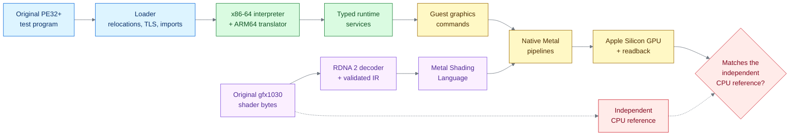
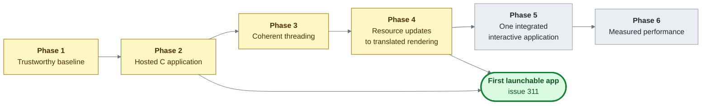
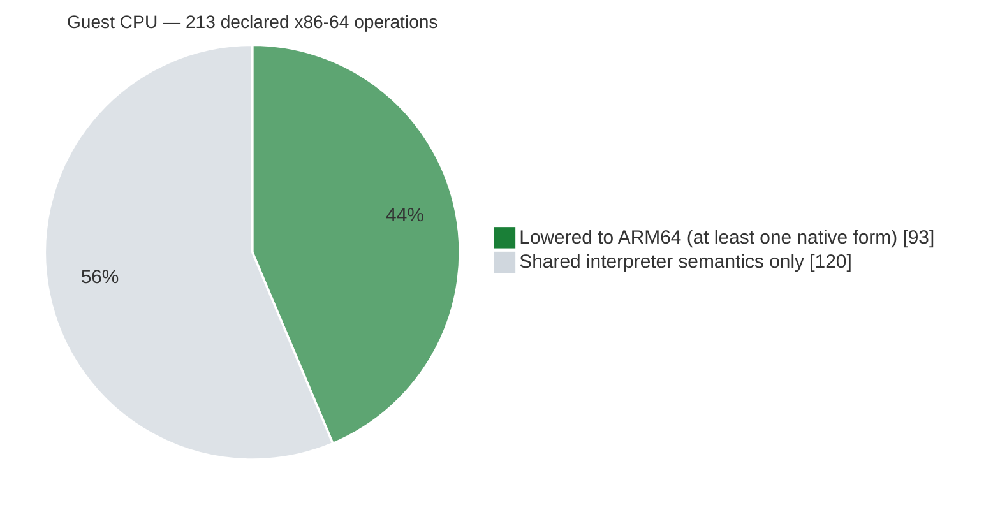
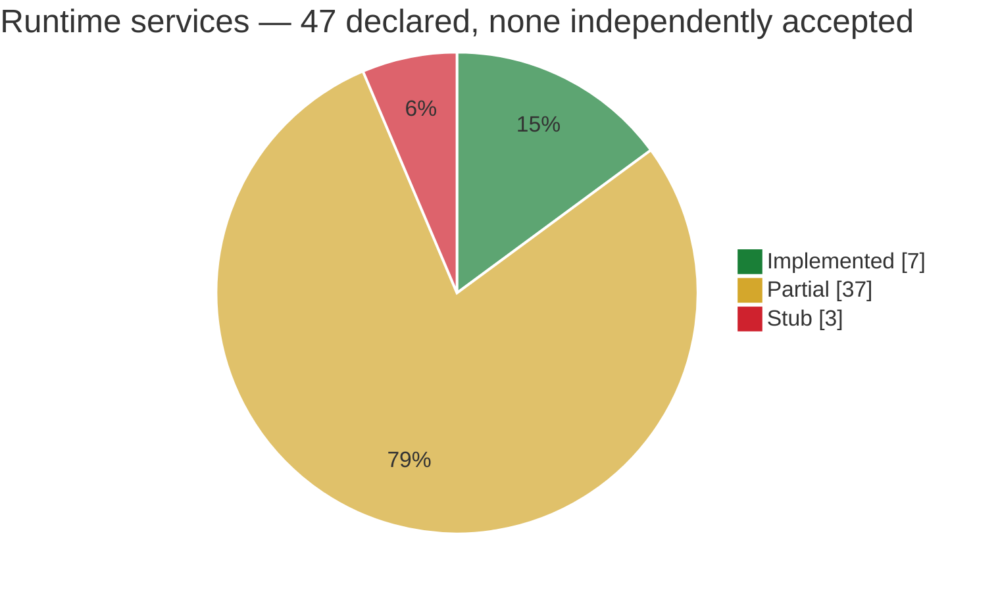
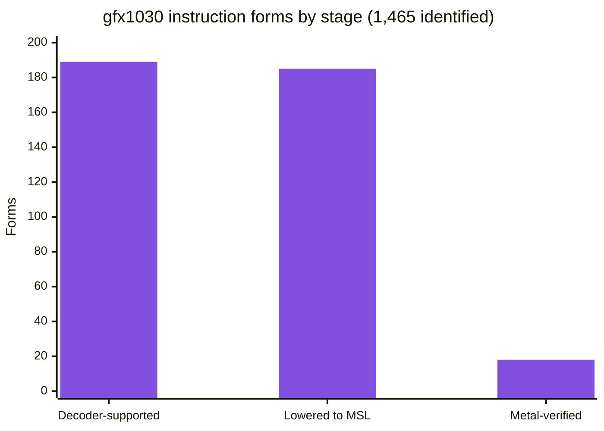
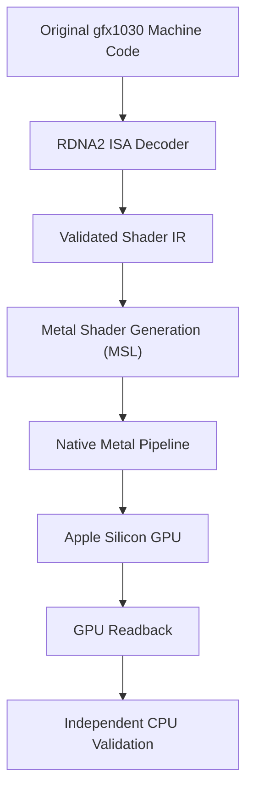
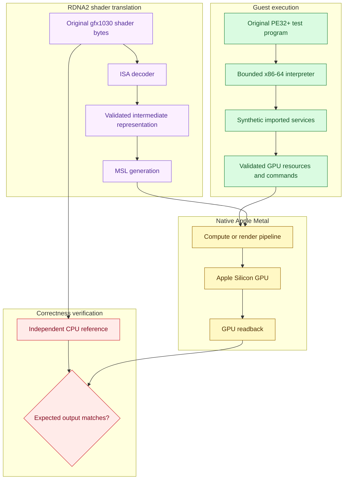

<div align="center">

# BetterXen

**Experimental Xbox Series X|S emulation research, built natively for Apple Silicon.**

[](https://github.com/MacosPorters/betterxen/actions/workflows/ci.yml)
-1f6feb?logo=apple&logoColor=white)


**No Wine. No CrossOver. No Rosetta. No Vulkan runtime.**

</div>

BetterXen is a community-maintained, open-source project written primarily in Rust. It builds and verifies a native, bounded execution environment on Apple Silicon: an independent x86-64 guest path, original PE32+ loading, AMD RDNA 2 shader translation, and a native Apple Metal graphics backend. The host runs as ARM64 code; the x86-64 code being emulated is guest data.

> [!IMPORTANT]
> **BetterXen is experimental.** Verified work is restricted to independently authored synthetic programs and shaders. Authentic Xbox executable loading, system-service compatibility and commercial game execution are **not supported**. Progress is measured by reproducible tests, not by estimated game compatibility percentages. See the [current limitations](#current-limitations).

> [!CAUTION]
> **BetterXen strictly opposes piracy.** BetterXen is an independent, clean-room, general-purpose emulation research project that neither distributes copyrighted game files nor supports unauthorized content, DRM circumvention, or leaked materials. Use only legally obtained software. BetterXen is not affiliated with Microsoft or any other publisher or platform holder.

---

## How it fits together

One guest program travels through three native subsystems. Every stage is checked against an independently derived expectation.



Legend: 🟦 guest loading · 🟩 guest CPU and services · 🟪 shader translation · 🟨 native Metal · 🟥 independent verification.

---

## Milestones

BetterXen's work order is the six [development phases](docs/development-phases.md), which lead to one concrete target: the **first launchable application** (tracker [#311](https://github.com/MacosPorters/betterxen/issues/311)). That target is an original C program, built with native ARM64 tools, that runs through the ARM64 translator, controls its own translated shader pipeline, and shows its Metal frame in the native app window. It is **not** a commercial or authentic Xbox title, and no date or percentage is attached to it.



<sub>🟨 work under way · ⬜ not started · 🟩 the next original-workload target. Nothing here is independently accepted.</sub>

| Phase | Goal | State | What exists now |
| --- | --- | --- | --- |
| **1 · Baseline** | Contributors can tell what exists on `main`, what is pending review, and which checks ran | 🟡 In progress | CODEOWNERS review, a fast repository hygiene check, claim-before-work rules, generated status tables and claim audits |
| **2 · Hosted C application** | An original hosted C program starts, uses the runtime, reports results and exits with checked cleanup | 🟡 In progress | CRT startup, arguments, exit handlers, formatted output, file streams and the hosted-C fixture (A2) are integrated; a stdio follow-up is still open and the result is not independently accepted |
| **3 · Threaded behavior** | A worker-based application can block and resume without stalling other guest work | 🟡 In progress | Deterministic scheduler, guest thread contexts, guarded stacks and thread services. Guest `Sleep` still delays all guest threads (#304); worker TLS and callback lifecycle is a design draft (#312) |
| **4 · Resource updates to rendering** | A guest updates a texture and geometry, submits translated rendering and gets a checked frame | 🟡 In progress | Persistent resources, descriptor-table texture binding, translated vertex and pixel stages, blend, depth and indexed draws. Guest-selected pipelines and the typed graphics bridge are open (#314–#316) |
| **5 · Integrated interactive app** | Guest execution, rendering, input, audio, filesystem and lifecycle in one session | ⚪ Planned | Swift app with frame loop, input, audio and sandboxed filesystem fixtures exists, but those demonstrations are not guest-integration evidence |
| **6 · Measured performance** | Faster execution of workloads whose correctness is already checked | ⚪ Planned | Startup, DBT and TLS measurements recorded; bottlenecks are chosen from measurements, not assumed |

The launch milestone's proposed acceptance is **60 bounded frames containing two independently distinguishable guest-controlled states, then a clean close and one restart**. Sixty is a fixture criterion, not a measured frame rate. The work is tracked as issues [#313](https://github.com/MacosPorters/betterxen/issues/313)–[#323](https://github.com/MacosPorters/betterxen/issues/323).

<details>
<summary><b>Capability reference: the original X1–X25 map</b></summary>

The X1–X25 names are an older, broad capability map. Keep them as a reference; use the phases above for the next work order. X10–X25 are proposed engineering milestones, not completed implementations or a guaranteed sequence.

| Milestone | Implementation | Status |
| --- | --- | --- |
| X1 — Guest CPU | Bounded x86-64 instruction execution on ARM64 macOS | Verified |
| X2 — Executable loading | Loading original fixed-base PE32+ test executables | Verified |
| X3 — GPU compute | Guest-submitted Metal compute workloads and readback | Verified |
| X4 — Metal rendering | Guest-driven offscreen rendering using authored Metal shaders | Verified |
| X5 — Guest execution expansion | Additional bounded CPU execution and fixture coverage | Implemented |
| X6 — Guest control flow | Nested calls, returns, checked memory and synthetic PE execution | Verified |
| X7 — Imported services | Named imports, guest-to-host service dispatch and result validation | Verified |
| X8 — Translated compute | Original gfx1030 compute shaders executing on Metal, partial Wave32 handling and BC1 readback | Verified subset |
| X9 — Translated graphics | Persistent resource handles, translated vertex/pixel stages and offscreen Metal rendering | Verified subset |
| X10 — Texture sampling | One translated `image_sample_lz` pixel stage with point/clamp sampling of RGBA8 and BC1 2D textures bound through descriptor tables, locally verified on Apple M5 Pro; upload, readback and decode of BC compressed formats (see [Texture support](#texture-support)). Other image instructions and formats are not implemented | Implemented subset |
| X11 — Graphics pipeline | Bounded multi-draw passes into offscreen RGBA8 targets: translated vertex and pixel stages, indexed triangle draws, colour write masks and blend state | Implemented |
| X12 — Wave execution | Expand Wave32/Wave64 semantics, divergent control flow, cross-lane operations, LDS and barriers | Planned |
| X13 — Advanced shaders | Mesh, geometry and additional compute shader capabilities with verified Metal execution | Planned |
| X14 — CPU recompilation | Native ARM64 dynamic recompilation of supported x86-64 instructions in synthetic fixtures | Implemented subset |
| X15 — Executable compatibility | Static PE inspection reports sections, relocations, thread-local storage (TLS) callbacks, imports and entry-point instructions | Static probe implemented |
| X16 — Guest memory and threading | Virtual memory mapping, thread scheduling, synchronization primitives and atomic operations | Implemented subset |
| X17 — System services | Implement a tested subset of Xbox-compatible runtime APIs, memory services, filesystem access and application lifecycle | Implemented subset |
| X18 — Graphics API translation | Translate supported Xbox graphics commands, resource descriptors, command queues, barriers and fences into Metal operations | Planned |
| X19 — Advanced GPU features | Indirect rendering, asynchronous compute, additional texture formats and ray-tracing compatibility research | Planned |
| X20 — Integrated guest runtime | Connect CPU recompilation, executable loading, system services and graphics translation into one persistent runtime | Planned |
| X21 — Application compatibility | Execute increasingly complex independently authored applications through the complete guest CPU and GPU pipeline | Planned |
| X22 — First application boot | Establish a reproducible startup and error-reporting path for supported game-like applications | Planned |
| X23 — Initial game compatibility | Investigate startup and execution of legally supported game software, identifying missing runtime and graphics behavior | Long-term goal |
| X24 — Gameplay and performance | Expand rendering correctness, input, audio, memory management, shader caching and execution performance | Long-term goal |
| X25 — Running games | Achieve reproducible, stable execution of compatible games on native Apple Silicon macOS using Metal | Long-term goal |

</details>

All existing verification refers to independently authored synthetic programs and shaders. Commercial-game compatibility remains unverified.

---

## Repository at a glance

Counts below come from the generated registries and were read from the repository, not measured on new runs. They describe synthetic fixtures only.

| Area | Where | What exists today |
| --- | --- | --- |
| Guest CPU | `crates/loader` | A generated x86-64 decoder and interpreter, plus a native ARM64 dynamic binary translator (DBT) for a bounded subset. The instruction registry declares 213 operations, 403 forms and 498 opcode slots; 93 operations have at least one form lowered to ARM64 and the rest run through shared interpreter semantics. See the [instruction registry](docs/cpu/instruction-registry.md). |
| Executable loading | `crates/loader` | PE32+ loading, relocations, thread-local storage, import binding and a static inspection report. |
| Runtime services | `crates/loader`, `crates/import-gen` | A typed service registry: 47 declared services (7 implemented, 37 partial, 3 stubs), all exercised through guest dispatch, none independently accepted. See the [registry](docs/runtime/registry.md) and [generated coverage](docs/runtime/services.md). Guest threads run on a deterministic scheduler on one host thread. |
| Shader ISA | `crates/isa`, `crates/decoder`, `crates/shader`, `crates/ref` | The RDNA 2 (gfx1030) instruction snapshot lists 1,465 forms; 189 are decoder-supported, 185 are lowered to Metal Shading Language, and 18 are Metal-verified on fixtures. See the [semantic coverage](docs/shaders/semantic-coverage.md). An independent CPU reference checks GPU output. |
| Metal backend | `crates/metal` | Native compute, blend, indexed-draw, depth and sampled-texture passes, with Metal API and shader validation. |
| Textures | `crates/texture` | Upload, readback, BC1 to BC7 decoding and sampler code. |
| Application | `app`, `crates/ffi` | A Swift macOS app over a versioned C interface: frame loop, interactive input, persistent resources, audio and a sandboxed virtual filesystem, all against synthetic guests. |
| Test and tooling | `tests`, `fuzz`, `benchmarks`, `scripts` | Original guest programs, independent validation, fuzz targets (CPU decode, PE parse, instruction streams, fixtures, reference, runtime services), mutation testing, correctness-gated benchmarks, and audit scripts for claims, status tables and dependency direction. |

The `betterxen` command-line tool provides `info`, `demo`, `inspect <pe>`, `probe --pe <path> --mode static`, `run`, `imports` and `shaders`. Run `cargo run -p betterxen` with no arguments to see its usage.


### Where the numbers stand

Counts come from the repository's generated registries at this revision. They describe synthetic fixtures only and are not compatibility percentages.







---

## Native graphics translation

BetterXen's graphics pipeline translates a supported subset of AMD RDNA 2 instructions into Metal Shading Language.

The translation process is:



The initial implementation focused on compute shaders. X9 extends this to actual translated **vertex and fragment/pixel shader stages**.

### Translated rendering

The current graphics subset supports:

- Original gfx1030 vertex and pixel shader fixtures.
- Decoding and translation into Metal shader functions.
- Vertex position transformation.
- Constant-color output and clipping.
- Interpolated vertex attributes.
- Offscreen RGBA8 render targets.
- Native GPU readback and pixel-by-pixel validation.
- Explicit rejection of unsupported shader forms.
- Flat-coloured triangle draws with colour write masks and blending (see [Blend pass](#blend-pass)).
- Indexed triangle draws (see [Indexed draws](#indexed-draws)).
- Depth testing with an optional `Depth32Float` attachment (see [Depth pass](#depth-pass)).

These are genuine translated shader stages, not merely demonstrations using handwritten Metal vertex and fragment programs.

The current rendering tests are deliberately narrow: original fixtures, a single triangle per draw, and controlled shader inputs and outputs.

### Blend pass

`NativeCompute::render_blend` draws up to 16 flat-coloured triangles in order into an offscreen RGBA8 target. Each draw has its own colour write mask (any subset of R, G, B, A) and either blending disabled or separate RGB and alpha blend factors (Zero, One, source and destination colour and alpha, and their one-minus forms) and operations (Add, Subtract, ReverseSubtract, and Min and Max). Colours are compared per channel against images derived independently (in exact fractions) from the public Metal blend equations.

GPU verification (Metal API and shader validation enabled): 39 Metal-validated passes over two original overlapping triangles — a clear-only pass; blending disabled; each source factor with the destination term zeroed and each destination factor with the source term zeroed; every operation; additive clamping; separate alpha factors; a separate alpha operation; eight write masks; and a pass whose first draw is itself blended and masked. On an Apple M5 Pro every rounded channel matched round-to-nearest exactly.

### Indexed draws

`NativeCompute::render_indexed` issues one real `drawIndexedPrimitives` call per draw (up to 16) on a 16- or 32-bit index buffer with a start index and a signed base vertex, into an offscreen RGBA8 target. A draw can sample an original BC1 texture uploaded natively.

GPU verification (Metal API and shader validation enabled): 16 Metal-validated passes (both index sizes, 32-bit indices above 16 bits, odd 16-bit start, positive and negative base vertex, reversed winding, flat and textured two-triangle draws, draw order, BC1-textured draws), compared per pixel against images derived independently from the geometry, the public D3D12 and Metal index semantics and the public BC1 rules.

### Depth pass

`NativeCompute::render_depth` draws up to 16 triangles in order into an offscreen RGBA8 target with an optional `Depth32Float` attachment, a chosen clear depth, a per-draw depth compare function (all eight) and depth write enable. Colour and the stored depth are both read back.

GPU verification (Metal API and shader validation enabled): 30 Metal-validated passes of original overlapping triangles: clear, every compare function at three depths, write enabled and disabled, depth test disabled with an attachment and no attachment at all, and a BC1-textured draw.

### Verified Apple M5 results

The X9 native Metal acceptance run reported **20 passing tests, zero failures and zero ignored tests**, with Metal API and GPU validation enabled. The newer passes below are separate Metal-validated campaigns, also with Metal API and shader validation enabled.

Representative checks include:

| Test | Verified behavior |
| --- | --- |
| Constant-color rendering | 12 red pixels and 12 clear pixels |
| Vertex transformation | 3 rendered pixels versus 7 for a pass-through control |
| Perspective interpolation | Exact checks of 16 pixels and another 16 after swapping vertex color channels |
| BC1 texture handling | 33 texels across selected mip levels and array layers |
| Guest rendering | PE32+ guest receives and checks the translated render output |
| Blend pass | 39 Metal-validated passes over two overlapping triangles |
| Indexed draws | 16 Metal-validated passes (both index sizes, signed base vertices, draw order) |
| Depth pass | 30 Metal-validated passes (all eight compare functions, no-attachment case) |

The expected results were calculated independently of the production shader translation path.

**Important:** Correct output for these fixtures does not prove general RDNA2 compatibility or correctness for arbitrary Xbox shaders.

## Persistent GPU resources

X9 introduces a bounded GPU resource-management system for synthetic guest programs.

The implementation includes:

- Generation-checked guest resource handles.
- Buffer creation, updates, reuse and destruction.
- Checked buffer views and memory permissions.
- Repeated compute submissions.
- Resource lifetime validation.
- Snapshot behavior for queued submissions.
- Rejection of stale handles and malformed resource requests.
- Guest-visible readback and result verification.

The original X9 PE fixtures exercise these services through the guest execution environment.

The resource system remains experimental. Native GPU work already in flight during resource release, persistent Metal texture residency across guest calls, and general asynchronous execution are not yet implemented.

## Texture support

BetterXen includes original texture upload, readback and block-compression paths.

Implemented and tested functionality includes:

- Validated mip levels and array layers.
- Pitched texture uploads.
- Block-compressed texture handling, including BC4/BC5 upload and readback and a CPU BC7 decoder for the eight modes.
- Native Metal texture readback.
- Edge-block and transparency tests.
- Invalid descriptor and bounds rejection.

**Translated texture sampling covers one instruction and one sampler mode.** A guest draw with the translated `image_sample_lz` pixel stage and a point/clamp sampler matched the software reference and hand-derived images on a local Apple M5 Pro run (one-level RGBA8 and an 8×8 BC1 texture). Other image instructions, filtering modes and formats are not implemented, and this is local verification, not independent acceptance.

The texture upload and readback paths use authored Metal kernels. They should not be confused with executing arbitrary RDNA2 texture-fetch instructions.

Xbox-specific texture layouts and additional compression formats require further research and validation.

## Architecture

BetterXen is organized around three connected subsystems: guest execution, shader translation and native GPU execution.



BetterXen's host execution environment is native ARM64. The guest architecture being interpreted is x86-64.

The native graphics pipeline runs translated vertex and pixel stages, the indexed-draw and blend passes and the depth pass into offscreen Metal targets, with GPU readback compared against independent CPU references.

The native ARM64 dynamic recompiler covers a bounded subset of x86-64 instructions; the rest run through the shared interpreter semantics (see the [CPU coverage map](docs/testing/cpu-coverage.md) once it lands). The project does not provide a complete Xbox operating-system implementation.

See [Interface Contracts](docs/interfaces.md) for the documented execution and resource boundaries.

---

## Current limitations

BetterXen is an engineering research project, not a working commercial-game emulator.

The following remain unsupported or incomplete:

| Subsystem | Outstanding work |
| --- | --- |
| Guest CPU | Broad x86-64 instruction coverage, multithreading and performant dynamic recompilation |
| Executable loader | General relocations, TLS, DLL initialization and authentic Xbox startup |
| Xbox runtime | Console-specific services, system APIs, filesystem and application lifecycle |
| RDNA2 shaders | General control flow, broader instructions, Wave64, cross-lane operations and mesh stages |
| Graphics | Broader translated texture sampling (one instruction and sampler mode exist) and broader resource binding |
| Textures | Authentic Xbox memory layouts and broader translated sampling |
| Performance | Production-scale workloads, CPU/GPU profiling and optimized execution |
| Game compatibility | No demonstrated execution of commercial Xbox titles |

BetterXen's current shader fixtures target a bounded subset of desktop gfx1030 behavior. This is not equivalent to complete Xbox Series GPU compatibility.

Progress is measured by reproducible tests rather than estimated game compatibility percentages.

---

## Building BetterXen

### Requirements

- Apple Silicon Mac running native ARM64 macOS.
- Rust toolchain with `aarch64-apple-darwin` support.
- Xcode and Metal development tools.
- Python 3.11 or newer.
- LLVM with AMDGPU support for applicable shader-fixture assembly and verification.

The recorded Apple M5 environment uses Rust 1.100.0 and Xcode 27.2.

### Clone

```sh
git clone https://github.com/MacosPorters/betterxen.git
cd betterxen
```

### Build

```sh
scripts/bootstrap.sh
cargo build --locked -p betterxen
```

### Run core tests

```sh
cargo fmt --all -- --check
cargo clippy --locked --workspace --all-targets -- -D warnings
cargo test --locked --workspace
```

The format, lint and test trio is the standard check set. The native Metal
passes use Metal API and shader validation; `scripts/audit/status.py --check`
verifies the generated status tables.

### Run native Metal tests

These require a Metal-capable Apple Silicon Mac.

```sh
scripts/test-gpu.sh
```

The native test suite enables Metal API and shader validation and tests the supported compute, rendering and texture paths. The full semantic-review batch defaults to a 300-second timeout; set `XENORA_SEMANTIC_TIMEOUT` to raise or lower it for a slower or faster host. On macOS, the script uses a Python 3 fallback when GNU `timeout` is unavailable.

### Verify guest execution

```sh
cargo test --locked \
  --manifest-path experiments/x1/Cargo.toml \
  --target aarch64-apple-darwin \
  --features metal
```

Run the original guest resource integration tests:

```sh
tests/compat_fixtures/verify-resources.sh
```

Additional checks:

```sh
tests/compat_fixtures/verify.sh
tests/compat_fixtures/verify-compute.sh
scripts/assemble-fixture.sh --check
scripts/demo.sh
```

Some verification paths require additional tools. Refer to the relevant test scripts and documentation before interpreting a missing dependency as a test failure.

### Test evidence

Testing distinguishes between:

- **CPU correctness:** Independent expected values and bounded execution.
- **Shader compilation:** Decoding, lowering and valid generated Metal source.
- **Native GPU execution:** Actual GPU work and checked readback.
- **Guest integration:** Original test executables invoking GPU services and checking results.
- **Unsupported behavior:** Explicit rejections and documented missing functionality.

Compiling a shader is not equivalent to proving its GPU output is correct.

### Contributing

Contributions are welcome, and several people and coding agents work in this repository at once. To avoid duplicated work:

1. Read every comment on an issue and check for open pull requests that link it.
2. Claim the issue with a plain reply (for example "I'm taking this. Plan: ...") before you edit anything. The earliest live claim wins, and a claim is stale only after about seven days without a pull request.
3. Stay inside the files the issue lists, and put `Closes #<n>` in the pull request description.
4. Sign off every commit (DCO) and use only public documentation and original code. Anyone who has seen leaked or confidential Xbox material must not contribute.
5. Update `CHANGELOG.md` for meaningful changes. Changes to `main` need maintainer review through [CODEOWNERS](.github/CODEOWNERS).

See [CONTRIBUTING.md](CONTRIBUTING.md), [docs/legal.md](docs/legal.md) and the [documentation index](docs/README.md) for the full rules.

### Where the work is heading

See the [milestones](#milestones) for proposed milestones, and the [changelog](CHANGELOG.md) for the current unreleased additions, such as the native blend pass, indexed draws and the depth pass. The remaining research steps are the outstanding items in [current limitations](#current-limitations).

---

**The goal is to build a trustworthy native Apple Silicon compatibility framework, one verifiable subsystem at a time.**

---

## License

BetterXen is licensed under the [GNU General Public License v3 or later](LICENSE).

See [THIRD_PARTY_NOTICES.md](THIRD_PARTY_NOTICES.md) for third-party attribution and [docs/legal.md](docs/legal.md) for the project's research and legal boundaries.

BetterXen is an independent open-source project and is not affiliated with Microsoft, Xbox, any game publisher or Apple.

---
