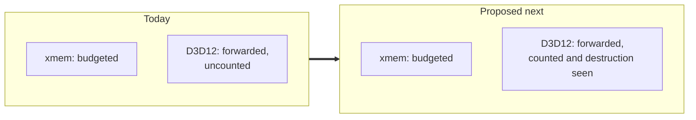
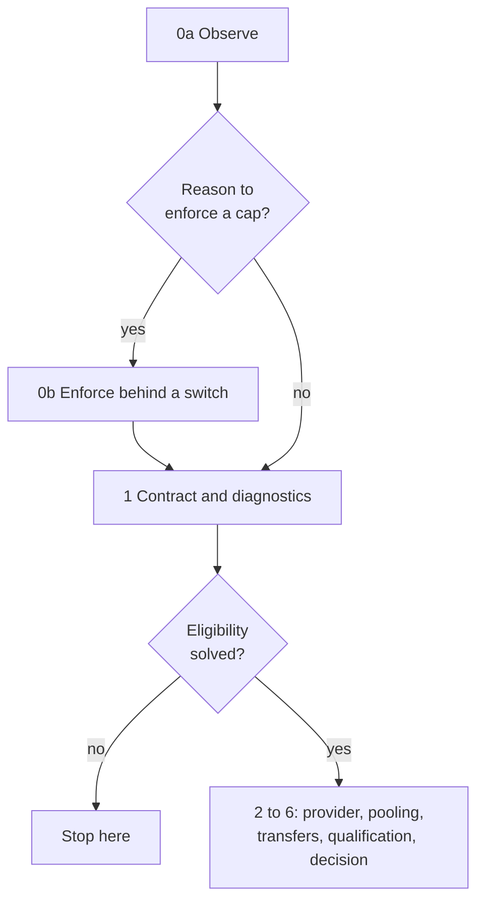

# Proposed unified memory architecture and roadmap (#473)

> [!IMPORTANT]
> **ARCHITECTURE DRAFT — DO NOT MERGE OR MARK READY FOR REVIEW**
>
> This proposal is preliminary. Roadmap amendments, architectural decisions and implementation require maintainer approval.

**DRAFT — FOR MAINTAINER DISCUSSION ONLY — NOT APPROVED FOR IMPLEMENTATION**

Prepared 2026-11-26, updated 2026-11-27, against `main` `cd945ba`, with AI assistance (Claude Code, for @Arths17). Not independently reviewed. No production code, ABI file or issue is changed by it.

## How it fits the roadmap

No new milestone or track, and **no existing roadmap exit gate has to change**. The one open point is the "`xmem`-backed" wording in issues #464 and #469. M0–M6 are [roadmap milestones](../../../roadmap.md); 0a–6 are this proposal's stages. Full mapping and diagrams: [roadmap integration](roadmap-integration.md).

| Existing milestone | Existing objective | Proposed memory work | Affected tracks | Prerequisites | Impact on exit gate | Status |
| --- | --- | --- | --- | --- | --- | --- |
| M0 | Repo, ABI, cross-build | None | None | — | Unchanged | Complete |
| M1 | Startup shims | None added. Follow-up: `XMemVirtualAlloc` parameters | B (follow-up) | Lawful source | Unchanged; not reopened | Complete |
| M2 | First frame, shader gate | Optional 0a observation; settle #464/#469 questions; design admission | C; A, B, F support | Coordinate with #486 | Unchanged | In development |
| M3 | Shaders, streaming, textures | Contract (1), staging reuse (4); **conditional** 0b, 2, 3 | B, C; A, F support | Eligibility and consumer ABI for 2; `[ABI]` for 0b | Unchanged; provider does not gate | Planned |
| M4 | 3D, DXR, upscaling | Validate on larger workloads | C; B, F support | Whatever M3 built | Unchanged | Planned |
| M5 | Audio, saves, stability | Stress qualification (5) | B, C, F; A supports | Correctness rules already in place | Optional wording clarification | Planned |
| M6 | Cache, 16 GB, polish | Tuning; adopt, revise or reject (6) | B, C, F; A supports | Independent matched evidence | Unchanged | Planned |

**Tracks D (shaders) and E (runtime services) are independent at every milestone.**

| Kind of work | What falls in it |
| --- | --- |
| Mandatory correctness | Only what claimed M2 work already promises; fence, destruction and admission rules before any provider |
| Optional, research-derived | Observation, the written contract, staging reuse |
| Conditional | Enforcement, mapped provider, pooling |
| Independent | Shaders, tiling, DirectStorage interfaces and decompression, runtime services, presentation |
| Deferred to M6 | Tuning, storage selection, adoption decision |

## Start here

| If you have | Read |
| --- | --- |
| 5 minutes | [Meeting briefing](meeting-briefing.md), [roadmap integration](roadmap-integration.md#short-answer) |
| 15 minutes | [Executive summary](executive-summary.md), then [eligibility](eligibility.md) |
| An hour | [Self-audit](self-audit.md), [alternatives](architecture-alternatives.md), [design](proposed-memory-architecture.md), [migration](migration-proposal.md) |

## Position in one table

| Question | Answer (proposal) |
| --- | --- |
| Do now | Observe graphics allocations and real destruction |
| Do next, if justified | One admission authority behind a switch |
| Do not do yet | Any mapped-buffer provider or provider interface |
| Blocking unknown | [A reliable eligibility mechanism](eligibility.md) |
| Check first | [`XMemVirtualAlloc` parameter list on `main`](eligibility.md#a-discrepancy-on-main-that-needs-maintainer-attention) |

## Today and proposed

## What is evidence and what is proposal

| Kind | Where | Weight |
| --- | --- | --- |
| Research observations | [#473 publication](https://github.com/MacosPorters/betterxen/blob/0aaa81ab81309d64432d97d3005284c8b13cd285/docs/research/publications/001-unified-memory/README.md), [evidence audit](https://github.com/MacosPorters/betterxen/blob/0aaa81ab81309d64432d97d3005284c8b13cd285/docs/research/publications/001-unified-memory/evidence-audit.md) (research revision `f8810a48`) | Scoped to the tested versions and hosts; the publication itself is not independently reviewed. These files are on the research branch, not `main`. A [contributor review](https://github.com/MacosPorters/betterxen/discussions/493) asks for fixes to the publication |
| Source facts | [Current architecture](current-architecture.md) | `main` at `cd945ba` |
| New observations for this draft | [Executive summary](executive-summary.md#new-observations-made-for-this-draft) | One host, author-run |
| Everything described as proposed | All other documents | **Opinion until the maintainers decide** |

Not established anywhere: physical zero-copy, memory savings, performance gains, console allocation semantics, game execution, or Xbox hardware behaviour.

## Documents

| Group | Document | Contents |
| --- | --- | --- |
| Decide | [Roadmap integration](roadmap-integration.md) | Milestones, tracks, issues, six diagrams, proposed wording |
| Decide | [Meeting briefing](meeting-briefing.md) | Recommendation, objections, five decisions, abandon conditions |
| Decide | [Maintainer decisions](maintainer-decisions.md) | Thirteen decisions, four proposed records |
| Decide | [Executive summary](executive-summary.md) | Problem, recommendation, observations |
| Challenge | [Self-audit](self-audit.md) | Errors found in the first revision; traceability |
| Challenge | [Eligibility investigation](eligibility.md) | Public signals and their limits |
| Challenge | [Risk register](risk-register.md) | Twenty-nine risks |
| Design | [Current architecture](current-architecture.md) | Source map and allocation lifecycle |
| Design | [Alternatives](architecture-alternatives.md) | Decision matrix |
| Design | [Proposed memory architecture](proposed-memory-architecture.md) | Admission, provider selection, diagnostics |
| Design | [Resource lifecycle](resource-lifecycle.md) | States and synchronization |
| Design | [ABI impact](abi-impact-analysis.md) | With and without ABI change |
| Plan | [Migration proposal](migration-proposal.md) | Stages |
| Plan | [Validation strategy](validation-strategy.md) | Gates and benchmarks |
| Plan | [Cross-track dependencies](cross-track-dependencies.md) | Tracks and open work |
| Record | [Evidence record](evidence.md) | Probe sources, patches, commands, environment |
