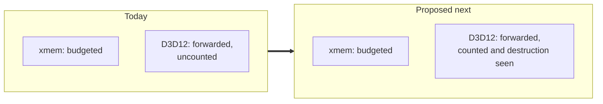
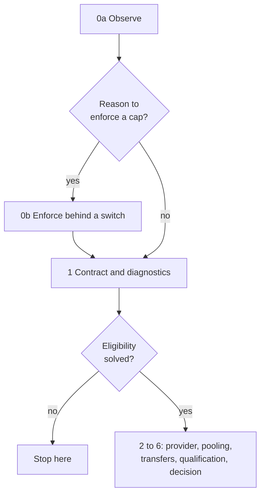

# Proposed unified memory architecture and roadmap (#473)

> [!IMPORTANT]
> **ARCHITECTURE DRAFT — DO NOT MERGE OR MARK READY FOR REVIEW**
>
> This proposal is preliminary and intended for collaborative maintainer discussion. No architectural decisions have been finalized. Implementation must not begin until the maintainers have agreed on the design, migration strategy and validation requirements.

**DRAFT — FOR MAINTAINER DISCUSSION ONLY — NOT APPROVED FOR IMPLEMENTATION**

Prepared 2026-11-26 against `main` `cd945ba`, with AI assistance (Claude Code, for @Arths17). Not independently reviewed. No production code, ABI file or issue is changed by it.

## Start here

| If you have | Read |
| --- | --- |
| 5 minutes | [Meeting briefing](meeting-briefing.md) |
| 15 minutes | [Executive summary](executive-summary.md), then [eligibility](eligibility.md) |
| An hour | [Self-audit](self-audit.md), [alternatives](architecture-alternatives.md), [design](proposed-memory-architecture.md), [migration](migration-proposal.md) |

## Position in one table

| Question | Answer (proposal) |
| --- | --- |
| Do now | Observe graphics allocations and real destruction |
| Do next, if justified | One admission authority behind a switch |
| Do not do yet | Any mapped-buffer provider or provider interface |
| Blocking unknown | [A reliable eligibility mechanism](eligibility.md) |
| Check first | [`XMemVirtualAlloc` parameter list on `main`](eligibility.md#a-discrepancy-on-main-that-needs-maintainer-attention) |

## Today and proposed

## What is evidence and what is proposal

| Kind | Where | Weight |
| --- | --- | --- |
| Research observations | [#473 publication](https://github.com/MacosPorters/betterxen/blob/0aaa81ab81309d64432d97d3005284c8b13cd285/docs/research/publications/001-unified-memory/README.md), [evidence audit](https://github.com/MacosPorters/betterxen/blob/0aaa81ab81309d64432d97d3005284c8b13cd285/docs/research/publications/001-unified-memory/evidence-audit.md) (research revision `f8810a48`) | Scoped to the tested versions and hosts; the publication itself is not independently reviewed. These files are on the research branch, not `main` |
| Source facts | [Current architecture](current-architecture.md) | `main` at `cd945ba` |
| New observations for this draft | [Executive summary](executive-summary.md#new-observations-made-for-this-draft) | One host, author-run |
| Everything described as proposed | All other documents | **Opinion until the maintainers decide** |

Not established anywhere: physical zero-copy, memory savings, performance gains, console allocation semantics, game execution, or Xbox hardware behaviour.

## Documents

| Group | Document | Contents |
| --- | --- | --- |
| Decide | [Meeting briefing](meeting-briefing.md) | Recommendation, objections, five decisions, abandon conditions |
| Decide | [Maintainer decisions](maintainer-decisions.md) | Twelve decisions, four proposed records |
| Decide | [Executive summary](executive-summary.md) | Problem, recommendation, observations |
| Challenge | [Self-audit](self-audit.md) | Errors found in the first revision; traceability |
| Challenge | [Eligibility investigation](eligibility.md) | Public signals and their limits |
| Challenge | [Risk register](risk-register.md) | Twenty-five risks |
| Design | [Current architecture](current-architecture.md) | Source map and allocation lifecycle |
| Design | [Alternatives](architecture-alternatives.md) | Decision matrix |
| Design | [Proposed memory architecture](proposed-memory-architecture.md) | Admission, provider selection, diagnostics |
| Design | [Resource lifecycle](resource-lifecycle.md) | States and synchronization |
| Design | [ABI impact](abi-impact-analysis.md) | With and without ABI change |
| Plan | [Migration proposal](migration-proposal.md) | Stages |
| Plan | [Validation strategy](validation-strategy.md) | Gates and benchmarks |
| Plan | [Cross-track dependencies](cross-track-dependencies.md) | Tracks and open work |
| Record | [Evidence record](evidence.md) | Probe sources, patches, commands, environment |
