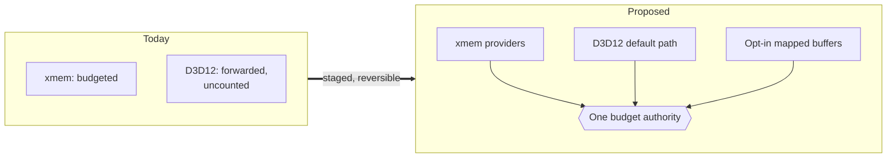
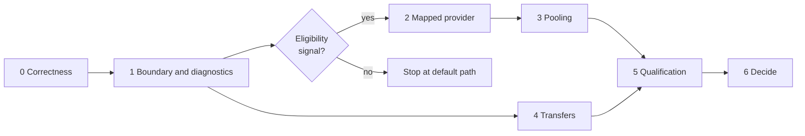

# Proposed unified memory architecture and roadmap (#473)

> [!IMPORTANT]
> **ARCHITECTURE DRAFT — DO NOT MERGE OR MARK READY FOR REVIEW**
>
> This proposal is preliminary and intended for collaborative maintainer discussion. No architectural decisions have been finalized. Implementation must not begin until the maintainers have agreed on the design, migration strategy and validation requirements.

**DRAFT — FOR MAINTAINER DISCUSSION ONLY — NOT APPROVED FOR IMPLEMENTATION**

Prepared 2026-11-26 against `main` `cd945ba`, with AI assistance (Claude Code, for @Arths17). Not independently reviewed. No production code, ABI file or issue is changed by it.

## Start here

1. [Executive summary](executive-summary.md)
2. [Maintainer decisions](maintainer-decisions.md): what we need to agree on

## Today and proposed

## What is evidence and what is proposal

| Kind | Where | Weight |
| --- | --- | --- |
| Research observations | [#473 publication](https://github.com/MacosPorters/betterxen/blob/0aaa81ab81309d64432d97d3005284c8b13cd285/docs/research/publications/001-unified-memory/README.md), [evidence audit](https://github.com/MacosPorters/betterxen/blob/0aaa81ab81309d64432d97d3005284c8b13cd285/docs/research/publications/001-unified-memory/evidence-audit.md) (research revision `f8810a48`) | Scoped to the tested versions and hosts; the publication itself is not independently reviewed. These files are on the research branch, not `main` |
| Source facts | [Current architecture](current-architecture.md) | `main` at `cd945ba` |
| New observations for this draft | [Executive summary](executive-summary.md#new-observations-made-for-this-draft) | One host, author-run |
| Everything described as proposed | All other documents | **Opinion until the maintainers decide** |

Not established anywhere: physical zero-copy, memory savings, performance gains, console allocation semantics, game execution, or Xbox hardware behaviour.

## Documents

| Document | Contents |
| --- | --- |
| [Executive summary](executive-summary.md) | Problem, recommendation, new observations |
| [Current architecture](current-architecture.md) | Ownership diagram, source map, allocation lifecycle |
| [Alternatives](architecture-alternatives.md) | Decision matrix |
| [Proposed memory architecture](proposed-memory-architecture.md) | Admission and provider diagrams |
| [Resource lifecycle](resource-lifecycle.md) | State and synchronization diagrams |
| [ABI impact](abi-impact-analysis.md) | Options with and without ABI change |
| [Cross-track dependencies](cross-track-dependencies.md) | Tracks and open work |
| [Migration proposal](migration-proposal.md) | Stages and dependency diagram |
| [Validation strategy](validation-strategy.md) | Gates, benchmarks, probe appendix |
| [Risk register](risk-register.md) | Twenty risks |
| [Maintainer decisions](maintainer-decisions.md) | Eleven decisions, four proposed records |
