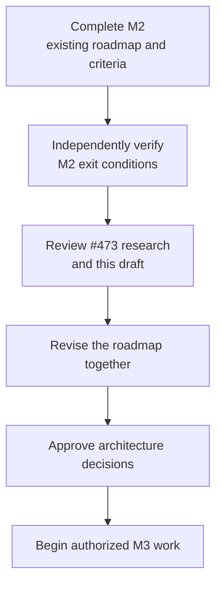
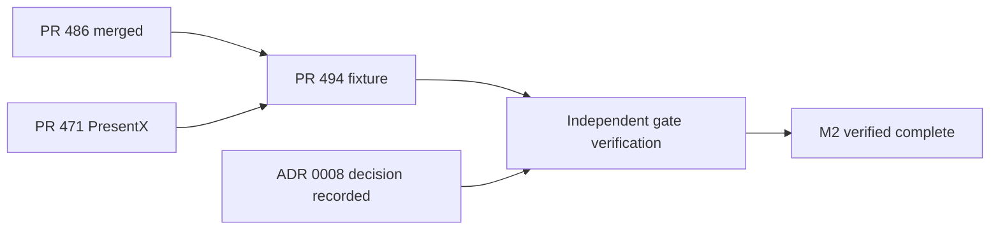

# Unified memory proposal (#473): deferred until before M3

> [!IMPORTANT]
> **ARCHITECTURE DRAFT — DO NOT MERGE OR MARK READY FOR REVIEW**
>
> This proposal is preliminary. Roadmap amendments, architectural decisions and implementation require maintainer approval.

**DRAFT — FOR MAINTAINER DISCUSSION ONLY — NOT APPROVED FOR IMPLEMENTATION**

**The proposed memory architecture is deferred to a maintainer discussion held after M2 is complete and before M3 begins.** The [roadmap](../../../roadmap.md) (M0–M6) stays as it is. Nothing here adds an M2 requirement. **Nobody needs to read this before M2 is done.**

## Sequence

## What M2 needs

Checked 2026-11-27 (about 04:15 UTC) against `main` `b8724bf`. Please recheck; this moves quickly.

M2's exit gate, from the roadmap: a synthetic D3D12 `PresentX` workload renders and verifies pixel readback through D3DMetal 3.0, **and** the M2 gate ADR selects Branch D1 or D2.

| Needed | Where | State | Remaining |
| --- | --- | --- | --- |
| Placed resources (in the M2 objective) | #464 / PR #486 | **Merged**, #464 closed | No independent live run of merged `main` was found |
| `PresentX` rendering and readback | #465 / PR #471 | Open | Conflicts in `CHANGELOG.md` and `d3d12_xs/CMakeLists.txt`; two open review findings (concurrent `Present`; signal failure after present); an earlier change request still recorded; rerun after changes |
| Combined exit-gate fixture | #469 / PR #494 | Open | Needs #471; `CHANGELOG.md` conflict; its CI build skips the fixture until then; independent run on `main` |
| "`xmem`-backed" wording | #464, #469 | **Maintainer reading needed** | The merged design uses a separate D3D12 heap, not `xmem` memory |
| Shader branch selected | [ADR 0008](../../../adr/0008-m2-shader-format-gate.md) | File still says **Proposed** | Record the maintainers' decision in the ADR |
| Verification of the exit gate | Roadmap rule | Not started | Someone other than the authors, then update the roadmap status |

### Known defects in merged M2 code

These are correctness fixes to existing work, not new requirements. Whether any must land before M2 closes is the maintainers' call. `devil8blade` [announced a follow-up](https://github.com/MacosPorters/betterxen/pull/486) for them.

| Defect on `main` | Basis |
| --- | --- |
| The budget can be exceeded depending on allocation order | `try_charge` unchanged; reproduced earlier on `bd546d8` |
| `CreatePlacedResource1` and `2` do not keep their heap's charge | Source; `CreatePlacedResource` itself is fixed |
| `CreateHeap1` and committed resources are not charged | Reproduced on `bd546d8`; listed in #486 |
| A returned `cpu_pointer` goes stale on reconfigure or device change | Source; listed in #486 |

### Open milestone items outside the exit gate

#483, #450, #407 and #473 are on the M2 milestone, and the roadmap gate does not require them. Whether to finish or move them is a maintainer decision.

## Not part of M2

All research-driven work waits for the pre-M3 discussion: allocation observation, a combined admission authority, any mapped-buffer provider, pooling and transfer optimization. See the [pre-M3 checklist](pre-m3-checklist.md).

One item is not research-driven and someone should triage it: Microsoft's public samples call [`XMemVirtualAlloc` with five arguments](appendix/eligibility.md#a-discrepancy-on-main-that-needs-maintainer-attention), and `main` declares four. It is inferred from call sites and unverified. **It is not proposed as an M2 requirement.**

## Reading

| Document | When |
| --- | --- |
| This page | Now, if anything |
| [Pre-M3 checklist](pre-m3-checklist.md) | At the pre-M3 discussion |
| [Review feedback](review-feedback.md) | At the pre-M3 discussion |
| [Appendix](appendix/README.md) | Only for detail |
