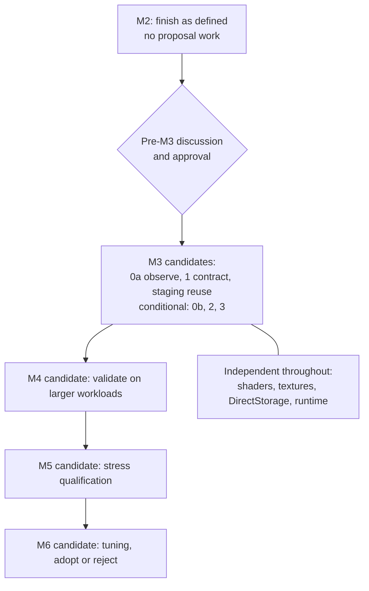
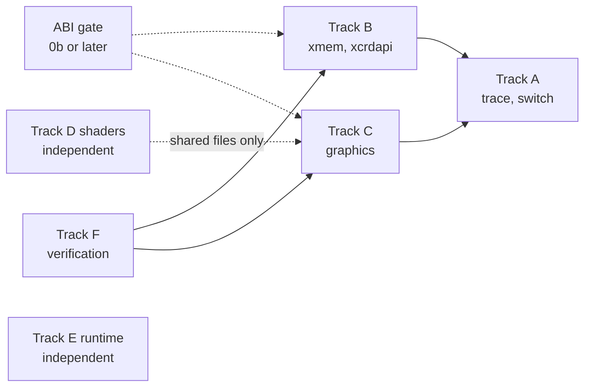
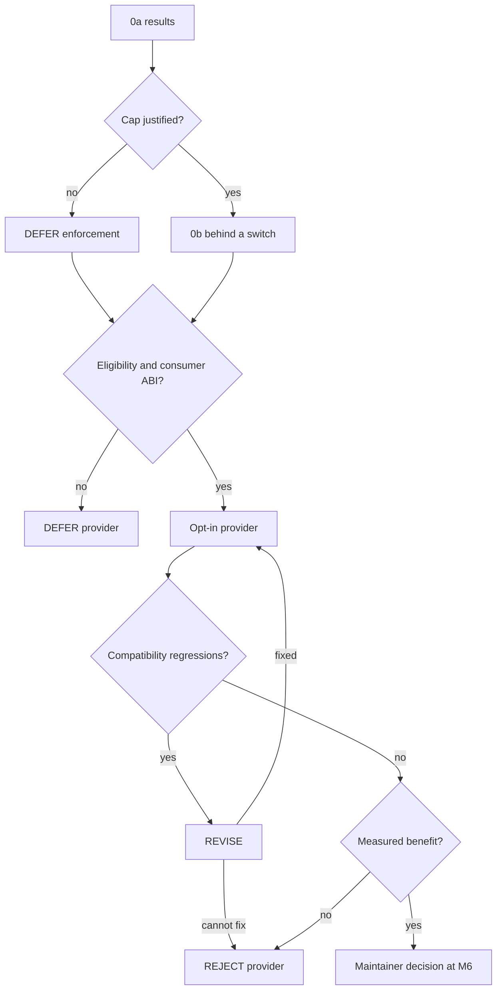

# Roadmap and track mapping, for later

> **DRAFT — FOR MAINTAINER DISCUSSION ONLY — NOT APPROVED FOR IMPLEMENTATION**

**Deferred.** A starting point for the pre-M3 roadmap discussion. [`docs/roadmap.md`](../../../../roadmap.md) and the [tracks](../../../parallel-tracks.md) are unchanged. **Milestones M0–M6** are the roadmap's; **stages 0a–6** are this proposal's.

## Possible placement

| Stage | Meaning | Earliest, if approved | Condition |
| --- | --- | --- | --- |
| 0a | Observe allocations and destruction | M3 | Pre-M3 approval |
| 0b | Enforce one cap behind a switch | M3 | A reason from 0a; `[ABI]` approval |
| 1 | Provider and fallback contract | M3 | Pre-M3 approval |
| 2 | Opt-in mapped provider | M3 | Eligibility and consumer ABI resolved |
| 3 | Pooling | M3 if needed, else M6 | Stage 2 |
| 4 | Staging reuse, storage choices | M3, tuning M6 | Measurement |
| 5 | Stress and failure qualification | M5 | What was built |
| 6 | Adopt, revise or reject | M6 | Independent matched evidence |

No exit gate change is proposed for M0–M4 or M6.

## Tracks

| Milestone | ABI gate | A | B | C | D | E | F |
| --- | --- | --- | --- | --- | --- | --- | --- |
| M0–M2 | Unaffected | Unaffected | Unaffected | Unaffected | Independent | Independent | Unaffected |
| M3 | Conditional | Supporting | Primary | Primary | Independent | Independent | Supporting |
| M4 | Unaffected | Unaffected | Supporting | Primary | Independent | Independent | Supporting |
| M5 | Unaffected | Supporting | Primary | Primary | Independent | Independent | Primary |
| M6 | Unaffected | Supporting | Primary | Primary | Independent | Independent | Primary |

## Component ownership (tracks only)

| Component | Primary | Supporting | Earliest | Depends on | ABI impact | Validation |
| --- | --- | --- | --- | --- | --- | --- |
| Allocation observation | C | A, F | M3 | Approval | None | Every visible path; unseen paths named |
| Destruction tracking | C | F | M3 | Observation | None | Live placed resource; GPU in flight |
| Placement validation | C | F | M3 beyond #486 | — | None | Misaligned, out of bounds, overflow |
| Combined-budget authority | B | C, F | M3 | `[ABI]` | New exports | Both orders; concurrency |
| Eligibility | B | C | Pre-M3 | Lawful source | None to investigate | Written finding |
| Ownership contracts | C | B | M3 | Eligibility | None for a document | Review |
| Mapped provider | C | B, F | M3 conditional | Eligibility, authority | Likely | Fenced round trips; device loss |
| Pooling | C | F | M3 or M6 | Provider | Probably none | Retirement, fragmentation |
| Staging reuse | B | F | M3 | Measurement, #483 | None | Byte-exact |
| Storage policy | C | B | M6 | Measurements | None expected | Equal work |
| Multi-queue sync | C | B, F | M3 (existing gate) | — | None | Cross-queue controls |
| Benchmarking | F | A | M6 | What exists | None | [Protocol](../../../../testing/hybrid-workloads.md) |

Likely file conflicts at that time: `d3d12_xs` (`vmem.cpp`, `proxy.cpp`, `CMakeLists.txt`), `xmem`, `xcrdapi`, `bx-telemetry`.

## Decision paths

## Candidate roadmap wording

For the discussion only.

| Milestone | Sentence |
| --- | --- |
| M3 | "A D3D12-owned buffer provider is considered only if allocation eligibility and the consuming API are resolved from lawful sources; it does not gate M3." |
| M5 | "Bounded memory is reported for `xmem` allocations and observed D3D12 allocations, with process footprint recorded separately." |
| M6 | "Decide, from independent matched measurements, whether any experimental memory provider is enabled, revised or removed." |
