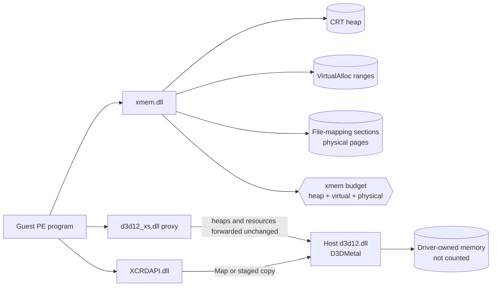

# Current architecture

> **DRAFT — FOR MAINTAINER DISCUSSION ONLY — NOT APPROVED FOR IMPLEMENTATION**

This describes `main` at `cd945ba`, from source inspection. It is not a runtime certification. Open pull requests are listed separately at the end.

## Ownership today

No arrow joins `d3d12_xs` to the budget. `d3d12_xs` includes `bx_xmem_internal.h` and links `xmem`, but on `main` it calls neither exported query.

## xmem

| Concern | Implementation | Source |
| --- | --- | --- |
| Heap path | `_aligned_malloc` with a 64-byte header; `XMemFreeDefault` does not validate the pointer | [`xmem.cpp:135`](../../../../shims/xmem/xmem.cpp#L135), [`:159`](../../../../shims/xmem/xmem.cpp#L159) |
| Virtual path | Forwards to `VirtualAlloc`; tracks committed ranges; reconciles `VirtualFree` by walking them with `VirtualQuery` | [`:89`](../../../../shims/xmem/xmem.cpp#L89), [`:180`](../../../../shims/xmem/xmem.cpp#L180) |
| Attributes | Only the low protection byte is interpreted; other console attribute bits are dropped | [`:186`](../../../../shims/xmem/xmem.cpp#L186) |
| Physical path | One file-mapping section per page (64 KiB or 2 MiB); tags; scatter views over placeholders | [`physical_pages.cpp:156`](../../../../shims/xmem/physical_pages.cpp#L156), [`:245`](../../../../shims/xmem/physical_pages.cpp#L245) |
| Admission | One mutex; `heap + virtual + physical <= title limit` | [`xmem.cpp:61`](../../../../shims/xmem/xmem.cpp#L61), [`:73`](../../../../shims/xmem/xmem.cpp#L73), [`:317`](../../../../shims/xmem/xmem.cpp#L317) |
| Cross-DLL view | `bx_xmem_get_internal_stats` returns a snapshot; `bx_xmem_query_region` covers **physical-page views only** | [`:303`](../../../../shims/xmem/xmem.cpp#L303), [`physical_pages.cpp:367`](../../../../shims/xmem/physical_pages.cpp#L367) |
| Title limit | 8 GiB default; 13,500 MiB for `anaconda`; `BX_MEM_LIMIT_MB` override (minimum 512) | [`runtime_veh.cpp:402`](../../../../shims/runtime_veh/runtime_veh.cpp#L402) |

There is no way for another DLL to **reserve** budget. The only internal reservation function, `try_reserve_physical`, is private to `xmem.dll`.

## d3d12_xs

| Concern | Implementation | Source |
| --- | --- | --- |
| Device creation | Host `D3D12CreateDevice` on the default adapter, wrapped in a logging proxy | [`d3d12_xs.cpp:38`](../../../../shims/d3d12_xs/d3d12_xs.cpp#L38) |
| Virtual memory configuration | Logged no-op returning `S_OK` | [`d3d12_xs.cpp:92`](../../../../shims/d3d12_xs/d3d12_xs.cpp#L92) |
| Wrapped objects | Device, command queue, command allocator, command list only | [`proxy.cpp:215`](../../../../shims/d3d12_xs/proxy.cpp#L215) |
| Heaps and resources | `CreateCommittedResource`, `CreateHeap`, `CreatePlacedResource` forwarded; **host objects returned** | [`proxy_generated.cpp:163`](../../../../shims/d3d12_xs/proxy_generated.cpp#L163), [`:169`](../../../../shims/d3d12_xs/proxy_generated.cpp#L169), [`:175`](../../../../shims/d3d12_xs/proxy_generated.cpp#L175) |
| Descriptors, fences | Forwarded; host objects returned | [`:85`](../../../../shims/d3d12_xs/proxy_generated.cpp#L85), [`:205`](../../../../shims/d3d12_xs/proxy_generated.cpp#L205) |
| Submission | `ExecuteCommandLists` unwraps lists and forwards | [`proxy.cpp:527`](../../../../shims/d3d12_xs/proxy.cpp#L527) |
| Queue `Signal` / `Wait` | Forwarded | [`proxy_generated.cpp:664`](../../../../shims/d3d12_xs/proxy_generated.cpp#L664) |
| Shaders | PSO creation is inspected and gated (ADR 0008) | [`proxy.cpp`](../../../../shims/d3d12_xs/proxy.cpp), [`shader_gate.cpp`](../../../../shims/d3d12_xs/shader_gate.cpp) |

Consequence: on `main`, `d3d12_xs` cannot know when a resource is destroyed, which fence last used it, or how much graphics memory is live.

## DirectStorage (`XCRDAPI.dll`)

- CPU destinations: synchronous file read into the caller's pointer.
- CPU-visible resources: `Map`, read, `Unmap` ([`xcrdapi.cpp:232`](../../../../shims/xcrdapi/xcrdapi.cpp#L232)). No fence check against GPU use of the destination.
- Other buffers: per-request upload resource, queue, allocator, list and fence ([`:328`](../../../../shims/xcrdapi/xcrdapi.cpp#L328)). If completion is unconfirmed, the objects and destination are deliberately kept alive ([`:279`](../../../../shims/xcrdapi/xcrdapi.cpp#L279)).
- Requests drain serially on one threadpool work item per queue ([`:582`](../../../../shims/xcrdapi/xcrdapi.cpp#L582)).
- Only BetterXen's synthetic COM interfaces exist; public DirectStorage interfaces are [#483](https://github.com/MacosPorters/betterxen/issues/483).

## Other components

| Component | Memory relevance |
| --- | --- |
| `xg_xs.dll` | Linear-compatible layout only ([`xg_xs.cpp:393`](../../../../shims/xg_xs/xg_xs.cpp#L393)); no console tiling |
| Shader pipeline | Classifies containers; does not allocate guest memory |
| `bx-cli` | Isolated environment ([`main.rs:378`](../../../../launcher/crates/bx-cli/src/main.rs#L378)); a new runtime switch must be added to what it passes |
| `abi/` | [`bx_xmem_internal.h`](../../../../abi/include/bx_xmem_internal.h), [`xmem.def`](../../../../abi/defs/xmem.def), [`d3d12_xs.def`](../../../../abi/defs/d3d12_xs.def) |
| Conformance | `test_xmem`, `test_xmem_physical`, `test_d3d12_xs`, `test_xcrdapi`, `test_integration_boot`; none exercises a combined CPU and graphics budget |

## Lifecycle of one graphics allocation today

| # | Step | What happens on `main` |
| --- | --- | --- |
| 1 | Guest requests memory | Either `XMem*` (CPU) or `CreateCommittedResource` / `CreateHeap` (graphics); the two are unrelated |
| 2 | Runtime receives it | `xmem` handles the first; the proxy forwards the second |
| 3 | Ownership established | `xmem` record, or a host COM reference held by the guest |
| 4 | Budget admission | `xmem` only. **Graphics: none** |
| 5 | CPU pointer exposed | `xmem` return value, or host `Map` |
| 6 | Graphics resources created | By the host; `xmem` memory cannot become a resource |
| 7 | GPU work references them | Command lists forwarded; no reference tracking |
| 8 | Synchronization | Entirely the guest's responsibility |
| 9 | Retirement | None in BetterXen |
| 10 | Release | `XMemFree*` / `VirtualFree`, or host `Release`. No coordination |

## Planned or proposed in open pull requests (not on `main`)

Heads as of 2026-11-27.

| PR | Head | What it would change |
| --- | --- | --- |
| [#486](https://github.com/MacosPorters/betterxen/pull/486) | `7056671` | Wraps heaps; charges them in `d3d12_xs` against an `xmem` snapshot; one opt-in `WRITE_BACK` backing heap per configured region; patches two device vtable slots |
| [#471](https://github.com/MacosPorters/betterxen/pull/471) | `b096424` | `PresentX` bridge; DXGI-owned back buffers |
| [#494](https://github.com/MacosPorters/betterxen/pull/494) | `fbd2f8c` | M2 first-frame fixture over #486 and #471 |
