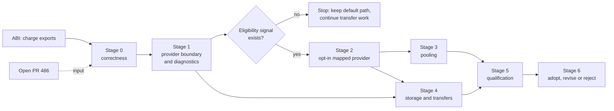

# Migration proposal

> **DRAFT — FOR MAINTAINER DISCUSSION ONLY — NOT APPROVED FOR IMPLEMENTATION**

Stages are conceptual. They carry no dates and no owners, and each needs separate authorization. Every stage must be able to ship alone and be turned off or reverted.

## Stage 0 — Correctness foundations

Needed even if no new provider is ever built.

- One admission authority covering `xmem` and every D3D12 creation path.
- Release charges on confirmed destruction.
- Validate offset, alignment and span at any placement boundary BetterXen owns, without a global 64 KiB rule.
- Make failures visible: propagate cleanup failures; no reuse on unproven completion.

## Stage 1 — Provider abstraction

- A selection function whose only result is "default", with a recorded reason.
- Diagnostics from [the design](proposed-memory-architecture.md#5-diagnostics).
- Written compatibility and fallback contract. **No allocation moves.**

## Stage 2 — Experimental mapped-buffer provider

- Off by default. Buffers only. One explicit eligibility signal.
- Existing path remains and is what runs when the switch is off.
- Pointer alignment checked at run time.

## Stage 3 — Pooling and reuse

- Evaluate the pinned AMD allocator behind the same provider interface.
- Block reservation charged once; slices not charged.
- Defragmentation off for exposed pointers.

## Stage 4 — Storage and transfer optimization

- Per-class storage choices backed by matched measurements.
- Staging-object reuse in `xcrdapi` (today each staged request creates its own queue and fence).
- Optional write-watch for CPU-owned sources only; GPU write tracking stays unknown.

Parts of Stage 4 do not depend on Stage 2 and are Architecture A work.

## Stage 5 — Production qualification

Memory pressure, multi-queue, failure injection, long runs, representative synthetic graphics workloads, several chip generations.

## Stage 6 — Adoption decision

Compare with the existing implementation on independent results. Enable, revise or remove. Removing is an acceptable outcome.
