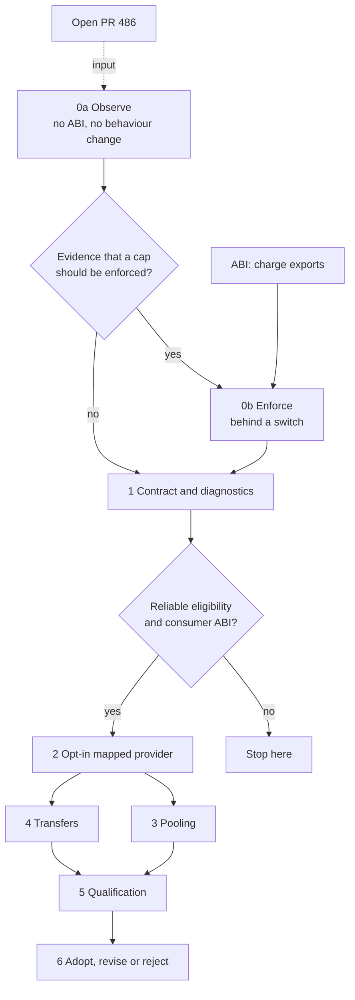

# Migration proposal

> **DRAFT — FOR MAINTAINER DISCUSSION ONLY — NOT APPROVED FOR IMPLEMENTATION**

Stages are conceptual. They carry no dates and no owners, and each needs separate authorization. Every stage must be able to ship alone and be turned off or reverted.

## Stages mapped to milestones

Stages are not milestones. The full table is in [roadmap integration](roadmap-integration.md#two-numbering-systems).

| Stage | Earliest milestone |
| --- | --- |
| 0a | M2, optional |
| 0b | M3, conditional |
| 1 | M3 (drafting may start in M2) |
| 2 | M3, conditional |
| 3 | M3 if needed, otherwise M6 |
| 4 | M3 staging reuse; M6 tuning |
| 5 | M5 (workloads from M4) |
| 6 | M6 |

## Stage 0a — Observe

- Count graphics allocations that pass through the proxy; log which paths cannot be seen.
- Detect real destruction (candidate: private-data sentinel).
- Log what a combined cap **would** have refused. Refuse nothing.

## Stage 0b — Enforce

Only if 0a shows a reason to.

- One admission authority (`[ABI]` change), covering every path the proxy can see.
- Off by default until reviewed; a switch that `bx-cli` passes through.
- Release charges on confirmed destruction.
- Validate offset, alignment and span at any placement boundary BetterXen owns, without a global 64 KiB rule.
- Make cleanup failures visible; no reuse on unproven completion.

## Stage 1 — Contract and diagnostics

- A written compatibility and fallback contract, and reason codes in the trace.
- Diagnostics from [the design](proposed-memory-architecture.md#5-diagnostics).
- **No allocation moves, and no provider interface is coded until a second provider exists.** The work stops here unless eligibility is solved.

## Stage 2 — Experimental mapped-buffer provider

- Off by default. Buffers only. One explicit eligibility signal.
- Existing path remains and is what runs when the switch is off.
- Pointer alignment checked at run time.

## Stage 3 — Pooling and reuse

- Evaluate the pinned AMD allocator behind the same provider interface.
- Block reservation charged once; slices not charged.
- Defragmentation off for exposed pointers.

## Stage 4 — Storage and transfer optimization

- Per-class storage choices backed by matched measurements.
- Staging-object reuse in `xcrdapi` (today each staged request creates its own queue and fence).
- Optional write-watch for CPU-owned sources only; GPU write tracking stays unknown.

Staging-object reuse does not depend on Stage 2 and can be proposed on its own if measurement shows it matters.

## Stage 5 — Production qualification

Memory pressure, multi-queue, failure injection, long runs, representative synthetic graphics workloads, several chip generations.

## Conditions for abandoning the provider architecture

See [the meeting briefing](meeting-briefing.md#when-to-abandon-it).

## Stage 6 — Adoption decision

Compare with the existing implementation on independent results. Enable, revise or remove. Removing is an acceptable outcome.
