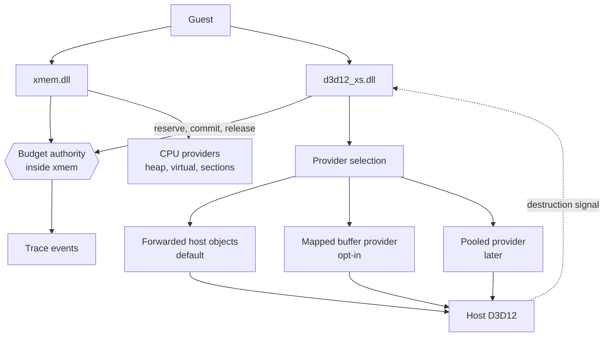
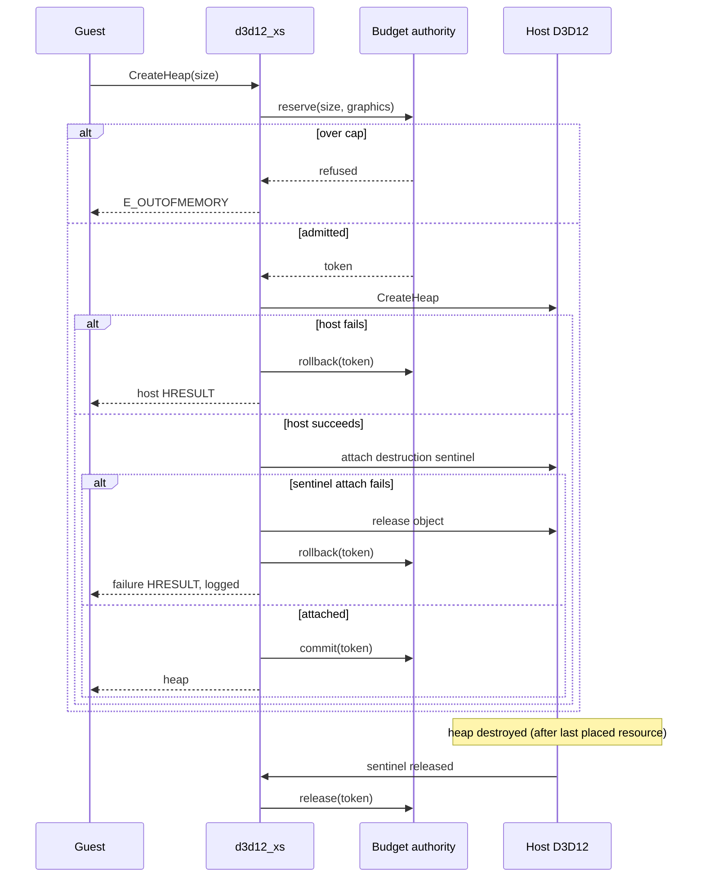
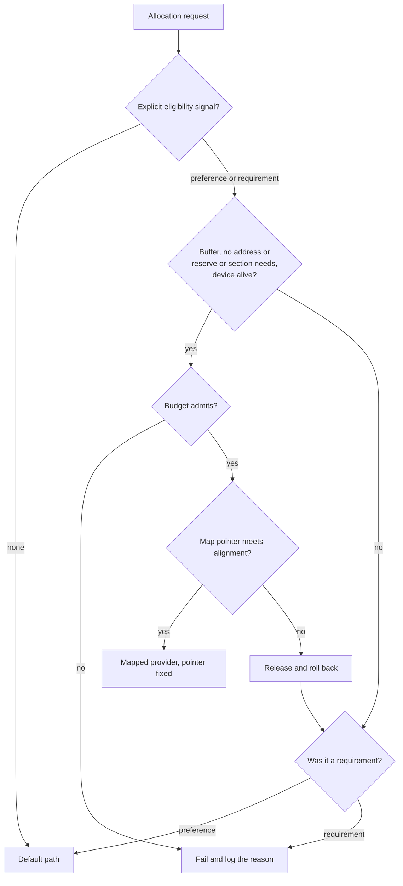

# Proposed memory architecture

> **DRAFT — FOR MAINTAINER DISCUSSION ONLY — NOT APPROVED FOR IMPLEMENTATION**

Conceptual design. No names, layouts or signatures here are agreed.

## Target shape, if it is ever built

Only the budget and destruction-signal edges are in Stages 0a and 0b. Provider selection and the new providers are **not** to be built until [eligibility](eligibility.md) is solved.

## 1. Budget authority

**One owner of the cap.** Proposed: `xmem.dll`, because it already holds the lock, the limit and three of the counted classes.

### Operations

| Operation | Meaning |
| --- | --- |
| Reserve | Atomically admit `n` bytes for a class, or fail |
| Commit | The host allocation succeeded |
| Rollback | The host allocation failed; return the bytes |
| Release | Destruction confirmed; return the bytes |

Nothing proposed here needs a separate "retire" or "migrate" operation. In **observe mode (Stage 0a)** the same calls only count and log what would have been refused; they need no `xmem` export.

This is the enforcing form (Stage 0b).

### Rules

- **Concurrency:** reserve is one critical section. A snapshot followed by a separate add is not admission.
- **Overflow:** compare `n > limit - used` after checking `used <= limit`, as `can_commit` already does. Never sum untrusted sizes.
- **Double counting:** a placed resource or slice is not charged when its heap is. A pool is charged once, for the block.
- **Shared backing:** aliases (section views, aliased placed resources) are one charge.
- **No migration:** exposed guest pointers never move between providers.
- **Failure:** every path from reserve ends in commit-then-release or rollback. A failed release is logged and the bytes stay counted (fail closed).
- **What size:** use `GetResourceAllocationInfo` for committed and reserved resources, and `SizeInBytes` rounded to the heap alignment for heaps. Driver-retained memory is **not** inferred; it is measured separately.

### Release point

#486 credits the charge on the wrapper's last `Release`, which is too early when a placed resource still holds the heap. Two candidates:

| Candidate | For | Against |
| --- | --- | --- |
| `SetPrivateDataInterface` sentinel | No resource wrapping; fired only on real destruction in [the M4 probe](validation-strategy.md#appendix-destruction-signal-probe) | One host, author-run; GPU-in-flight and device-removal behaviour untested; relies on D3DMetal keeping this behaviour |
| Wrap resources and heaps, count references | Fully under BetterXen's control; also gives lifetime tracking | Large surface; every method taking a resource must unwrap; #486 already hit faults from a missed unwrap |

`ID3DDestructionNotifier` is not available on the tested runtime (`QueryInterface` returned `E_NOINTERFACE`).

### Creation paths, and what interception cannot see

`CreateHeap`, `CreateHeap1`, `CreateCommittedResource` and its `1`–`3` forms, reserved-resource tile heaps, `OpenSharedHandle` (decide: counted or not). DXGI swap-chain buffers are host-created and need an explicit estimate or an explicit exclusion.

**Coverage is best-effort.** Resources and fences are host objects, so their `GetDevice` returns the host device and anything created through it is invisible to the proxy; `xcrdapi` staging does exactly this. A guest calling `d3d12.dll` directly is also invisible. Closing that needs wrapping far more objects, which this proposal does not recommend.

**The release signal's contract.** `SetPrivateDataInterface` releases the interface when the object is destroyed or the same GUID is overwritten ([Microsoft](https://learn.microsoft.com/en-us/windows/win32/api/d3d12/nf-d3d12-id3d12object-setprivatedatainterface)). When, and on which thread, is unspecified: the callback must be non-blocking and take no lock that a host call is made under.

## 2. Provider selection and eligibility

This diagram is hypothetical until [eligibility](eligibility.md) is solved.

Eligibility inputs: allocation type, required alignment, **the actual returned pointer**, address stability, flags, existing contents, device availability, mapping restrictions, lifetime and CPU/GPU access pattern. Every fallback records one reason code. A fallback happens only **before** a pointer is exposed.

A requirement that cannot be met fails; only a preference may fall back, and the fallback is logged.

## 3. Pooling

| Criterion | AMD D3D12 Memory Allocator | Small internal allocator | Hybrid: AMD blocks, BetterXen policy |
| --- | --- | --- | --- |
| Licence | MIT per file at `600949266be0`; needs registry, reuse-matrix and notice entries | Original code | As AMD |
| Strategy | Mature, configurable pools | Whatever we write | AMD placement, our admission and retirement |
| Fragmentation | Statistics and defragmentation; **moving must stay off** for exposed pointers | We build statistics | As AMD |
| Alignment | Handles resource alignment; not CPU pointer alignment | Same gap | We check the pointer |
| Retained blocks | Configurable | Ours | Charged by the authority |
| Deferred retirement | Caller's job | Caller's job | Ours |
| Thread safety | Provided by the library; verify for our configuration | Ours to get right | Mixed |
| Failure handling | Returns `E_OUTOFMEMORY` at the bound in the tested case | Ours | Map to authority rollback |
| Integration | Vendor a pinned copy; MinGW build was exercised in research | More code and review | Moderate |

Recommendation: the hybrid, **if** Stage 3 is reached. Nothing shows it improves production performance. See the [allocator assessment](https://github.com/MacosPorters/betterxen/blob/f8810a48af384d13c594b9fba954200bfdb944f1/docs/research/d3dmetal-zero-copy/allocation-profiling/allocator-assessment.md).

## 4. Textures and incompatible resources

| Class | Path |
| --- | --- |
| `UNKNOWN`-layout textures | Host-owned; `WriteToSubresource` or upload/readback copies. No texel pointer |
| Render targets, depth/stencil | Host-owned `DEFAULT`; explicit activation and initialization when aliased |
| CPU memory with requested address, sections, scatter, reserve/commit, pre-device | Stays in `xmem`; copied explicitly when the GPU needs it |
| Swap-chain buffers | DXGI-owned |
| Console tiled layouts | Not addressed here (`xg_xs`, M3) |

## 5. Diagnostics

| Metric | Distinguishes |
| --- | --- |
| Reserved bytes, by class | Admission from use |
| Committed backing, live allocations | Real backing from promises |
| Pending retirement | "Freed" from reusable |
| Pool capacity, free, largest free span | Fragmentation from free space |
| Provider chosen, with reason code | How much work actually takes a new path |
| Explicit transfer bytes | Copies removed from copies moved elsewhere |
| Allocation failures, budget rejections with reason | Cap behaviour from host failure |
| Lifetime violations (release while pending) | Correctness |
| Process footprint and RSS, sampled separately | Ledger from physical effect |

A change that lowers BetterXen's ledger while footprint and transfer bytes do not move is an accounting change, not a memory saving.
