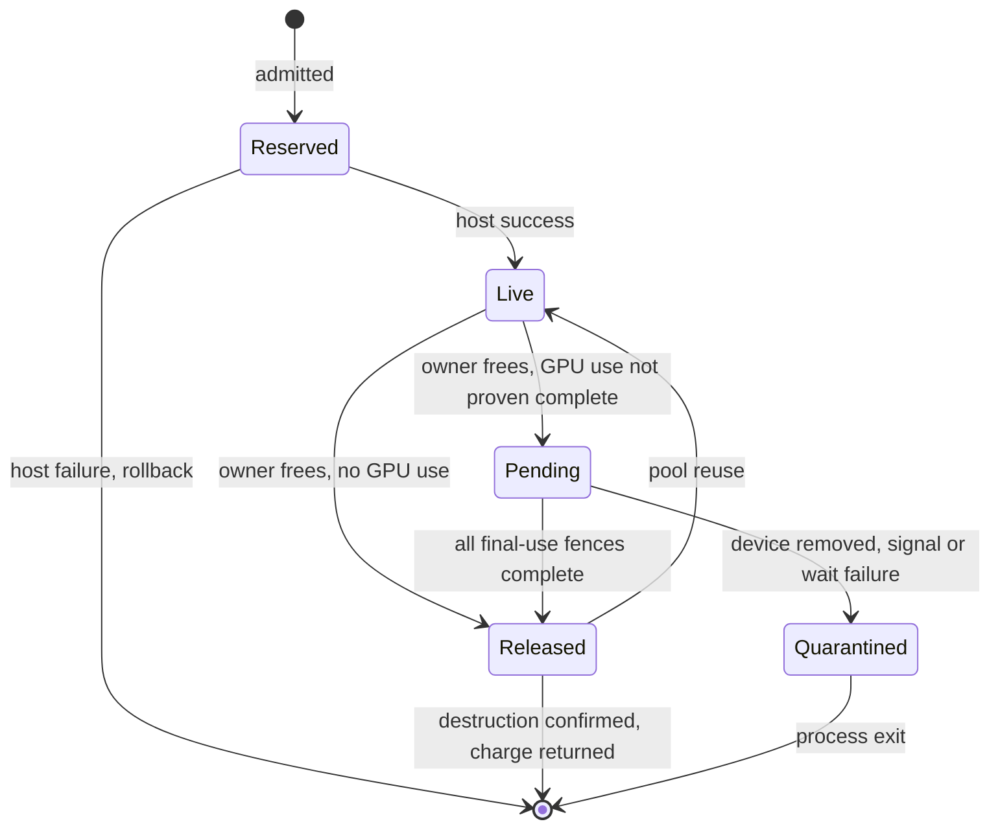
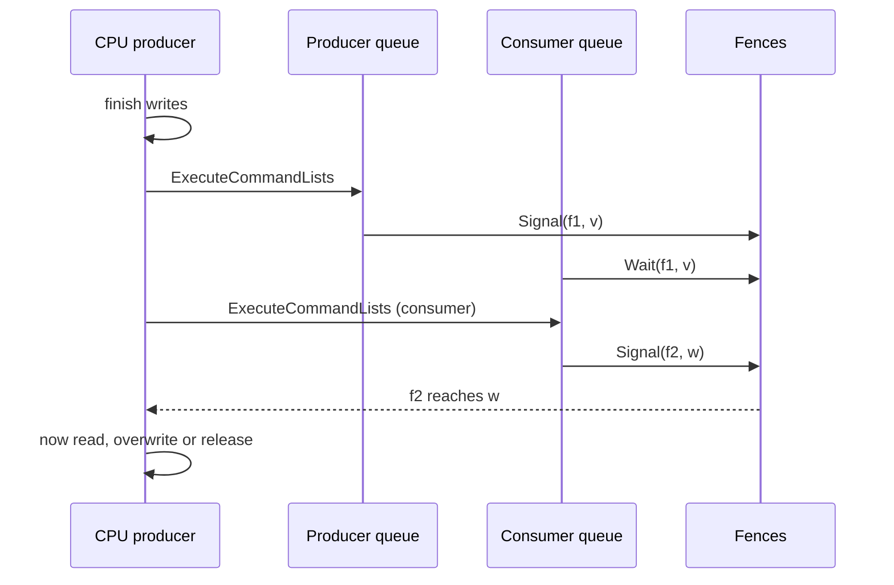

# Resource lifecycle and synchronization

> **DRAFT — FOR MAINTAINER DISCUSSION ONLY — NOT APPROVED FOR IMPLEMENTATION**

These rules apply to anything BetterXen itself owns or reuses. They are derived from public D3D12 contracts ([placement and lifetime](https://github.com/MacosPorters/betterxen/blob/f8810a48af384d13c594b9fba954200bfdb944f1/docs/research/d3dmetal-zero-copy/gpu-correctness/contracts/resource-placement-lifetime.md), [synchronization](https://github.com/MacosPorters/betterxen/blob/f8810a48af384d13c594b9fba954200bfdb944f1/docs/research/d3dmetal-zero-copy/gpu-correctness/contracts/synchronization-mapping-tracking.md)). Guest-owned synchronization remains the guest's responsibility.

## States

This applies **only to objects BetterXen creates and recycles itself** (staging and any future pool). For guest-owned D3D12 objects BetterXen sees creation and destruction, not GPU use.

## CPU and GPU ordering

## Rules

| Event | Rule |
| --- | --- |
| CPU writes | Complete before the submission that reads them; the caller orders its own threads |
| GPU submission and access | Resource states and alias barriers as the public contract requires |
| Fence completion | Only a completed value proves completion. A CPU-side signal proves nothing about the GPU |
| Cross-queue | Producer signals, consumer waits; retirement records **every** queue's final use |
| CPU reads | After the writing queue's fence |
| Deferred release | Keep resource, heap, descriptors and command objects until the last fence |
| Safe reuse | Only from `Released` |
| Device removal | Never reuse; quarantine and report |
| Failed `Signal` or `Wait`, timeout | Completion is unproven: quarantine, never recycle. `xcrdapi` already does this for staged copies |
| Shutdown | Bounded drain. If unproven, leak and log rather than free; do not block in `DllMain` |

## Multi-queue

Production multi-queue behaviour was **not** qualified by the research. `d3d12_xs` currently forwards `Signal` and `Wait` and does not know which resources a command list references (it would need to track bindings, descriptors and GPU virtual addresses). Therefore:

- **Do not** infer GPU use inside BetterXen for guest-owned resources. D3D12 already makes that the guest's job.
- BetterXen should only retire objects whose use **it** submits (its own staging, pool slots it recycles) or that the host destroys.
- For pool slots released by the guest, either require the guest's fenced release semantics (as D3D12 does) or do not recycle the slot. Choosing otherwise needs reference tracking that is a project of its own ([D6](maintainer-decisions.md#d6-who-tracks-gpu-use)).

## Mapped-provider specifics

- The mapped pointer is valid only while the resource lives, and the resource only while its device is usable. After device removal the guest holds a pointer to memory that may not be meaningful: this has no equivalent in `xmem` today and must be a documented behaviour.
- At `bd546d8`, #486 unmaps and releases its backing buffer when the region is reconfigured or the host device changes, even if the guest still holds the pointer. A provider must either refuse that or keep the mapping alive.
