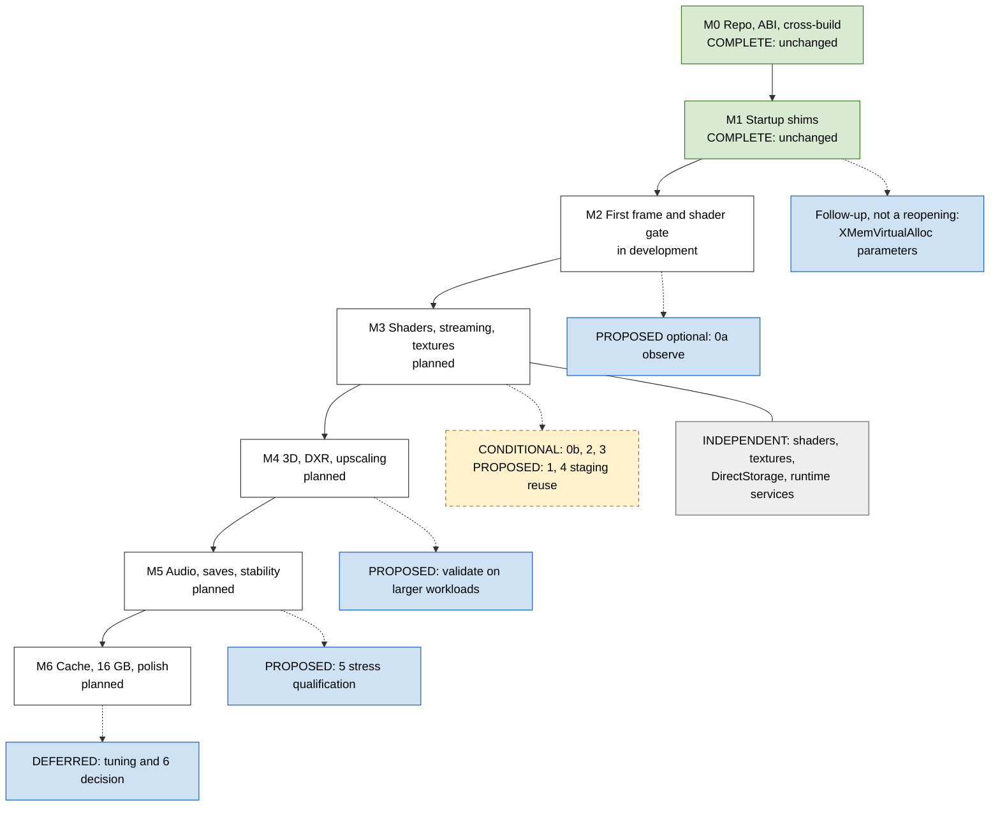
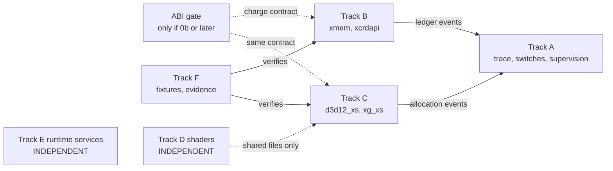
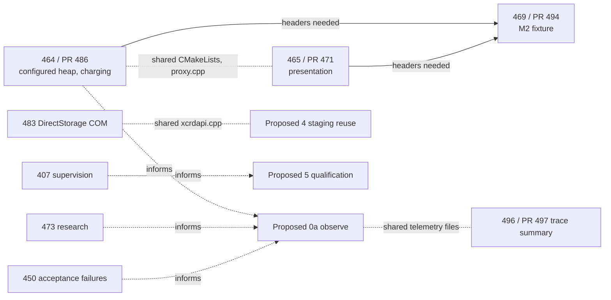
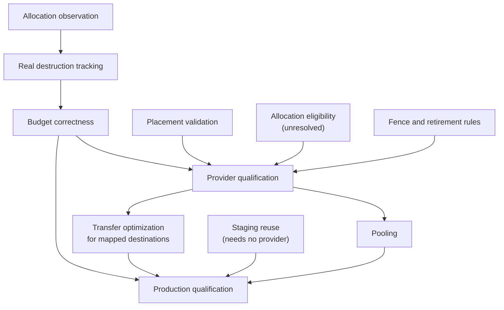
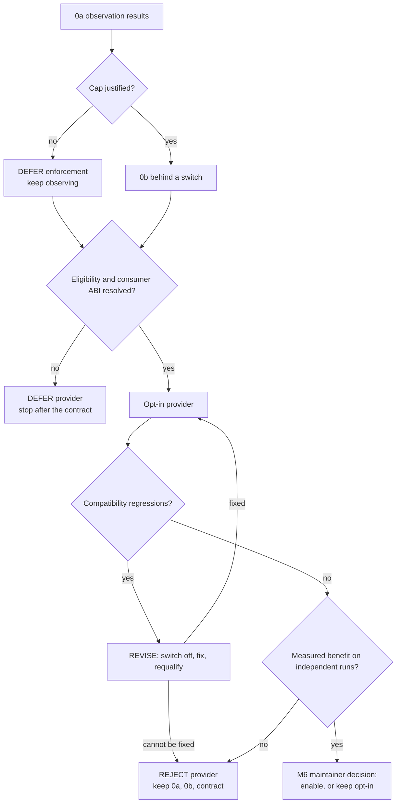

# Fitting the proposal into the existing roadmap

> **DRAFT — FOR MAINTAINER DISCUSSION ONLY — NOT APPROVED FOR IMPLEMENTATION**

This is the single place where the proposal is mapped onto BetterXen's [roadmap](../../../roadmap.md) and [tracks](../../parallel-tracks.md). It adds no milestone and no track, and changes neither document. Checked against `main` `cd945ba` and GitHub on 2026-11-27 (about 03:30 UTC).

## Short answer

- **No existing exit gate needs to change.** M0 and M1 stay complete.
- **M2** is touched lightly: existing claimed work (#464, #469) raises accounting and wording questions, and non-invasive observation is optional.
- **M3** is the earliest place for anything conditional, including any mapped-buffer provider.
- **M4** only validates; **M5** adds stress qualification; **M6** holds tuning and the final adopt, revise or reject decision.
- **Tracks B and C** carry the work. A and F support. **D and E continue independently.**

## Two numbering systems

**Milestones M0–M6** are the project's roadmap. **Stages 0a–6** are the steps of this proposal. They are not the same thing.

| Proposal stage | Meaning | Earliest milestone | Condition |
| --- | --- | --- | --- |
| 0a Observe | Count graphics allocations and real destruction; refuse nothing | M2 (optional) | None; must not delay the M2 gate |
| 0b Enforce | One admission authority behind a switch | M3 | 0a shows a reason; `[ABI]` approval |
| 1 Contract | Written provider and fallback contract, reason codes | M3 (drafting may start in M2) | None |
| 2 Mapped provider | Opt-in D3D12-owned buffers | M3 | Eligibility and consumer ABI resolved |
| 3 Pooling | Reuse and suballocation | M3 if the provider needs it, otherwise M6 | Stage 2 exists |
| 4 Transfers | Staging reuse, storage choices | M3 (staging reuse), M6 (tuning) | Measurement shows it matters; staging reuse does not need Stage 2 |
| 5 Qualification | Stress and failure testing | M5 (larger workloads from M4) | Whatever has been built |
| 6 Decision | Adopt, revise or reject | M6 | Independent matched evidence |

## Diagram A: roadmap with proposed additions

Solid boxes in the chain are existing milestones. Attached boxes are labelled complete, proposed, conditional (also dashed), deferred or independent, so colour is not needed to read it.

## Milestone detail

| Milestone | Mandatory correctness | Optional research-derived | Conditional | Independent | Deferred |
| --- | --- | --- | --- | --- | --- |
| M0 | None added | — | — | — | — |
| M1 | None added to its acceptance. Follow-ups below | — | — | — | — |
| M2 | Only what claimed M2 work already promises: #464's budget accounting and its fixture, as maintainers judge them | 0a observation; investigate the `XMemVirtualAlloc` parameters; design (not build) combined admission | None | Shader gate, presentation, DirectStorage interfaces, runtime services | Provider, pooling |
| M3 | If any provider is attempted: destruction-based release, atomic admission and fence rules first. Multi-queue is already in M3's gate | Stage 1 contract; `xcrdapi` staging reuse | 0b, 2, 3 | Shader lowering, `xg_xs` tiling, decompression | Pool tuning |
| M4 | Lifetime correctness for anything BetterXen owns | Ledger and footprint under larger scenes; render-target, depth and ray-tracing allocations observed | Provider checked with new resource kinds | DXR, upscaling, input | Memory optimization |
| M5 | Soak "bounded memory" should say what it counts (proposal) | Concurrent allocation, retention, device removal | Pool fragmentation, multi-queue stress | Audio, saves | Optimization |
| M6 | Independent evidence before any default changes | Footprint, transfer volume, frame pacing on 16 GB | Pool tuning, resource selection | Shader cache, UI | Final adopt, revise or reject |

### M1 follow-ups (correctness work, not a redefinition)

| Concern | Origin | Status |
| --- | --- | --- |
| `XMemVirtualAlloc` may take five parameters, not four ([detail](eligibility.md#a-discrepancy-on-main-that-needs-maintainer-attention)) | `xmem`, from the M0/M1 foundation | Inferred, unverified, unclaimed |
| D3D12 heaps and resources are neither counted nor tracked | `d3d12_xs` proxy | Known design limit |
| Host `GetDevice` on resources escapes the proxy | `d3d12_xs` proxy | Source reading, untested |

## Diagram B: tracks working in parallel

## Diagram F: milestone by track

Involvement **in the memory proposal only**. "Independent" means the track's own milestone work proceeds without waiting.

| Milestone | ABI gate | A | B | C | D | E | F |
| --- | --- | --- | --- | --- | --- | --- | --- |
| M0 | Unaffected | Unaffected | Unaffected | Unaffected | Unaffected | Unaffected | Unaffected |
| M1 | Unaffected | Unaffected | Follow-up | Follow-up | Unaffected | Unaffected | Unaffected |
| M2 | Unaffected | Supporting | Supporting | Primary | Independent | Independent | Supporting |
| M3 | Conditional | Supporting | Primary | Primary | Independent | Independent | Supporting |
| M4 | Unaffected | Unaffected | Supporting | Primary | Independent | Independent | Supporting |
| M5 | Unaffected | Supporting | Primary | Primary | Independent | Independent | Primary |
| M6 | Unaffected | Supporting | Primary | Primary | Independent | Independent | Primary |

## Track responsibilities

| Track | Responsibility under this proposal | Keep out |
| --- | --- | --- |
| ABI gate | Charge, commit, rollback exports if 0b is approved; a switch name; nothing for 0a | No change for observation |
| A | Summarize new trace events; pass a switch; supervise failure runs | No weakening of environment isolation |
| B | Admission authority; eligibility and parameter investigation; CPU fallbacks; staging reuse | No relocation of exposed pointers |
| C | Observation, destruction tracking, placement validation, any provider and retirement | No provider before eligibility |
| D | None. Textual overlap in `proxy.cpp` and `d3d12_xs/CMakeLists.txt` | No new dependency on memory work |
| E | None found: no source link from `xgameruntime`, input or audio to this work | — |
| F | Fixtures, negative controls, independent verification, evidence | Does not certify its own code |

## Component ownership

Tracks only; nobody is assigned.

| Component | Primary | Supporting | Earliest | Depends on | ABI impact | Validation |
| --- | --- | --- | --- | --- | --- | --- |
| Allocation observation | C | A, F | M2 | — | None | Every visible creation path counted; unseen paths named |
| Real destruction tracking | C | F | M2 | Observation | None | Release heap with a live placed resource; GPU in flight; second chip |
| Placement validation | C | F | M2 (#464 scope), M3 | — | None | Misaligned, out of bounds, overflow; ordinary calls unchanged |
| Combined-budget authority | B | C, F | M3 | Observation, destruction, `[ABI]` | New exports | Both orders; concurrency; rollback |
| Allocation eligibility | B | C | M2 investigation | Lawful public source | None to investigate | Written finding; no guessed behaviour |
| Resource ownership contracts | C | B | M3 | Eligibility finding | None for a document | Maintainer review |
| Mapped-buffer provider | C | B, F | M3 conditional | Eligibility, consumer ABI, authority | Likely | Fenced round trips; alignment; device loss |
| Memory pooling | C | F | M3 conditional, M6 | Provider | Probably none | Retirement, fragmentation, licence records |
| `xcrdapi` staging reuse | B | F | M3 | Measurement; coordinate with #483 | None | Byte-exact, failure paths |
| Resource-specific storage policy | C | B | M6 | Matched measurements | None expected | Equal useful work |
| Multi-queue synchronization | C | B, F | M3 (existing gate) | — | None | Cross-queue dependencies; negative controls |
| Production benchmarking | F | A | M6 | What exists | None | [Measurement protocol](../../../testing/hybrid-workloads.md) |

**Possible ownership conflicts:** `d3d12_xs/CMakeLists.txt` and `proxy.cpp` (#486, #471, any observation work); `bx-telemetry` and `bx-cli` (PR #497 and any new trace events); `xcrdapi.cpp` (#483, claimed, and staging reuse); `xmem` (any parameter fix and the authority).

## Current issues and pull requests

State on 2026-11-27. Nothing here takes over or replaces anyone's work.

| Item | Owner | Status | Overlap | Independent? | Clarification needed | Prerequisite for | Duplication risk |
| --- | --- | --- | --- | --- | --- | --- | --- |
| #464 / PR #486 `7056671` | `devil8blade` | Open, CI green, earlier change requests still recorded | Heap charging, placement checks | Yes | Does an order-dependent cap meet "accounting against the budget"? Does a D3D12 heap meet "`xmem`-backed"? | #494 | High if observation or admission is built separately: coordinate |
| #465 / PR #471 `b096424` | `Arths17` | Open, conflicts in `CHANGELOG.md`; two open review findings | Back buffers uncounted; shared files | Yes | — | #494, M2 gate presentation | Low |
| #469 / PR #494 `fbd2f8c` | `atesahmet0` | CI green; fixture target is skipped until #486 and #471 merge; says `Tracks #469` | Exercises the configured region | No: needs both | Is a separate D3D12 mapping acceptable for "`xmem` placed resources"? | M2 exit evidence | None |
| #483 | `1Bartosz` | Claimed, no PR | Destinations are D3D12 resources | Yes | — | Stage 4 | Staging reuse must not race it |
| #496 / PR #497 | `EternaPeptix` | Open, no CI result at the time of checking; not reviewed here | Same telemetry files as new events | Yes | — | Reading shader-gate evidence | Extend its summary later; do not parallel it |
| #450 | `soggyramennoodle` | Open; independent results documented (#491) | Swap-chain retention informs lifetime diagnostics | Yes | — | — | Low |
| #407 | `Arths17`, `jelly013` | Open; draft PR #425 | Supervised runs, evidence records | Yes | — | Stage 5 tooling | Low |
| #473 | `atesahmet0`, `2elliti`, `Arths17` | Open; publication under review in [discussion 493](https://github.com/MacosPorters/betterxen/discussions/493) | Evidence base | Yes | Reviewer requested fixes before announcement | This proposal | — |

**#486's findings.** At `bd546d8` a 640 MiB total fit under a 512 MiB cap and a charge was credited while memory was live. The current head leaves the three budget functions unchanged and now lists both as under review, with `CreateHeap1` and committed resources uncharged. Not re-run on `7056671`.

**#494's claim.** Its current text says the pixels come from a D3D12 `WRITE_BACK` heap and that the `xmem` page keeps its sentinel. A reviewer notes the sentinel check cannot fail. The acceptance question is open.

## Diagram E: how current work relates

Solid: a build or source dependency. Dashed: same files. Dotted label "informs": useful input only.

## Diagram C: correctness dependencies

## Diagram D: decision gates

## Does this delay anything?

| Question | Answer |
| --- | --- |
| Can M2 finish without the experimental provider? | **Yes for the roadmap gate**, which asks only for a verified frame and a shader-path ADR. One condition: #464 and #469 say "`xmem`-backed". Existing memory cannot be imported, so if maintainers read that literally, they must accept a copy boundary or reword it. A provider is not the only answer |
| Which correctness problems affect M2's existing gate? | The gate is a presented, verified frame plus a shader-path ADR. #471's two findings touch the presentation path. #494 needs #486 and #471 merged. ADR 0008 still reads **Proposed** on `main`. The budget findings affect #464's own contract, not the roadmap gate |
| Can M3 shader work continue if eligibility stays unknown? | **Yes.** No source dependency |
| Can DirectStorage work continue independently? | **Yes.** #483 and decompression do not need any of this |
| Diagnostics without ABI changes? | **Yes** for counting and logging through the existing log call. A runtime switch for enforcement would touch `abi/` |
| Transfer optimization without inverted ownership? | **Yes.** `xcrdapi` staging reuse is the only BetterXen transfer today |
| What waits for M6? | Pool tuning, resource-specific storage selection, footprint and frame-pacing optimization, the adoption decision |
| When is the provider abandoned? | See [the briefing](meeting-briefing.md#when-to-abandon-it) |

## Proposed work packages (not issues)

None is authorized and none has an issue.

| Package | Track | Smallest form | Wait for |
| --- | --- | --- | --- |
| W1 Verify `XMemVirtualAlloc` parameters | B | A written finding from a lawful source | Maintainer direction |
| W2 Observe graphics allocations and destruction | C | Log events only, in new files | #486 to land or its owner to agree |
| W3 Write the provider and fallback contract | C, B | A document | W1, W2 results |
| W4 Reuse `xcrdapi` staging objects | B | Measurement first | #483 |

## Proposed roadmap wording (for discussion only)

[`docs/roadmap.md`](../../../roadmap.md) is **not** changed. If maintainers approve, additions like these could be considered. M0, M1 and M4 need none.

| Milestone | Where | Proposed sentence |
| --- | --- | --- |
| M2 | Objective, appended | "Graphics allocation observation may be added if it changes no allocation behaviour; it is not part of the exit gate." |
| M3 | Objective, appended | "A D3D12-owned buffer provider is considered only if allocation eligibility and the consuming API are resolved from lawful sources; it does not gate M3." |
| M5 | Exit gate, clarification of "bounded memory" | "Bounded memory is reported for `xmem` allocations and observed D3D12 allocations, with process footprint recorded separately." |
| M6 | Objective, appended | "Decide, from independent matched measurements, whether any experimental memory provider is enabled, revised or removed." |

**Exit-criteria changes proposed to the roadmap: only the M5 clarification, and it is optional.** Separately, the #464/#469 issue wording needs a maintainer reading (decision D9).
