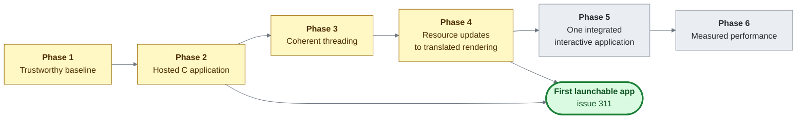

# Native-first README milestones (archived)

**Archived 2026-11-25; paused native research, not the active plan.** This section was the README's "Milestones" content on `main` when BetterXen moved to the CrossOver-based hybrid direction. Statuses describe the native implementation only, with synthetic evidence. The active plan is the [roadmap](../roadmap.md). Links below were written for the repository root README and may need adjusting.

## Native-first milestones

BetterXen's work order is the six [development phases](development-phases-native-first.md), which lead to one concrete target: the **first launchable application** (tracker [#311](https://github.com/MacosPorters/betterxen/issues/311)). That target is an original C program, built with native ARM64 tools, that runs through the ARM64 translator, controls its own translated shader pipeline, and shows its Metal frame in the native app window. It is **not** a commercial or authentic Xbox title, and no date or percentage is attached to it.

🟨 work under way · ⬜ not started · 🟩 the next original-workload target. Nothing here is independently accepted.

| Phase | Goal | State | What exists now |
| --- | --- | --- | --- |
| **1 · Baseline** | Contributors can tell what exists on `main`, what is pending review, and which checks ran | 🟡 In progress | CODEOWNERS review, a fast repository hygiene check, claim-before-work rules, generated status tables and claim audits |
| **2 · Hosted C application** | An original hosted C program starts, uses the runtime, reports results and exits with checked cleanup | 🟡 In progress | CRT startup, arguments, exit handlers, formatted output, file streams and the hosted-C fixture (A2) are integrated; a stdio follow-up is still open and the result is not independently accepted |
| **3 · Threaded behavior** | A worker-based application can block and resume without stalling other guest work | 🟡 In progress | Deterministic scheduler, guest thread contexts, guarded stacks and thread services. Guest `Sleep` still delays all guest threads (#304); worker TLS and callback lifecycle is a design draft (#312) |
| **4 · Resource updates to rendering** | A guest updates a texture and geometry, submits translated rendering and gets a checked frame | 🟡 In progress | Persistent resources, descriptor-table texture binding, translated vertex and pixel stages, blend, depth and indexed draws. Guest-selected pipelines and the typed graphics bridge are open (#314–#316) |
| **5 · Integrated interactive app** | Guest execution, rendering, input, audio, filesystem and lifecycle in one session | ⚪ Planned | Swift app with frame loop, input, audio and sandboxed filesystem fixtures exists, but those demonstrations are not guest-integration evidence |
| **6 · Measured performance** | Faster execution of workloads whose correctness is already checked | ⚪ Planned | Startup, DBT and TLS measurements recorded; bottlenecks are chosen from measurements, not assumed |

The launch milestone's proposed acceptance is **60 bounded frames containing two independently distinguishable guest-controlled states, then a clean close and one restart**. Sixty is a fixture criterion, not a measured frame rate. The work is tracked as issues [#313](https://github.com/MacosPorters/betterxen/issues/313)–[#323](https://github.com/MacosPorters/betterxen/issues/323).

<b>Capability reference: the original X1–X25 map</b>

The X1–X25 names are an older, broad capability map. Keep them as a reference; use the phases above for the next work order. X10–X25 are proposed engineering milestones, not completed implementations or a guaranteed sequence.

| Milestone | Implementation | Status |
| --- | --- | --- |
| X1 — Guest CPU | Bounded x86-64 instruction execution on ARM64 macOS | Verified |
| X2 — Executable loading | Loading original fixed-base PE32+ test executables | Verified |
| X3 — GPU compute | Guest-submitted Metal compute workloads and readback | Verified |
| X4 — Metal rendering | Guest-driven offscreen rendering using authored Metal shaders | Verified |
| X5 — Guest execution expansion | Additional bounded CPU execution and fixture coverage | Implemented |
| X6 — Guest control flow | Nested calls, returns, checked memory and synthetic PE execution | Verified |
| X7 — Imported services | Named imports, guest-to-host service dispatch and result validation | Verified |
| X8 — Translated compute | Original gfx1030 compute shaders executing on Metal, partial Wave32 handling and BC1 readback | Verified subset |
| X9 — Translated graphics | Persistent resource handles, translated vertex/pixel stages and offscreen Metal rendering | Verified subset |
| X10 — Texture sampling | One translated `image_sample_lz` pixel stage with point/clamp sampling of RGBA8 and BC1 2D textures bound through descriptor tables, locally verified on Apple M5 Pro; upload, readback and decode of BC compressed formats (see [Texture support](#texture-support)). Other image instructions and formats are not implemented | Implemented subset |
| X11 — Graphics pipeline | Bounded multi-draw passes into offscreen RGBA8 targets: translated vertex and pixel stages, indexed triangle draws, colour write masks and blend state | Implemented |
| X12 — Wave execution | Expand Wave32/Wave64 semantics, divergent control flow, cross-lane operations, LDS and barriers | Planned |
| X13 — Advanced shaders | Mesh, geometry and additional compute shader capabilities with verified Metal execution | Planned |
| X14 — CPU recompilation | Native ARM64 dynamic recompilation of supported x86-64 instructions in synthetic fixtures | Implemented subset |
| X15 — Executable compatibility | Static PE inspection reports sections, relocations, thread-local storage (TLS) callbacks, imports and entry-point instructions | Static probe implemented |
| X16 — Guest memory and threading | Virtual memory mapping, thread scheduling, synchronization primitives and atomic operations | Implemented subset |
| X17 — System services | Implement a tested subset of Xbox-compatible runtime APIs, memory services, filesystem access and application lifecycle | Implemented subset |
| X18 — Graphics API translation | Translate supported Xbox graphics commands, resource descriptors, command queues, barriers and fences into Metal operations | Planned |
| X19 — Advanced GPU features | Indirect rendering, asynchronous compute, additional texture formats and ray-tracing compatibility research | Planned |
| X20 — Integrated guest runtime | Connect CPU recompilation, executable loading, system services and graphics translation into one persistent runtime | Planned |
| X21 — Application compatibility | Execute increasingly complex independently authored applications through the complete guest CPU and GPU pipeline | Planned |
| X22 — First application boot | Establish a reproducible startup and error-reporting path for supported game-like applications | Planned |
| X23 — Initial game compatibility | Investigate startup and execution of legally supported game software, identifying missing runtime and graphics behavior | Long-term goal |
| X24 — Gameplay and performance | Expand rendering correctness, input, audio, memory management, shader caching and execution performance | Long-term goal |
| X25 — Running games | Achieve reproducible, stable execution of compatible games on native Apple Silicon macOS using Metal | Long-term goal |

