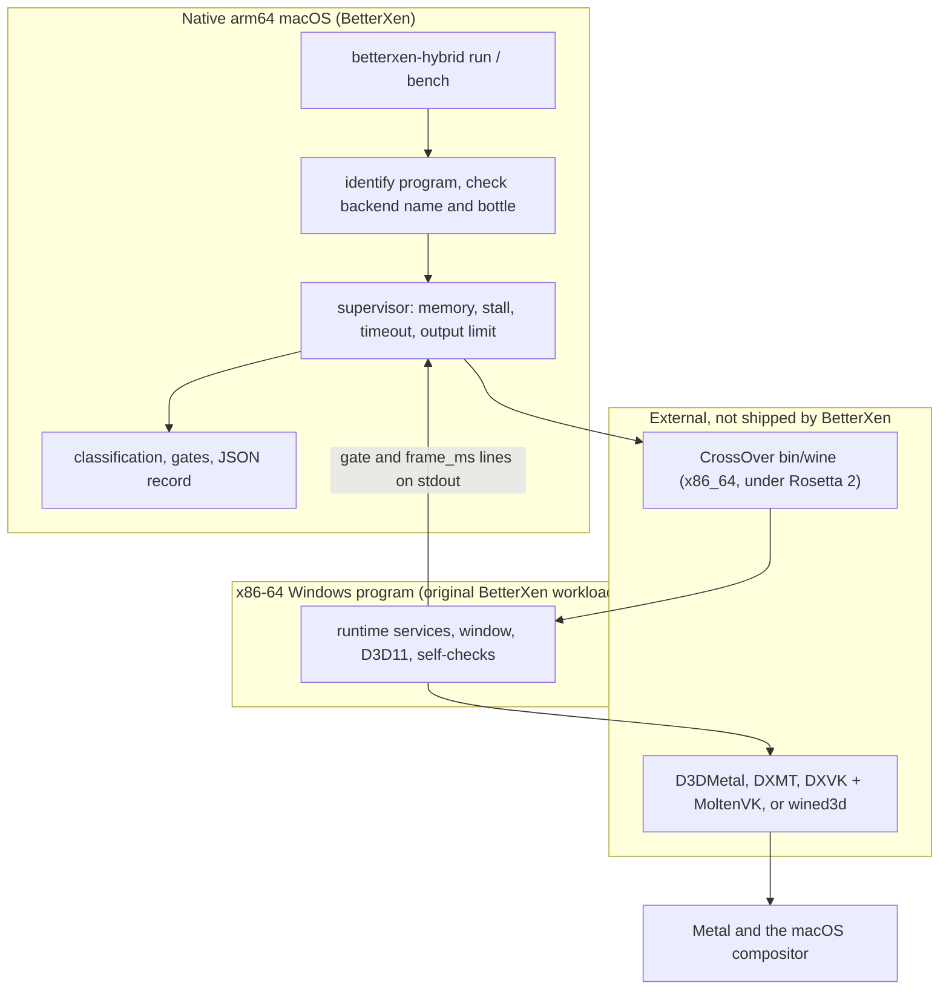

# Running a program through the hybrid path

How BetterXen launches an original Windows program through an installed CrossOver, what each part owns, and what has actually been shown to work. This is not game or console compatibility: every program run here was written for BetterXen.

## What runs where



| Boundary | Owner | Code | Shown by |
| --- | --- | --- | --- |
| Command line and configuration | BetterXen | `crates/hybrid/src/main.rs` (`parse_run_args`) | unit tests |
| Environment preflight | BetterXen | `crates/hybrid/src/preflight.rs` | `doctor` on one Mac; unit tests |
| Executable identification | BetterXen | `crates/hybrid/src/pe.rs` | unit tests with hostile inputs; real x86-64 and ARM64 files |
| Process start, supervision, stop | BetterXen | `crates/hybrid/src/run.rs` (`execute`, `stop_bottle`), `memory.rs` | stub tests; real pass, crash and hang runs |
| Windows API, CPU translation | CrossOver, Wine, Rosetta 2 | external | the workload's own checks only |
| Direct3D 11, shader compilation | CrossOver backends and `d3dcompiler_47` | external | pixel comparison in the workload |
| Presentation | CrossOver, macOS | external | window capture (`check_window.py`) |
| Input | Wine message queue | external | posted messages only |
| Records | BetterXen | `records.rs`, `json.rs` | unit tests; records kept per run |

The native research crates (`xenora-*`: x86-64 loader and translator, GFX10.3 shader compiler, Metal backend) are **not on this path**. Nothing in `betterxen-hybrid` depends on them, and the `betterxen` and `app/` front ends reach only the native research code. No console shader translator is connected to the hybrid path.

CrossOver's `bin/wine --bottle`, `wineserver -k` and `CX_GRAPHICS_BACKEND` are not documented by CodeWeavers as macOS automation interfaces ([#350](https://github.com/MacosPorters/betterxen/issues/350)). A CrossOver update may break them.

## Commands

```sh
export RUSTUP_TOOLCHAIN=1.100.0-aarch64-apple-darwin
cargo build --release -p betterxen-hybrid
target/release/betterxen-hybrid doctor --bottle BOTTLE
workloads/d3d11-integrated/build.sh "$LLVM_MINGW"
target/release/betterxen-hybrid run --bottle BOTTLE --expect "PASS integrated" --out artifacts/hybrid-runs \
    -- "$PWD/artifacts/hybrid-workloads/x86_64/d3d11-integrated.exe" --frames 600
scripts/hybrid/accept-integrated.sh "$LLVM_MINGW" BOTTLE
```

Prerequisites: Apple Silicon Mac, CrossOver (user-installed), a `win11_64` bottle, Rosetta 2, Rust 1.100.0, the [pinned llvm-mingw](research/hybrid-toolchain.md), and for the window check a GUI session with the Screen Recording permission.

## Acceptance gates

Evidence from `scripts/hybrid/accept-integrated.sh` on one machine: Apple M4 (24 GiB), macOS 27.0 (26A428), CrossOver 26.3 (26.3.0.39832), default backend, 2026-11-25. The author of the code ran it, so none of this is independently verified.

| Gate | Status | Evidence | Limit |
| --- | --- | --- | --- |
| A. Environment | Pass | `doctor`: all checks true | Checks presence, not correctness |
| B. Executable | Pass | identified as x86-64 console PE; ARM64 build refused before launch | Delay-load imports not listed |
| C. Runtime | Pass for the services tested | gates `runtime.threads`, `.memory`, `.exceptions`, `.time`, `.files` | No audio, sockets, controllers or stress on synchronization |
| D. Graphics initialization | Pass | gate `graphics.init` | Feature level 11_0 only |
| E. Shader execution | Pass | vs, ps, cs at shader model 5.0; output compared pixel by pixel; `color`, `blank`, `depth` controls fail | Trivial shaders; no console shader input |
| F. First verified frame | Pass | back-buffer read-back at frame 0; window capture matches 1016 of 1016 samples of the final frame; wrong rendering is detected on screen | Capture is a sampled grid with a tolerance of 6 per channel |
| G. Continuous rendering | Pass | 20,000 presented frames, 46 read back, none mismatched | Sampled verification; about three minutes |
| H. Interactive execution | **Partial** | five posted key messages change the rendered image as expected; the `input` control fails | No key was typed on the Mac; no mouse or controller |
| I. Extended stability | **Partial** | five repeats with identical pixel digests; working set 65.8 MB after warm-up to 69.1 MB at the end of the 20,000-frame run; crash and hang stopped and followed by a passing run | Minutes, not hours; GPU memory not measured; Ctrl-C of the supervisor not tested |
| J. Reproducibility | **Not met** | one script and documented prerequisites | No second person or machine has run it |

## Backends

One run of 300 frames each, same executable. All five passed with the same pixel digest `e3ee5e2b018b4783`: default (inferred D3DMetal), `d3dmetal`, `dxmt`, `dxvk`, `wined3d`. The workload is far too small to compare performance.

## Memory and timing observed

| Measurement | Value |
| --- | --- |
| Workload resident memory, sampled by `ps` | peak 78 to 93 MB across runs |
| Persistent CrossOver processes | not part of the workload figure; reported separately as `peak_crossover_rss_kb_sampled` |
| First verified frame, from program start | about 1.0 s on the first run of a session, about 0.25 s afterwards |
| Frame interval, 600 frames, vsync off | p50 1.8 ms in one run and 8.1 ms in later runs; the cause of the difference is **unknown** |
| Soak, 20,000 frames | p50 8.4 ms, p99 31 ms, maximum 158 ms |
| GPU memory, GPU utilization | not measured |

These describe a tiny offscreen-sized scene with periodic read-back. They are not estimates of any application's performance.

## Security limits

- **A bottle is not a sandbox.** The workload appeared with a `Y:\` path into the user's home directory. A program run this way can read and write what the user can. Run only programs you trust.
- The child inherits the supervisor's environment apart from the two backend variables, including any secrets in it.
- Stopping a run stops every process in that bottle.
- The supervisor does not handle its own SIGINT or SIGTERM; processes may be left running.
- The executable is identified and then launched by path, so a file replaced in between is not detected.
- The PE reader is bounds-checked and tested against truncated and corrupted input; it has not been fuzzed.
