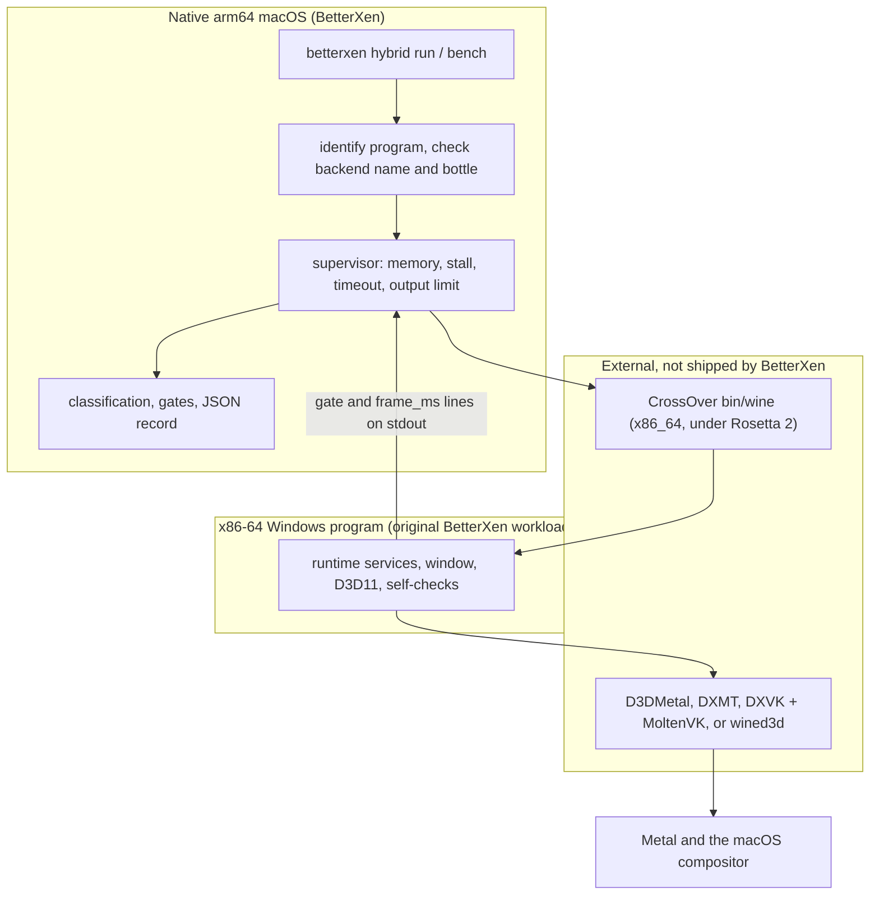

# Running a program through the hybrid path

How BetterXen launches an original Windows program through an installed CrossOver, what each part owns, and what has actually been shown to work. This is not game or console compatibility: every program run here was written for BetterXen.

## What runs where



| Boundary | Owner | Code | Shown by |
| --- | --- | --- | --- |
| Command line and configuration | BetterXen | `crates/hybrid/src/main.rs` (`parse_run_args`) | unit tests |
| Environment preflight | BetterXen | `crates/hybrid/src/preflight.rs` | `doctor` on one Mac; unit tests |
| Executable identification | BetterXen | `crates/hybrid/src/pe.rs` | unit tests with hostile inputs; real x86-64 and ARM64 files |
| Process start, supervision, stop | BetterXen | `crates/hybrid/src/run.rs` (`execute`, `stop_bottle`), `memory.rs` | stub tests; real pass, crash and hang runs |
| Windows API, CPU translation | CrossOver, Wine, Rosetta 2 | external | the workload's own checks only |
| Direct3D 11, shader compilation | CrossOver backends and `d3dcompiler_47` | external | pixel comparison in the workload |
| Presentation | CrossOver, macOS | external | window capture (`check_window.py`) |
| Input | Wine message queue | external | posted messages only |
| Records | BetterXen | `records.rs`, `json.rs` | unit tests; records kept per run |

The native research crates (`xenora-*`: x86-64 loader and translator, GFX10.3 shader compiler, Metal backend) are **not on this path**. Nothing in `betterxen-hybrid` depends on them, and the `betterxen` and `app/` front ends reach only the native research code. No console shader translator is connected to the hybrid path.

CrossOver's `bin/wine --bottle`, `wineserver -k` and `CX_GRAPHICS_BACKEND` are not documented by CodeWeavers as macOS automation interfaces ([#350](https://github.com/MacosPorters/betterxen/issues/350)). A CrossOver update may break them.

## Commands and independent reproduction

`betterxen hybrid <command>` is the interface; the `betterxen-hybrid` binary runs the same code. Commands: `doctor`, `inspect`, `run`, `bench`, `stop`, `guard`, `frames`, `receipt`.

The child process receives only `HOME`, `USER`, `LOGNAME`, `TMPDIR`, the locale variables, a system-only `PATH`, and values given with `--env NAME=VALUE`. `--inherit-env true` passes everything. SIGINT, SIGTERM and SIGHUP stop the run; after a SIGKILL of the supervisor use `betterxen hybrid stop --bottle BOTTLE`. Use one run per bottle at a time.

To reproduce the results, on an Apple Silicon Mac:

1. Install CrossOver yourself and create a `win11_64` bottle. Install Rosetta 2, Rust 1.100.0 and the Xcode command-line tools (`swift`, `swiftc`).
2. Download the [pinned llvm-mingw](research/hybrid-toolchain.md), check its SHA-256 and unpack it.
3. Grant your terminal Screen Recording and Accessibility permission.
4. Close heavy applications: runs are refused below 50 % free memory.
5. From a clean checkout: `scripts/hybrid/accept-integrated.sh LLVM_MINGW_DIR BOTTLE`. Do not type while the keyboard step runs.
6. Report every `ok`, `KNOWN` and `FAIL` line, `commit.txt`, `receipt.json` and the CrossOver version, on [#355](https://github.com/MacosPorters/betterxen/issues/355). Records contain local paths; read them before sharing.

Reviewing the expected images independently is part of the job: they are computed in `expected_pixel` in each workload and again in `check_window.py`, all written by the same author.

## Acceptance gates

Evidence from the acceptance script on one machine: Apple M4 (24 GiB), macOS 27.0 (26A428), CrossOver 26.3 (26.3.0.39832), default backend (inferred D3DMetal), 2026-11-25, revision `14a54f8`: 33 steps ok, one known failure. The author of the code ran it.

| Gate | Status | Evidence | Limit |
| --- | --- | --- | --- |
| A. Environment | Pass | `doctor`: all checks true | Checks presence, not correctness |
| B. Executable | Pass | identified as x86-64 console PE; ARM64 build refused before launch | Delay-load imports not listed |
| C. Runtime | Pass for the services tested | threads, memory protection, exception handling, timing, files; environment isolation | No audio, sockets or controllers |
| D. Graphics initialization | Pass, D3D11 and D3D12 | `graphics.init` in both workloads | Feature level 11_0 |
| E. Shader execution | Pass | vs, ps, cs at shader model 5.0; fault controls fail | Small shaders; no DXIL / shader model 6 |
| F. First verified frame | Pass | read-back, and a window capture for D3D11 (1016 of 1016 samples) | No window capture of the D3D12 workload |
| G. Continuous rendering | Pass | 20,000 D3D11 frames; D3D11 and D3D12 digests equal over 600 frames | Sampled verification |
| H. Interactive | Pass with synthesized macOS events | key events posted to the process with `CGEventPostToPid` move the quad as expected; wrong or no keys fail | No person typed; no mouse or controller |
| I. Extended stability | Pass for rendering and memory over two hours; resource release fails | [long run](#long-run); 5 repeats; 20 back-to-back launches; crash, hang and signal recovery | One run, one machine, D3D12 only; GPU memory not measured |
| J. Reproducibility | **Not met** | instructions above | No second person or machine has run it |
| Resource release (D3D12) | **Fails on D3DMetal** | see below | |

## Observed backend behaviour

All on this one machine and CrossOver version; none confirmed with CodeWeavers or Apple.

- **D3DMetal keeps a reference for every destroyed D3D12 swapchain.** In a minimal program, each create and destroy cycle left `Release` of the swapchain returning 1 and one more device reference (12 after 12 cycles), also after destroying the window. The `wined3d` and `dxvk` settings returned to zero. The D3D12 workload's `shutdown` gate therefore fails on D3DMetal. D3D11 swapchains released cleanly. A program that recreates swapchains often would accumulate them.
- **Under the `wined3d` and `dxvk` settings** D3D12 is provided by Wine's `vkd3d`. 128-frame runs passed every gate; longer runs slowed to 2.0 s per frame after about 440 frames, with vsync on or off, and timed out. Cause unknown.
- **`dxmt`** offers no D3D12 device (classified `no_graphics_device`).
- **Frame pacing with vsync off is bimodal.** The D3D11 workload's median interval switches between about 1 ms and 4 to 9 ms *within* runs, in no relation to run order; in short D3D11 runs with vsync it was 16.7 ms (the [long D3D12 run](#long-run) did not hold that). The earlier "first run is faster" reading was wrong. Vsync-off intervals from these workloads are not performance measurements. Trigger not identified.

## Backends

D3D11: one 300-frame run each; default, `d3dmetal`, `dxmt`, `dxvk`, `wined3d` all passed with the same pixel digest (earlier revision). D3D12: see the observations above.

## Memory and timing observed

Revision `14a54f8` unless stated.

| Measurement | Value |
| --- | --- |
| Workload resident memory, sampled by `ps` | 94 to 101 MB in the D3D11 first run, D3D12 run and 20,000-frame run |
| Persistent CrossOver processes | not part of the workload figure; reported separately as `peak_crossover_rss_kb_sampled` |
| First verified frame, from program start | about 0.2 s here; about 1.0 s was seen on some earlier first runs |
| 20,000 D3D11 frames, vsync off | p50 8.3 ms, p99 20 ms, one frame of 1,023 ms |
| Frame pacing, vsync off | bimodal; see above |
| GPU memory, GPU utilization | not measured |

These describe a 256 by 256 scene with periodic read-back. They are not estimates of any application's performance.

## Long run

One D3D12 run of two hours with vsync requested, on the machine above (workload and runner code of revision `14a54f8`, 2026-11-25):

```sh
betterxen hybrid run --bottle betterxen-test --timeout 7600 --stall-timeout 120 --keep-output true --out <dir> -- <path>/d3d12-integrated.exe --duration-s 7200 --vsync --verify-every 600
```

The run is classified `failed_exit_1`: every gate passed except `shutdown`, the D3D12 reference retention described above.

| Measurement | Value |
| --- | --- |
| Frames presented | 844,497 over 7,200 s |
| Frames verified by read-back | 1,414, none mismatched |
| Resource create and destroy cycles | 8,445; device references after release: 2, as in short runs |
| Device removed | no |
| Workload working set, sampled each minute by the program | 95.3 MB in the first sample, then falling; 50.9 MB at the end |
| Lowest system free memory | 46% (69% at start) |
| Frame interval | p50 8.9 ms, p99 20.4 ms, p99.9 34.2 ms, maximum 1,019 ms; 21 frames over 100 ms |
| Thermal warnings recorded by `pmset` before and after | none |

The frame intervals did not settle at a display refresh period despite `--vsync`: per-minute medians ranged from 8.1 to 16.6 ms. The cause of this, and of the 1 s frame, is unknown. The machine was not isolated from other use. GPU memory was not measured, and a longer or heavier scene was not tried.

## Security limits

A CrossOver bottle is **not** a sandbox: it maps the whole filesystem. Supervision limits runaway behaviour only. See the [security review](research/security-audit-2026-11-25.md).
