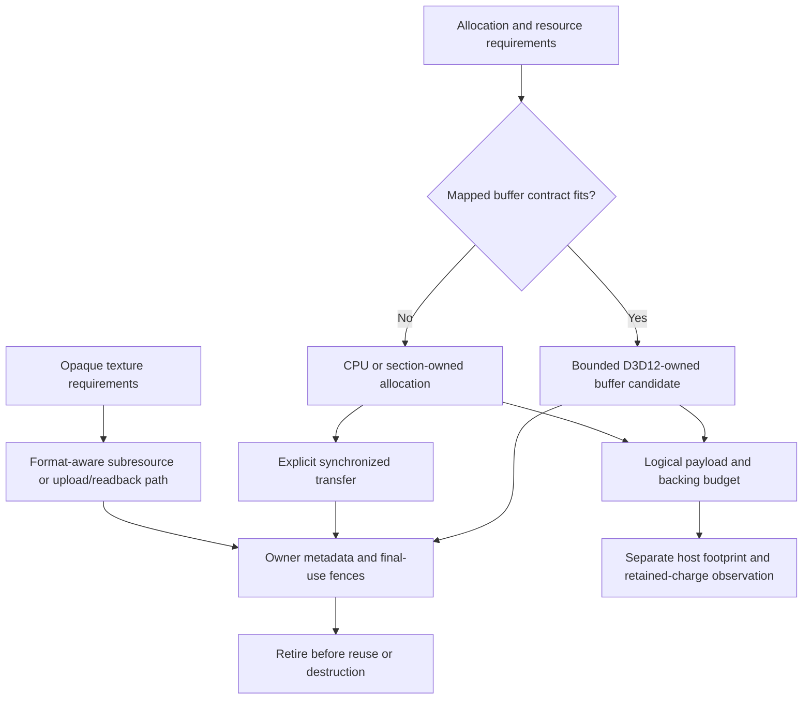

# Memory architecture research consolidation — independent review draft

BetterXen #473, 2026-11-26. Author: Workstream A under Arths17. Proposed independent reviewer: Workstream B under Asufte/@atesahmet0; ownership acknowledgment and review are pending in the issue. This draft stays in A's directory and does not replace shared findings, merge branches or declare research accepted. The [evidence register](evidence-register.md) and [complete records](evidence-register.json) identify each source, platform, raw receipt, review, reproduction, limitation and acceptance state.

## 1. Executive summary

The tested CrossOver/D3DMetal configuration supports useful application-visible mapped-buffer access with fence-separated CPU/GPU visibility, legal buffer aliases and several texture transfer/clear cases. It does not provide the tested existing-memory import routes. Actual CPU pointers are not consistently 64 KiB aligned. Existing CPU allocation identity, requested virtual addresses, section/scatter semantics and opaque texture layouts therefore require separate treatment.

Bounded pooling and the pinned AMD allocator reduce or avoid certain allocation-call costs in synthetic traces, but have not demonstrated production memory savings or end-to-end application performance improvement. Process-ledger retention, logical free spans and physical residency are different measurements. Physical backing identity and a universal absence of internal copies remain unknown.

B has independently reviewed/reproduced selected earlier A cases on M5. A has reviewed B's published source/raw data and recalculated its distributions, but critical M4 reproduction and independent trace extraction remain blocked. The newer A graphics supplement has one passing smoke, an earlier author bug and a pressure-stopped repeat. The proposed fence-error correction compiles but is not runtime-qualified. These limitations constrain the recommendations below.

## 2. Original objectives and eight decision gates

The six-check baseline at `9ae6d1ee7092b6021aad075531f50ba60de4fd53` remains frozen, including timeout, order, allocations, values, five warmups and 40 timed submissions. A's published continuation is `8c9eceb05ab660504ee981c2f4fcaf1728a5dbff`; B is `a40228747470f0d184375e451b0173769c90aef5`. Executed source snapshots, rather than later helper revisions, govern historical results.

| Revised-plan decision gate | Evidence-supported answer | Remaining gate |
| --- | --- | --- |
| 1. Physically shared buffer configurations? | Application-visible persistent mapping and alias inheritance work in scoped cases (BASE-4, A-8, B-3). | Physical backing-page identity remains Unknown; do not rename functional sharing as physical proof. |
| 2. Hidden full-buffer/dirty-page copies? | B's matched windows constrain cost relative to its explicit full READBACK copy (B-1/B-2). | Faster, overlapping, deferred, CPU-write-stage or referenced-range work remains possible. Trace extraction requires source inputs. |
| 3. Can inverted ownership satisfy xmem? | Candidate for eligible graphics bytes; not a universal provider (A-5/A-6). | Preserve unsupported address/section/reservation/pre-device/existing-content contracts; console meanings remain unverified. |
| 4. Shared versus GPU-optimized resources? | Both CPU-visible and DEFAULT paths have scoped correctness evidence; B measures different workloads (A-9–A-12, B-3/B-7). | No intrinsic heap ranking or identification of opaque Metal storage modes. |
| 5. Does pooling help? | Certain allocation-call costs improve; bounded statistics/reuse are demonstrated (A-2–A-4). | Cold setup, slack, fragmentation, host retention and production workload cost remain separate; no general application gain. |
| 6. Necessary synchronization/lifetimes? | CPU ownership, states, fences, alias ordering and owner retention are required. | Multi-queue and failed-completion cleanup need further qualification (A-13/B-3). |
| 7. Required fallbacks? | CPU/section ownership and explicit transfers where the mapped provider cannot meet the contract; format-aware texture paths. | CPU watch is only a serialized eligible-allocation optimization; general GPU tracking remains Unknown (B-4/B-5). |
| 8. What informs #464? | Validate actual alignment/span/ownership and preserve logical versus host accounting; provide scoped reproduction fixtures. | No production edit or certification of its implementation; existing owner and independent acceptance remain intact. |

These answers fulfill the consolidation questions as research outcomes, including unresolved ones. They do not satisfy every independent acceptance criterion or complete M2.

## 3. Experimental methodology

Only original or authorized synthetic workloads, public interfaces and publicly licensed source were used. CrossOver, D3DMetal, Rosetta and host tools remain external. AMD D3D12 Memory Allocator 3.3.0 is pinned at `600949266be004553f74c9ef809384380a9d44cf`, with per-file MIT notices and Git blobs recorded before use. Its implementation remains in ignored artifacts, not a production dependency.

A's accounting profile requests fresh processes for 64/256/1024 MiB across CPU-only, graphics-warmed CPU, CUSTOM WB/L0 and UPLOAD. It separates settled baselines, initialization, full GPU consumption, resource release, command/pipeline/output retirement and device release. Repeated in-stage samples are correlated. The checksum validates a reduction across source words, not every byte independently. Repeated sessions are incomplete.

A's pooling study uses matched payload, description, alignment and GPU work, deterministic seeds and changing data. Cold pool creation, allocation, placement, Map and retirement are separate. Real delayed queued work, guard/interior readbacks and an omitted-copy negative control accompany a separate logical interval model. The latter does not measure a driver allocator.

B's sweeps use 1/16/64 MiB, WB/WC/UPLOAD, two write strides, seeded case/page order, three warmups and twelve measured iterations. Whole-byte rewrites are distinct from one word per page. Small GPU copies preserve fixed endpoint/interior work; full copies validate the full destination. CPU writing, command encoding, execution, signal/wait and validation have separate intervals. Compute poisoning/omitted-dispatch controls are separate from copy controls. Instruments captures remain separate from uninstrumented host timings.

The host safety policy independently gates kernel pressure and the conservative occupied-memory metric, with explicit reserve below 23,000,000,000 bytes. It cannot redefine existing swap or correlated samples as normal-pressure independent runs. Urgent pressure blocks required remaining GPU/large studies; no optional 2 GiB or concurrent polling experiment was run.

## 4. Workstream A findings

The corrected first accounting sweep completed twelve processes; the bounded continuation completed six smaller/control cases and stopped the next graphics case under urgent pressure. In the first sweep, large graphics allocations retained process-accounted charge after resource, command and device release; CPU controls differed and 64 MiB graphics could fit previously charged pools. RSS and footprint diverged under compression/swap. This does not identify physical residency, allocation count or a leak.

Three matched pooled/individual pairs show reduced heap/suballocation-call components, separately measured pool setup and noisy whole-cycle results. The 32 MiB GPU trace did not exhaust the slab. The separate model exercises 6012 snapshots, fixed external fragmentation, variable alignment/lifetimes and simulated pending retirement; corrupted copied statistics are rejected.

Six WB/WC allocator processes use one 32 MiB block. Each 432-request sequence matches its original pool seed; all 216 full/holes/empty statistics agree with a separate interval calculation. Sampled readbacks match and oversized valid requests return E_OUTOFMEMORY. Empty library allocations coexist with configured block retention. Library ownership does not automate queue-fence retirement.

Valid overlapping buffers, mixed mip textures and reinitialized render/depth aliases have scoped M4/M5 evidence. The texture rejection gate fails because two invalid buffer calls succeed; invalid objects are never GPU-used. A's offset-1 call also overflows the heap span by one byte, while B isolates alignment with a larger heap. One corrected graphics smoke checks seven 512-pixel outcomes for point sampling, raster depth and stencil. Its repeated/control profile is not complete.

## 5. Workstream B findings

Two M5 copy sweeps complete 36 processes and 5040 measured comparisons. Four WB 64 MiB comparisons show full rewrite versus no-write small-copy completion excess of 46–279 microseconds. Word-per-page timings are variable and nonmonotonic. The no-write explicit full-copy workload takes approximately 2.09–2.36 milliseconds median. This challenges comparable-cost serial full copying within the small-copy window, not copying in every stage or domain.

Two uninstrumented compute sessions produce 576 measured comparisons across WB→WB, WC→WC, UPLOAD→WB and staged DEFAULT→DEFAULT. CPU/GPU visibility is fence-separated; poison remains when dispatch is omitted. Shader workloads use 4 MiB. Direct and staged outputs have different transfer work, and sparse cases are completion-latency dominated.

Separate Metal extracts report 300 shader and 45 full-copy intervals including warmups. Payload divided by interval duration is workload throughput, not physical transaction bandwidth. Published medians and variability recalculate, but source XML/reference selection cannot yet be independently rerun. Single pressured captures and substantial outliers preclude a general ordering of heap types.

CPU write-watch's 4096-byte returned page sets distinguish subpages, reset/rearm, reads and same-value stores. Those allocations cannot be imported through the tested address-open route. General GPU tracking remains unresolved. D3D12 timestamp resolves leave distinct sentinels unchanged; the corrected clock result declines to supply GPU elapsed time, preserving the earlier invalid sentinel-difference diagnostic.

## 6. Cross-generation comparisons

M4: 24 GiB, macOS 27.0 (26A428). M5: 16 GiB, macOS 27.2.1 (26B131). Both recorded CrossOver 26.3.0.39832, D3DMetal 3.0 and the later-observed Wine 11.0-8726-g2e2f5fca349, with different Rosetta/toolchain receipts. The initial baseline did not independently record its exact Wine engine. Per-run metadata governs each claim.

B rebuilds the same earlier A alias/texture source on M5 and independently derives expectations; PE build hashes differ. CPU pointer remainders vary across both hosts. Positive texture subcases and the overall failed rejection gate reproduce. These are useful cross-generation observations under stated protocols, not controlled isolation of chip generation from OS, pressure or runtime effects. The identical full six-check shared-runner reproduction criterion remains open. No new M1–M3 hardware coverage is claimed.

## 7. Independent verification results

B's pinned A review re-derives mip sizes, clear values, pointer/placement distinctions, aliases and accounting checkpoints, and records its hardware reproduction. It identifies the old A helper's unsafe error unwinding. It does not review the newly published allocator/model/graphics additions yet.

A exports B read-only, checks 98 source identities, 33 watch phases, reported uninstrumented match counts and 1080 recorded compute endpoint pairs including separate traced captures. A recalculates every published trace median, median absolute deviation and useful-payload rate. These are actual source/data checks, not M4 hardware reproduction. A's build-only B snapshot launches zero guests. No independent acceptance is inferred from matching summaries or from an author-written second checker.

## 8. Failed experiments and negative controls

Preserved failures include initial build/setup errors, historical timeout, two corrected-accounting pressure stops, accepted-invalid creation calls, the first graphics compiler-DLL lifetime bug, the no-guest graphics repeat stop, unavailable timestamp resolves, an Instruments pressure stop and a capture-save timeout/retry. Specific omitted-copy/dispatch poison and corrupted-statistic controls retain expected outcomes. An unrun control is not a pass.

One stopped B stderr differs from its recorded empty-file hash; all other 155 reviewed stdout/stderr/HLSL/DXBC hashes match. Original receipt and output remain unchanged. A possible late surviving-child write is a hypothesis; B's finalization evidence is still needed. There is no evidence that this stopped-run discrepancy affects the completed benchmark data.

## 9. Remaining limitations

Required M4 B reproduction, repeated graphics datasets, omitted draw, frame-data recalculation, failed-fence runtime behavior and missing accounting repeats are blocked by pressure or review. Minimal target-only trace XML/schema/reference nodes remain needed to validate process selection, time units and joins. Five already-published historical/setup source references lack retained matching bytes; newer successful runs retain sources.

The studies do not establish arbitrary texture formats/layouts, MSAA, compressed/planar data, arrays/3D, general filtering, all heap tiers, production allocator defragmentation, device loss or multi-queue lifetime. These gaps limit admission of those resource classes, while the existing evidence already rules out a universal raw-buffer treatment of opaque textures. Console cache/ABI semantics, game execution and physical backing mechanisms are not verified.

## 10. Proposed unified-memory architecture

Use a requirement-based provider decision, not a single physical-sharing assumption. Before exposing any pointer, classify the requested CPU address/alignment, device availability, protection/commit semantics, section/scatter requirements, contents/identity obligations and resource class. Inspect the actual returned Map address. A legal byte slice inside a buffer still needs its own valid views, offsets and bounds; it does not become a newly placed resource at a biased offset.

This is an architectural recommendation awaiting independent review, not a new frozen ABI or working production provider. Existing/pre-device/fixed-address data must retain its original owner unless an independently validated transfer of ownership can preserve the required contract.

## 11. Allocation and pooling recommendations

Prefer evaluating the established pinned AMD allocator over turning the experimental first-fit model into a production allocator. Its demonstrated bounded CUSTOM buffer/statistics behavior fits a limited candidate use. Eligibility, queue retirement, stable guest pointers and unified accounting remain BetterXen responsibilities. Do not silently enable defragmentation that moves exposed pointers.

Distinguish requested payload, allocation-rounded spans, reserved slabs, alignment waste, reusable free space, largest free span and fence-pending storage. Do not charge a slice and its parent as two guest payloads. During migration, old and new backing both remain reserved until retirement. A library's empty allocation statistics do not establish OS physical release. Benchmark cold setup, steady allocation, retirement and a full workload before promising performance or memory benefit.

## 12. Synchronization and lifetime requirements

Finish CPU producers before submission; wait for the appropriate final-use queue fence before CPU reads, overwrite, destruction or reuse. Persistent mapping alone supplies neither scheduling nor an atomic interoperability contract. Bind states appropriate to buffers, textures and queue use; uphold required alias ordering and post-activation render/depth initialization. Retain resource, heap, descriptor and command owners through use. Multi-queue work needs explicit cross-queue dependencies and final-use ownership.

Validate adapter/resource allocation alignment and overflow-safe spans at the owned placement boundary: a valid alignment, offset within heap, and size no greater than heap size minus offset. Do not impose a global 64 KiB placement rule on small textures whose allocation-info alignment differs. CPU alignment is independently checked. These are derived requirements from the public [placed-resource contract](https://learn.microsoft.com/en-us/windows/win32/api/d3d12/nf-d3d12-id3d12device-createplacedresource) and the scoped failures, not new console semantics.

A's proposed helper fails the disposable process with exit 2 when fence completion is unproven, instead of unwinding reusable storage. Runtime qualification must also cover supervisor termination and final output sealing. [ExitProcess](https://learn.microsoft.com/en-us/windows/win32/api/processthreadsapi/nf-processthreadsapi-exitprocess) can call DLL detach code and deadlock; compilation is not a teardown proof. This proposed research correction is not production-grade recovery or independently accepted yet.

## 13. Explicit fallback mechanisms

| Contract or resource need | Candidate fallback | Condition |
| --- | --- | --- |
| CPU-only, pre-device, requested VA or existing exposed pointer/content | Conventional CPU/section allocation with explicit transfer where graphics needs it | Preserve identity and protection/commit semantics; do not replace a live pointer silently. |
| Physical tags, independent CPU aliases or scatter views | Existing section/physical mapping engine and an explicit graphics boundary | D3D12 GPU aliasing is not proof of equivalent CPU section semantics. |
| Opaque textures or GPU-oriented rendering | Format-aware subresource writes or DEFAULT upload/readback path | DEFAULT is not proof of D3DMetal's underlying private Metal storage mode; qualify each format/use. |
| CPU-written selective transfer | Optional write-watch on the eligible CPU allocation | Serialize writers/query/reset/snapshot/copy/retry; returned granularity governs. |
| Unknown GPU writers | Supported explicit synchronization and conservative transfer/known-writer instrumentation | Do not assume watch on a foreign Map pointer or universal GPU dirty tracking. |

The public [write-watch allocation contract](https://learn.microsoft.com/en-us/windows/win32/api/memoryapi/nf-memoryapi-getwritewatch) limits applicability. Its CPU success does not validate a general GPU coherence fallback.

## 14. Implementation risks

The main correctness risks are pointer/offset confusion, losing existing contents, freeing fence-pending storage, double or inconsistent budget charges, integer overflow, unsupported opaque layout reinterpretation, and accepting creation as validation. Failure cleanup and concurrent budget/lifetime transitions need dedicated verification. Main performance risks are cold setup, unused slab capacity, fragmentation, retained driver charges, extra transfers, compression/swap and costs moved outside timed windows. Required mitigations appear as acceptance criteria in the [roadmap](implementation-roadmap.md), not assumed implementations.

## 15. Recommendations relevant to #464

The existing implementation owner retains its scope. #486 was previously inspected at 6308fdc; a current metadata/source-diff check finds open head `c44ae4e221b76ad07564aca965936ddba1777b51`. It already describes a bounded backing-heap opt-in, allocation-info alignment/span validation there, ordinary-request forwarding and live-heap accounting. Reuse/review that work instead of proposing a duplicate provider. This draft does not certify its COM wrappers, concurrency, budget completeness or runtime behavior.

Its comment attributing physical/shared-memory interpretation to #473 exceeds this research's mechanism evidence if read as page identity or no copies. The appropriate handoff is version-scoped mapped visibility and legal alias behavior, plus explicit eligibility, lifecycle and fallback constraints. Reported CrossOver 26.2/vkd3d tests are separate from direct-host D3DMetal probes. Existing xmem address identity and Map address must be tested independently; initializing a new Map pointer does not prove preservation of preexisting section contents.

## 16. Remaining research questions

Resolve stopped-run finalization with evidence and preserve reconciliation; independently rerun target-only trace extraction with schema/units and outliers intact; obtain critical M4 B and latest A reciprocal runs when safe; review/test the failure helper; finish the missing common-profile repetitions. Only then consider workload-qualified allocator integration, further resource classes, multi-queue/device-loss stress and controlled production measurements. Stronger physical-mechanism claims require a separate discriminating observation, not another repetition of flat timing.

## 17. Evidence and reproduction appendix

Use [the register](evidence-register.json) for exact revisions and raw links. [A's pinned handoff](https://github.com/MacosPorters/betterxen/issues/473#issuecomment-7204949581) contains source/PE/shader hashes and historical/current reproduction distinctions. [B's published source guide](https://github.com/MacosPorters/betterxen/blob/a40228747470f0d184375e451b0173769c90aef5/docs/research/d3dmetal-zero-copy/copy-detection/README.md) and review inputs are pinned. [A's B review](../review-b.md), [publication audit](../publication-audit.md) and [resource/lifetime derivation](../../gpu-correctness/contracts/resource-placement-lifetime.md) retain scope and failures.

This report can be published and reviewed with blocked work explicitly identified. It cannot be called independently accepted or complete merely because all sections are written. The proposed roadmap is a reviewable recommendation; production implementation, ABI changes, issue creation and merging remain unauthorized.
