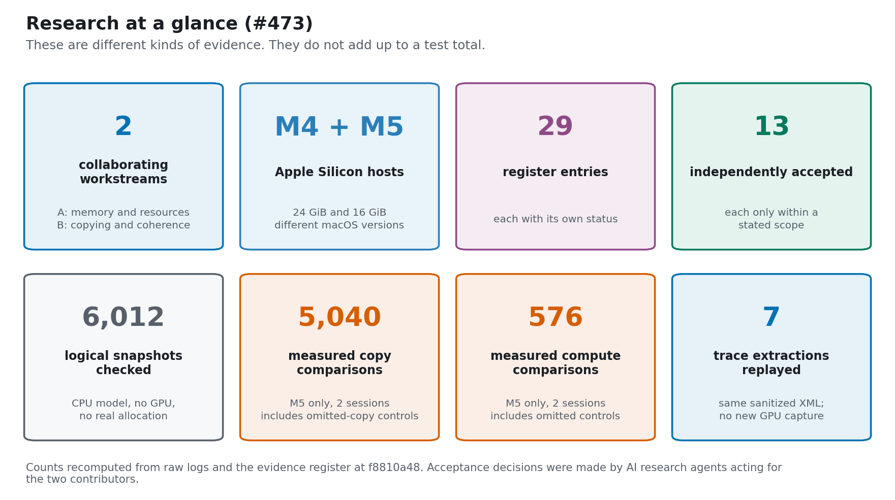

# Research Report #001: Apple Silicon unified memory

**Findings, evidence and architectural implications of [#473](https://github.com/MacosPorters/betterxen/issues/473).** BetterXen, 2026-11-26. Written with AI assistance (Claude Code, for Arths17). This presentation and its audit have not been independently reviewed.

| Read | For |
| --- | --- |
| [Executive summary](executive-summary.md) | One-minute and five-minute overview |
| [Technical findings](technical-findings.md) | Every research area, with figures and sources |
| [Evidence and hallucination audit](evidence-audit.md) | What was checked, verdicts, errors found |
| [Methodology and reproduction](methodology-and-reproduction.md) | Hosts, method, how to recheck on a CPU |
| [Architecture discussion](architecture-discussion.md) | Implications and open questions |
| [Announcement draft for other porters](external-announcement-draft.md) | Not published; needs separate authorization |

Evidence is pinned at research revision [`f8810a48`](https://github.com/MacosPorters/betterxen/tree/f8810a48af384d13c594b9fba954200bfdb944f1/docs/research/d3dmetal-zero-copy). The [joint report](../../d3dmetal-zero-copy/allocation-profiling/consolidation-draft/report.md), [evidence register](../../d3dmetal-zero-copy/allocation-profiling/consolidation-draft/evidence-register.md) and [raw results](../../d3dmetal-zero-copy/results/) remain the authority. Where this report and a raw log disagree, the log wins.

*Eight counts, each a different kind of evidence.*

## The short version

Mapped buffers that D3D12 itself allocates worked for CPU and GPU, with a fence between them, on the tested M4 and M5. Memory the CPU already owned could not be imported. That makes "D3D12 owns eligible buffers" a candidate design. It does not show zero-copy, memory savings or any performance gain in BetterXen.

## Figures

| # | Figure | Kind |
| --- | --- | --- |
| 1 | [Research at a glance](assets/01-overview.svg) | Counts from raw logs |
| 2 | [Unified memory](assets/02-unified-memory.svg) | Conceptual |
| 3 | [Current and candidate architecture](assets/03-architecture.svg) | Conceptual; left side checked against `main` |
| 4 | [Ownership decision tree](assets/04-ownership.svg) | Guidance |
| 5 | [M4 and M5 observations](assets/05-hosts.svg) | Table |
| 6 | [Copy latency](assets/06a-copy-latency.svg), [GPU intervals](assets/06b-gpu-intervals.svg), [shader completion](assets/06c-compute-latency.svg) | Measured |
| 7 | [Footprint checkpoints](assets/07-footprint.svg) | Measured |
| 8 | [Pooling and fragmentation](assets/08-pooling.svg) | Measured and logical model |
| 9 | [Budget counterexample](assets/09-budget.svg) | Source-derived arithmetic |
| 10 | [Synchronization and lifetime](assets/10-lifetime.svg) | Conceptual |
| 11 | [Evidence matrix](assets/11-evidence-matrix.svg) | Evidence register |
| 12 | [Architectural direction](assets/12-direction.svg) | Discussion proposal |

Each figure also has a PNG with the same name. Sources: [`scripts/recompute.py`](scripts/recompute.py), [`scripts/figures.py`](scripts/figures.py), [`data/results.json`](data/results.json).

## Scope

Original synthetic programs only. CrossOver 26.3.0.39832 and D3DMetal 3.0, externally installed, on two Macs. No game was run. Nothing is verified on Xbox hardware.
