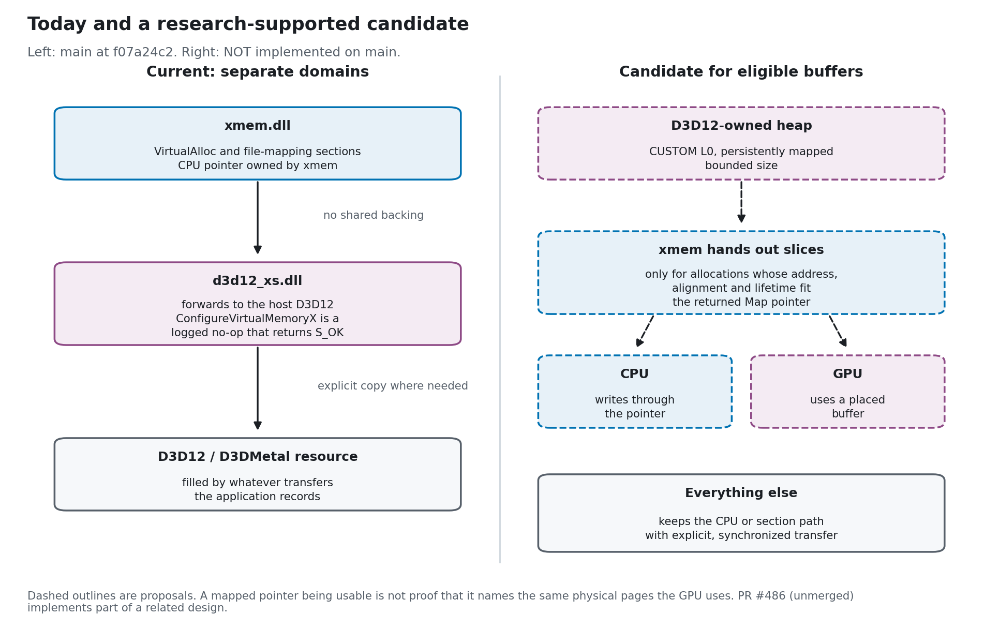
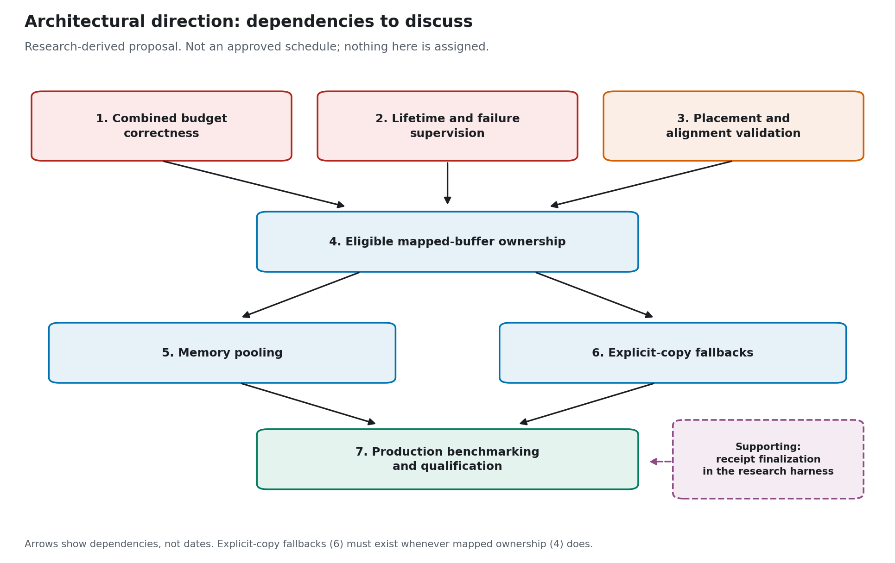

# Architecture discussion

Nothing here is decided, approved or assigned. It informs planning that the maintainers will do together.

## Implications for BetterXen

| Area | Potential benefit | What would have to be shown |
| --- | --- | --- |
| Memory duplication | One buffer where there might be a CPU copy and a GPU copy | Matched production footprint, not a ledger reading |
| Transfers | Fewer explicit staging copies for eligible buffers | Whole-workload timing including synchronization |
| Allocation churn | Pooled suballocation | Cold setup, slack and retention in real allocation patterns |
| Budgeting | One correct, atomic account | Both allocation orders and concurrency tests |
| Lifetime | Fenced reuse by design | Failure and multi-queue tests |
| 16 GB Macs | Lower peak memory | Measurements on a 16 GB host under normal pressure |
| Performance and stability | Possible | Measurement; nothing is promised |

**Not solved by this research:** shader translation, CPU instruction compatibility, missing graphics API coverage, DirectStorage ([#483](https://github.com/MacosPorters/betterxen/issues/483)), other runtime services, failure recovery, game compatibility and frame rate.

This is likely a coordinated change across `xmem`, `d3d12_xs`, the internal contract between them, tests and diagnostics, not one pull request.

## Relevance to other porters

| Topic | General principle | Observation specific to the tested stack |
| --- | --- | --- |
| Windows-to-macOS layers, D3D12-to-Metal | Test each memory API instead of inferring from hardware | Existing-memory import is not implemented in D3DMetal 3.0 |
| Unified-memory allocation | Decide ownership per resource class | Mapped D3D12 buffers worked; textures stayed opaque |
| Persistent mapping | It gives no scheduling and no atomics | CPU pointers were not reliably 64 KiB aligned |
| Pooling | Count setup, slack and pending work | Suballocation was cheaper; no workload speedup shown |
| Synchronization | Fence the last use before reuse | Timestamp resolves did not write results |
| Memory-constrained apps | Footprint is not residency | Large released allocations stayed charged |

Nothing in the right-hand column should be assumed for other versions, chips or translation layers.

## Where the related work stands (2026-11-26)

| Item | State |
| --- | --- |
| [#464](https://github.com/MacosPorters/betterxen/issues/464) virtual memory and placed resources | Open, claimed by devil8blade |
| [PR #486](https://github.com/MacosPorters/betterxen/pull/486) | Open, head `c13f9c7`, changes requested |
| [#465](https://github.com/MacosPorters/betterxen/issues/465) presentation, [PR #471](https://github.com/MacosPorters/betterxen/pull/471) | Open |
| [#469](https://github.com/MacosPorters/betterxen/issues/469) M2 exit gate | Open |
| [#483](https://github.com/MacosPorters/betterxen/issues/483) DirectStorage interfaces | Open; separate from memory ownership |

#473 is not a new blocking dependency for #464.

## Questions for Our Next Architecture Discussion

**Ownership**
1. Should D3D12-owned mapped buffers be the preferred path for eligible buffers, and who decides eligibility: `xmem` or `d3d12_xs`?
2. Which classes keep today's paths: existing contents, fixed addresses, pre-device, sections and scatter, textures?
3. What happens when an eligible-looking pointer fails the alignment the caller needs?

**Budget**
4. Where should the single admission authority live, and what is counted while a resource waits for its fence?
5. Does it need a change to `abi/include/bx_xmem_internal.h`, and therefore an ABI pull request first?
6. Should this be settled before PR #486 merges?

**Allocator**
7. AMD's allocator or a small one of our own? What evidence would decide it?

**Migration**
8. Can the change land in steps that keep ordinary D3D12 calls forwarded unchanged and keep a fallback?
9. How does it interact with #464, #465 and #469 without widening claimed scope?

**Testing and qualification**
10. Which synthetic regressions must exist before the first step: budget orders, lifetime failures, invalid placement?
11. What production measurement would count as a memory or performance benefit, on which hosts?
12. Who runs the missing repetitions, and on what pressure conditions?

**Correcting the record**
13. Should the "true zero-copy" wording in the #464 comment and the "true shared memory, no extra copy" wording in PR #486 be corrected by their authors?

## Prioritized recommendations from the reviewed roadmap

Order of correctness work: combined budget, lifetime and failure handling, placement validation, receipt finalization; then allocator qualification, storage selection and write-watch. Criteria and regressions are in the [implementation roadmap](../../d3dmetal-zero-copy/allocation-profiling/consolidation-draft/implementation-roadmap.md).
