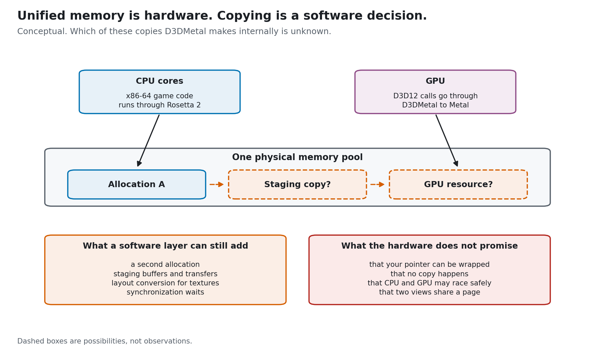
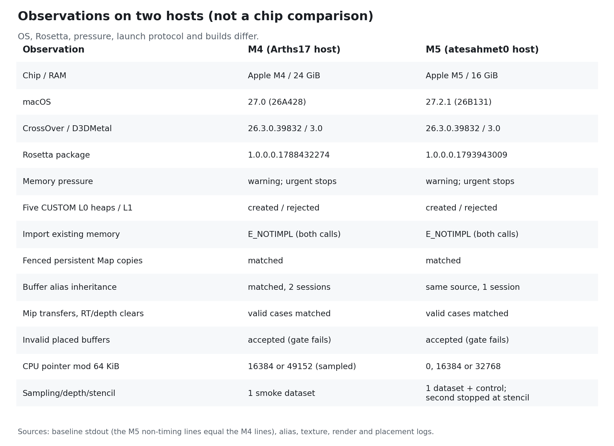
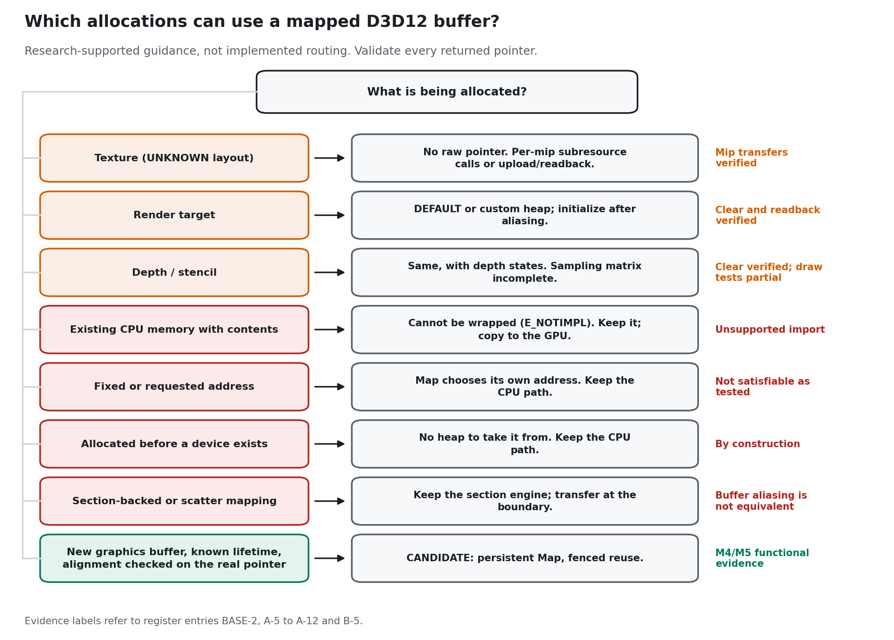
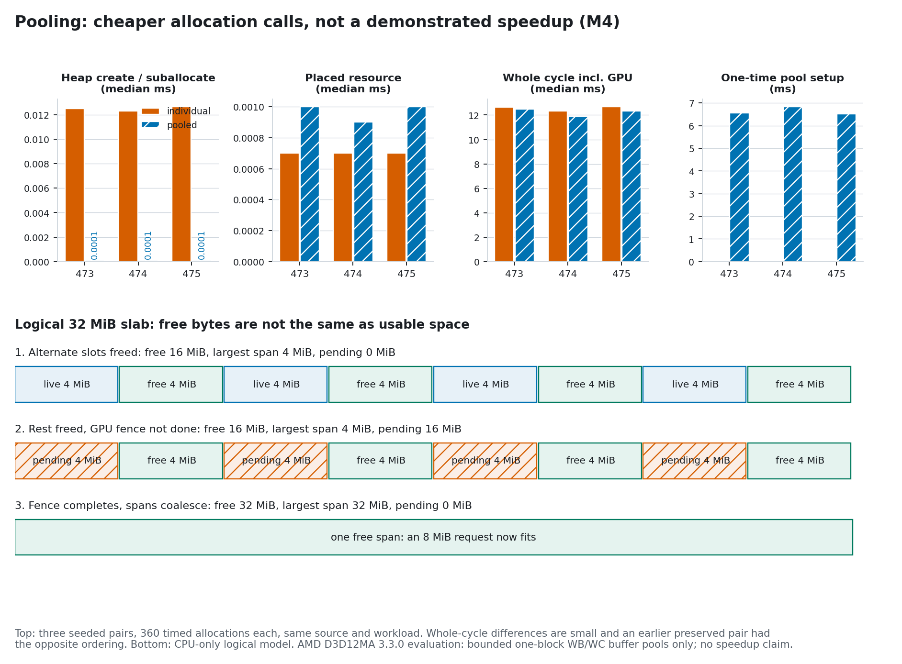
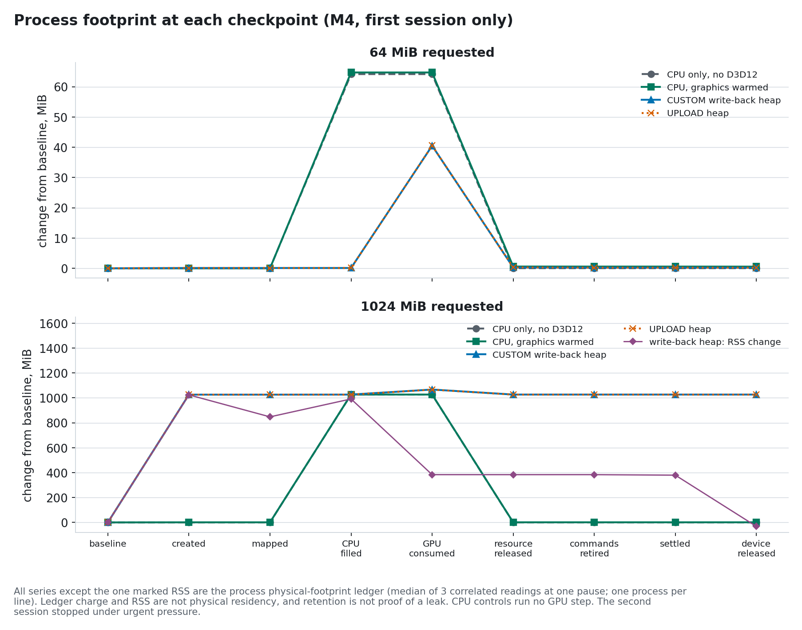
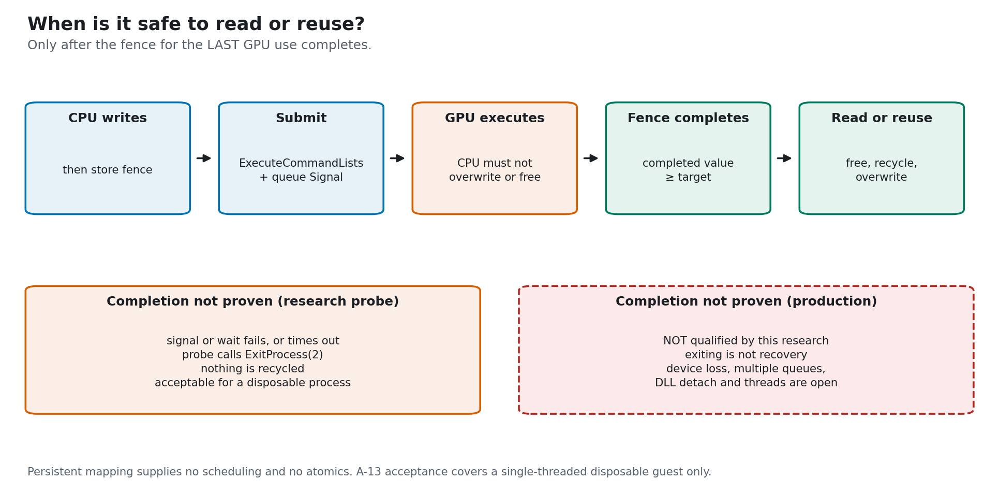
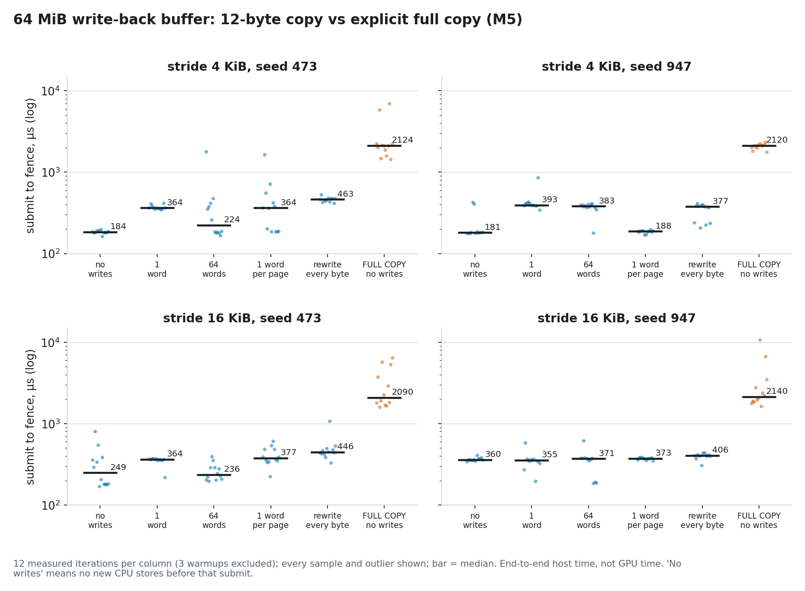
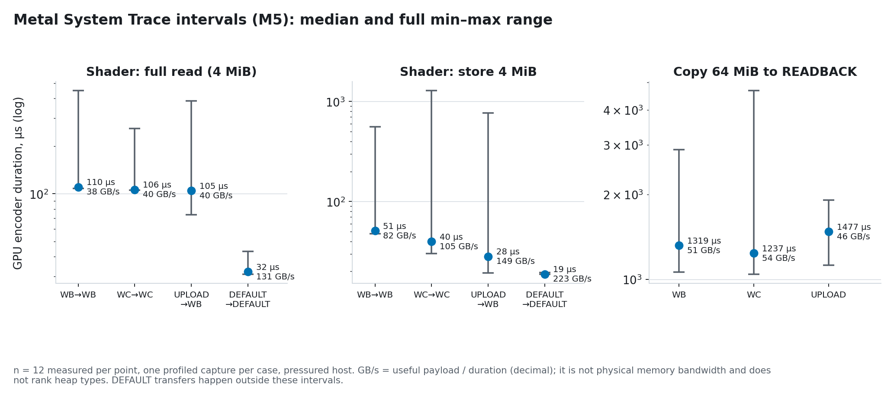
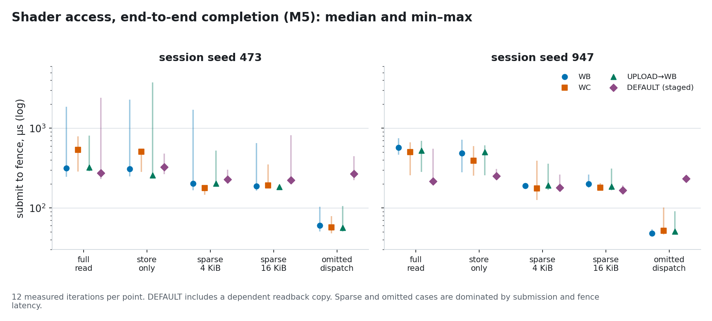
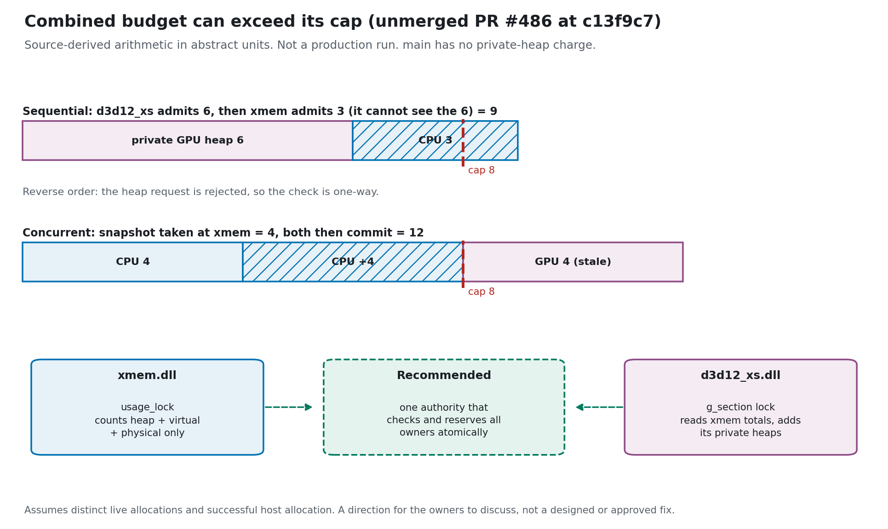

# Technical findings

Observations hold for CrossOver 26.3.0.39832 and D3DMetal 3.0 on the [two tested hosts](methodology-and-reproduction.md). Identifiers such as A-6 are rows of the [evidence register](../../d3dmetal-zero-copy/allocation-profiling/consolidation-draft/evidence-register.md).

**Terms.** A *heap* is a block of memory D3D12 allocates; a *placed resource* is a buffer or texture positioned inside it. *Map* returns a CPU pointer to a resource. A *fence* is a counter the GPU advances when work finishes. *WB* (write-back) is cached CPU memory, *WC* (write-combined) is uncached and suited to writing, *L0* is the memory pool CPU-visible heaps use. *UPLOAD* and *READBACK* are D3D12's standard CPU-to-GPU and GPU-to-CPU heaps; *DEFAULT* is GPU-only.

## 1. Buffer memory

| | |
| --- | --- |
| Investigated | Persistent mapping, both directions of fenced copies, alias inheritance, importing existing memory, pointer alignment |
| Observed | Fenced copies matched. Two buffers at one heap offset returned the same pointer and inherited data with an alias barrier. `OpenExistingHeapFromAddress` and `...FromFileMapping` returned `E_NOTIMPL`. CPU pointers had remainders of 0, 16384, 32768 or 49152 modulo 64 KiB |
| Why it matters | It decides who may own memory, and whether a console-style 64 KiB or 2 MiB pointer contract can be met |
| Unknown | Whether the pointer names the same physical pages the GPU uses |
| Implication | Let D3D12 allocate eligible buffers; check the returned pointer; keep other memory where it is |
| Evidence | BASE-2, BASE-4, A-6, A-8; [baseline](../../d3dmetal-zero-copy/findings.md), [alias and texture](../../d3dmetal-zero-copy/gpu-correctness/textures-and-resources/findings.md) |

## 2. Graphics resources

| | |
| --- | --- |
| Investigated | Three-mip textures in three formats beside a guard buffer; render-target and depth clears after aliasing; sampling, depth testing and stencil |
| Observed | Valid transfer and clear cases matched on both hosts. The same programs exit 1 because two invalid placements were accepted. Sampling/depth/stencil: one M4 smoke dataset; on M5 one dataset and an omitted-draw control; the second M5 dataset stopped at the stencil stage under memory pressure |
| Why it matters | Textures have an opaque layout: no raw pointer to texels |
| Unknown | MSAA, compressed and planar formats, arrays, 3D, general filtering |
| Implication | Textures need their own path; graphics qualification is incomplete |
| Evidence | A-7, A-9 to A-12 |

## 3. Allocation, pooling and lifetime

| | |
| --- | --- |
| Investigated | Custom heap combinations, one heap per buffer against a 32 MiB pool, a logical fragmentation model, AMD's D3D12 Memory Allocator 3.3.0 (pinned, external, not adopted), fenced reuse, process footprint |
| Observed | All five WB/WC L0 heap cases were created; the L1 control was rejected. Pool suballocation took a median 0.0001 ms against about 0.0125 ms for heap creation, with 6.5 to 6.8 ms one-time setup and small whole-cycle differences. The AMD allocator matched 432 requests in each of six runs and refused to grow past its one block |
| Why it matters | Reuse can reduce churn, but fragmentation and pending GPU work limit what "free" means |
| Unknown | Production workloads, textures or multiple queues in the allocator, adaptive pool sizes |
| Implication | Evaluate the established allocator before writing one; measure the whole workload |
| Evidence | BASE-3, A-2 to A-4; [pooling](../../d3dmetal-zero-copy/allocation-profiling/pooling-findings.md), [fragmentation](../../d3dmetal-zero-copy/allocation-profiling/fragmentation/README.md) |

### Retained footprint

After releasing a 256 MiB or 1 GiB graphics allocation and the device, the process was still charged about the same amount; the CPU control returned to baseline. At 64 MiB the graphics charge also returned. The footprint ledger, resident set size (RSS), requested size and physical residency are four different quantities. At 1 GiB the RSS change fell to a fraction of the ledger charge while the ledger stayed high. This is not proof of a leak. The second session is incomplete (A-1).

## 4. Copying and coherence

| | |
| --- | --- |
| Investigated | Small and full copies after various CPU write patterns; direct shader access; Metal System Trace intervals; CPU write tracking |
| Observed | 5,040 measured copy comparisons and 576 compute comparisons matched. Rewriting a whole 64 MiB buffer raised small-copy completion by 46 to 279 µs over the no-write case in four comparisons |
| Why it matters | Hidden full-buffer copies would erase the benefit of sharing |
| Unknown | See below |
| Evidence | B-1 to B-8; [Workstream B findings](../../d3dmetal-zero-copy/copy-detection/findings.md) |

**What this constrains:** inside the timed small-copy window there is no serialized copy costing as much as the explicit full copy to READBACK.

**What remains possible:** a faster internal copy, one that overlaps other work, one outside the timed window, or one limited to touched or referenced pages. Cache ownership, page activity, scheduling and memory pressure can also explain the differences. The "one word per page" results vary between sessions and are not monotonic.

The two timing figures measure different things: the first is device encoder time from a profiler, the second is host time from submission to fence. Rates divide useful payload by duration. They are not physical memory bandwidth. DEFAULT moves data in separate transfers, so its shader intervals are not comparable work.

D3D12 timestamp resolves left their output unchanged, so GPU time came from separate profiler captures (B-6, failed gate). Each trace case is one capture on a pressured host.

**CPU write-watch** reported exact 4096-byte page sets across 33 logged phases, including rearming and same-value writes. A watched allocation could not be imported into D3D12. **GPU write tracking is unknown**, not shown to be impossible.

## 5. Engineering problems

### Combined budget admission

In [PR #486](https://github.com/MacosPorters/betterxen/pull/486) at `c13f9c7`, `d3d12_xs` counts `xmem` usage plus its own heaps, but `xmem` cannot see those heaps, and the two use separate locks. Checked again on 2026-11-26: the PR is open, unmerged, at the same head, with changes requested for two other issues. `main` at `f07a24c2` has no private-heap charge, so `main` does not have this defect. Production code was not run.

### The other three

| Problem | Observed | Open |
| --- | --- | --- |
| Placement validation | Misaligned and out-of-bounds creations returned success (never used by the GPU). Microsoft documents these as caller preconditions, so this is not shown to be a runtime bug | Validate before forwarding |
| Lifetime failure handling | A disposable probe exits without recycling when completion is unproven. Accepted for that case only | Production recovery, device loss, multiple queues, threads |
| Receipt finalization | One historical stopped run recorded a stale error-log digest; the cause was reproduced with plain processes. A failed `wineserver -w` is still ignored | Treat such receipts as not final |
