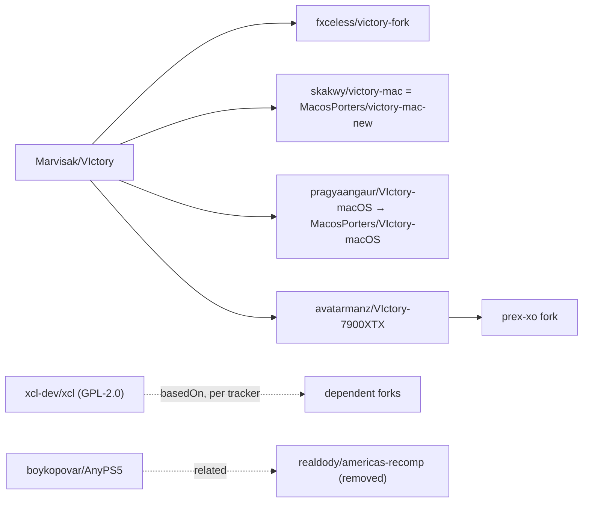

# Reference projects: what may be used, and what would have to change (2026-11-25)

Covers the named reference repositories and the [PortWatch VI tracker inventory](portwatch-inventory-2026-11-25.md). Evidence is repository metadata, licences, READMEs and file trees. **No reference repository's implementation source was read for this record, nothing was cloned for it except `d3dmetal-native`, and nothing was compiled or run from any project but that one.** Portability statements are therefore inferences from what the projects say about themselves. Not legal advice.

## The restrictions that apply

All from the engineering rules ([AGENTS.md](../../AGENTS.md)):

| Rule | Why it exists | Effect here |
| --- | --- | --- |
| "Provenance first: exclude anything derived from leaked proprietary material or unauthorized software. A project's license being GPL does not clear material it was built from or for." | A licence cannot grant rights its author never had | Covers every project developed against the leaked build |
| "Projects whose stated purpose depends on leaked or unauthorized builds ... are discovery references at documentation level; adopt nothing from them without a per-file provenance and license review recorded in the registry." | Contamination risk | Documentation-level reading only |
| "Never copy, port, translate or adapt source from emulator projects built for leaked or unauthorized material." | Same, for ideas carried as code | No porting, even of generic-looking parts |
| "Game-specific, asset-specific and decryption-related code is never adopted." | Third-party rights, anti-circumvention law | Excludes archive, texture-codec and key tooling |
| "Before integrating or copying anything: verify the exact license ... If licensing is uncertain, do not use it." | Licence compliance | No licence file means no reuse; GPL-2.0-only cannot be combined |
| BetterXen host binaries are ARM64; no x86-64 host executables | Native Apple Silicon host | Rules out linking x86-64-only libraries |

The first four are provenance and clean-room rules; the last two are ordinary dependency rules. Access granted by a maintainer to a private repository changes none of them: access is not a right to redistribute material that belongs to someone else.

## Named repositories

| Repository (head) | Licence | What it is | Disposition |
| --- | --- | --- | --- |
| MacosPorters/victory-mac-new and skakwy/victory-mac (`3ecbb8f96956`, identical) | GPL-3.0 | VIctory fork with a Mac build | Discovery only |
| MacosPorters/VIctory-macOS (`d6fc0620f53a`) | GPL-3.0 | VIctory fork for macOS | Discovery only |
| prex-xo/VIctory-7900XTX (`e2a28ec70632`) | GPL-3.0 | Fork of avatarmanz/VIctory-7900XTX with no commits of its own when compared | Discovery only; Windows and AMD RDNA 3 specific by its README (mesh shaders, shader model 6.6, 40 to 46 GB of memory) |
| meetox80/6stars (`480d9a4d00ed`) | **none** | Swift and Metal engine that reads the game's archives | Excluded: no licence, asset-specific |
| utmapp/d3dmetal-native (`af1ee17`) | MIT | Wine-free D3DMetal host | Reference only; see [evaluation](d3dmetal-native-evaluation.md) |

### Independently developed parts a different policy could evaluate

Listed so a maintainer can decide with specifics. None is approved.

| Part | Author as recorded | Would address | Prerequisite |
| --- | --- | --- | --- |
| `tools/macos/build-crossover-wine.sh`, `build-deps.sh` (VIctory-macOS) | mostly Pragyaan Gaur | A Wine built from CodeWeavers' published source, for comparison ([#389](https://github.com/MacosPorters/betterxen/issues/389)) | Per-file review; these build upstream Wine and do not touch title code |
| `mac/run-victory.sh` supervision ideas (victory-mac) | skakwy | Memory guard and stall handling | Already reimplemented in #384 and #388 |
| fp64 integer emulation (`emit/f64.rs`) | skakwy | Native shader compiler fp64 ([#387](https://github.com/MacosPorters/betterxen/issues/387)) | The #399 review says exclude the imported file; rewrite from IEEE 754 instead |

## Architecture: these projects and BetterXen

| Subject | Console-title layers (by their READMEs) | BetterXen hybrid | Portable to Apple Silicon? |
| --- | --- | --- | --- |
| CPU | Console x86-64 run natively in a Windows process | Windows x86-64 under CrossOver and Rosetta 2 | Only through Rosetta; AVX2 behaviour must be checked |
| Executable loading | Own PE loader and relinking | Wine's loader; BetterXen only identifies the file | Their loaders assume Windows or Wine |
| Runtime services | Reimplemented console and GDK libraries | Wine's Windows API | Console APIs have no counterpart here |
| Graphics | Direct3D 12 or Vulkan, often with NVIDIA or AMD requirements | D3D11 and D3D12 through CrossOver backends | Vendor-specific paths are not; plain D3D12 is, as far as the backend supports it |
| Shaders | RDNA 2 recompiled to DXIL, HLSL or SPIR-V | Ordinary DXBC from the program | A recompiler's output still needs a backend that accepts it; D3DMetal reports no double support |
| Resource and memory model | Windows virtual memory and placeholders; large discrete VRAM | Unified memory, 24 GB on the test machine | Reported needs of 22 to 46 GB do not fit it |
| Synchronization, threading | Win32 and D3D12 primitives | Same, provided by Wine and the backend | Yes at the API level |
| Testing | Mostly the target title | Original workloads with CPU-computed expectations | n/a |

## PortWatch candidates

From 84 distinct entries. Most target the console title, are unlicensed, GPL-2.0-only, AGPL-3.0 or removed.

| Candidate | Licence | Why it might be eligible | What it could add | Status |
| --- | --- | --- | --- | --- |
| ProhorovIlja/NativeX-Runtime | MIT | README describes original test programs, a source and licence review, and no proprietary material; Windows and Linux | Original D3D12 compute, raster and tiled-resource tests; BetterXen has no tiled-resource coverage | Candidate for a per-file review; not read |
| anrq0/SeriesX-Emulator | MIT | README says it never decrypts or unpacks and tests with its own guest programs | Little: BetterXen already identifies executables | Not pursued |

Other entries describing themselves as clean-room or "any title" layers target running dumped console games. Whether that purpose is admissible is a policy question this record does not settle.

**No component from any tracked project addresses a deficiency BetterXen has demonstrated**, so none was integrated. The deficiencies found so far (see [hybrid execution](../hybrid-execution.md)) are in CrossOver backends, in verification coverage and in missing independent reproduction.

## Relationships

Solid arrows from VIctory come from READMEs and the earlier audits; dotted ones from the tracker's `basedOn` and `related` fields. GitHub's own fork data links few of them.

## Maintainer decision

Keep the rules as they are and treat all of the above as documentation (recommended), or commission a per-file review of NativeX-Runtime if tiled-resource validation becomes a goal. Relaxing the provenance rules for the title-derived projects is not recommended.
