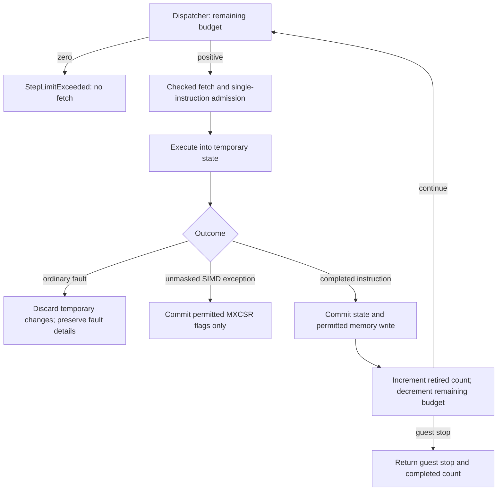

# Proposed Remill correctness adapters

**Design only. No adapter described here is implemented or independently
accepted.** The [extended evaluation](evaluation-2.md) still has eight numerical
mismatches and a missing guest-budget exit. Keep the current production CPU
path. This design is the next bounded experiment under issue #324; it does not
authorize changes to production admission, CPUID or the AVX work in #299.

The candidate remains BetterXen `b2654e93a42e74e29570183da1f31bb8cdc6f721`
and Remill `66c488c9911fd9b368e4d0c9647d74239f8bba8b`. All initial implementation
files belong under `experiments/remill/`; generated code and logs stay under
ignored `artifacts/`. Upstream code remains external with its notices intact.

## Architecture decision

Build a consumer of Remill's **single-instruction** lifting interface. Return
from each admitted instruction to a dispatcher that owns budgets, faults and
canonical guest state. Initially reuse BetterXen's exact integer-based numerical
implementation for legacy register-to-register `ADDSS`. Handle the small admitted
control-transfer subset explicitly in the adapter, and report that work in its
own counters. Do not pass arbitrary floating-point instructions to an unguarded
LLVM floating-point operation.

The existing `remill-lift-17` command optimizes whole traces before exporting
them. Its output is useful evidence but has already lost dependable instruction
boundaries. Do not recover a budget contract by counting optimized IR operations,
searching textual IR labels, charging only backward branches, or relying on the
external timeout. Each guest instruction can produce many IR operations, and
optimization can merge or remove them.

The pinned upstream interfaces actually inspected are:

- `Arch::DecodeInstruction` in `include/remill/Arch/Arch.h`.
- `InstructionLifterIntf::LiftIntoBlock` and `LiftStatus` in
  `include/remill/BC/InstructionLifter.h`.
- `Instruction::bytes`, `pc`, `next_pc`, `branch_taken_pc`,
  `branch_not_taken_pc` and `category` in `include/remill/Arch/Instruction.h`.

Upstream warns that decoding a larger byte stream can fuse idioms. Supply exactly
one independently bounded instruction and reject a disagreement in length,
operands or category. The actual consumer and its LLVM wrapper still need to be
written and tested; these interfaces do not supply the proposed dispatcher.

## First admission profile

The first adapter is for trusted original fixtures, not a general executable
loader. Every admitted form is listed explicitly; other forms return an
unsupported result with their guest PC and bytes.

| Forms | Proposed execution route | Initial boundary |
| --- | --- | --- |
| 64-bit register ADD, INC and DEC | Remill single-instruction thunk | Explicit fixture registers; defined arithmetic flags only |
| Legacy `ADDSS xmm0, xmm1` | Exact numerical helper | Register sources only; preserve the upper 96 destination bits and all source bits |
| JNE with a direct relative target | Adapter reads committed ZF and chooses the checked decoded target | Count as an adapter control step; no native jump directly to another guest thunk |
| HLT | Adapter guest stop | Completes one instruction and advances RIP, matching the existing synthetic CPU policy |
| 64-bit MOV through RBX and RET | Checked adapter memory/transfer operations in a later increment | One eight-byte span; authenticated fixture return sentinel; no general services or arbitrary host calls |

Using the numerical helper or explicit control adapter is visible routing,
not additional Remill-native instruction coverage. Preserve separate attempted
and retired counters for Remill thunks, numerical helpers and adapter controls.
There is no generic interpreter fallback and no implicit no-op.

VEX/EVEX, packed floating point, x87 operations, atomics, REP/string operations,
guest services and concurrent guest execution remain outside this profile. The
earlier vector probes remain separate research fixtures; their passing results
do not admit them into this adapter or establish production AVX state support.

## Numerical helper and state commit

The existing public Rust numerical surface is `softfloat::arithmetic`, using
`Arithmetic::Add`, `F32`, `Control::from_mxcsr` and `Outcome { bits, flags }`.
The private `x86_float::Raised::commit` cannot be called from the experiment.
The adapter must implement and independently test its exception-commit contract;
making private production handlers public is outside this work's scope.

The **proposed** helper ABI accepts two raw binary32 bit patterns and a guest
MXCSR value, and returns result bits, newly raised exception bits, the resulting
MXCSR and a normal/exception status through trusted host-owned storage. These are
new adapter fields, not existing Remill APIs. The proposed `AddssResultV1` has
four consecutive `uint32_t` fields: `result_bits`, `new_flags`, `mxcsr_after` and
`outcome`, with size 16 and alignment 4. `outcome` is 0 for completion or 4 for
SIMD exception; `result_bits` is consumed only on completion. A trusted wrapper
checks an explicit output-buffer size before writing, and distinguishes an ABI
error from a guest exception. These names and layouts are design proposals, not
functions already supplied by Remill or BetterXen.

Do not expose a Rust enum or cast either CPU structure across the C boundary.
No host float argument, floating-point return, `fesetround`, host FPCR change or
host exception flag is involved.

For each admitted ADDSS:

1. Snapshot the destination, source and guest MXCSR. The current guest instruction
   PC remains authoritative until the instruction completes.
2. Ask the exact helper to compute the low lane and newly raised flags. The
   high 96 destination bits, every source bit and integer flags are unchanged.
3. Decode exception masks from MXCSR bits 7–12. Newly raised pre-computation
   exceptions are considered before post-computation exceptions. An old sticky
   flag by itself must not cause a new trap.
4. If an unmasked pre-computation exception exists, commit the applicable new
   pre-computation flags to MXCSR and return `SimdException`. Otherwise OR the
   newly raised flags into MXCSR, and return `SimdException` if one is unmasked.
   Preserve existing sticky flags and all MXCSR control bits.
5. On an exception, leave the entire destination, source, integer flags, memory
   and RIP unchanged. MXCSR's permitted exception flags are the sole change.
   The faulting instruction does not increment the completed-instruction count.
6. Otherwise merge the computed low lane, advance RIP and retire one instruction.

This describes the intended compatibility contract for the first scalar form.
Packed-lane exception priority needs its own specification before packed forms
are admitted. Nonzero reserved bits in an externally seeded initial MXCSR are
an admission error, not a fabricated ADDSS exception. LDMXCSR is not admitted by
this initial helper profile.

Intercept the identified ADDSS **before** general semantic lifting/optimization.
Emit its helper call and checked status branches as an instruction operation.
Do not globally replace every LLVM `fadd`, infer x86 semantics from optimized
floating-point IR, or let a helper exception continue into a destination write.
Do not mark the helper pure or speculate it across an instruction boundary.

Expected outputs must remain independent. Reusing `softfloat` means agreement
between this route and the current CPU engines is a consistency check, not a
second numerical oracle. Keep the nine literal ADDSS cases and independently
derived fraction/manual cases as the acceptance expectations. Never generate
those expectations by calling this helper or reading its actual output.

## Budget, state and memory protocol

The **proposed** per-step result distinguishes completion, completion with guest
stop, unsupported form, ordinary fault and SIMD exception. It carries the current
PC, successor PC when applicable, and typed fault information. The proposed
`StepResultV1` layout is:

| Offset | Field | C type | Meaning |
| ---: | --- | --- | --- |
| 0 | abi_version | uint32_t | Exactly 1 |
| 4 | outcome | uint32_t | 0 complete, 1 completed guest stop, 2 ordinary fault, 3 unsupported, 4 SIMD exception, 5 host failure |
| 8 | instruction_pc | uint64_t | Guest PC admitted for this step |
| 16 | successor_pc | uint64_t | Valid only for outcomes 0 and 1 |
| 24 | detail | uint32_t | Outcome-specific tag; guest stop 1 is HLT; fault 1 is unmapped, 2 protection, 3 general protection |
| 28 | access | uint32_t | 0 none, 1 read, 2 write, 3 execute |
| 32 | fault_address | uint64_t | Valid only for a memory/fetch fault carrying an address; never a fabricated CR2 value for a general-protection fault |
| 40 | access_width | uint32_t | Requested byte width for the reported memory operation; otherwise zero |
| 44 | mxcsr_after | uint32_t | Guest MXCSR following the permitted commit rule |

Size is 48 bytes, alignment 8. Future implementation must assert every offset
and size independently in Rust and C++. All fields are initialized on every
return, but callers must branch on `outcome` and `detail` before consuming
conditional fields. A trusted entry takes an opaque adapter-context handle,
requested ABI version, output pointer and explicit output size; it rejects a wrong size/version without
writing beyond that buffer. Contexts are created and destroyed by their owner,
are not reentrant, and are never guest addresses. Temporary Remill state remains
C++-owned, canonical CPU/memory state remains Rust-owned, and conversions use
explicit fields. No whole-state structure is passed by value across the ABI.

Host failure is an experiment failure, not a guest trap or success. Unmapped,
permission, execute-fetch and canonical-address/general-protection failures stay
distinct; unsupported decode/lifting details retain the actual bytes in the host
diagnostic record. An execute-fetch fault uses `access = 3` and retains its
unmapped/protection detail. Unsupported details are 1 for an unadmitted form,
2 for decode disagreement and 3 for an unadmitted transfer. Host-failure details
are 1 for ABI mismatch, 2 for lifting/verification failure, 3 for state conversion
failure and 4 for an internal memory error. Unrecognized tags fail as host errors.
This is an experiment ABI proposal, not a stable production interface.

Budget behavior follows the existing interpreter's public `ExecutionResult`:

- Check remaining budget before fetch, decoding, compilation or operand access.
  A zero budget returns `StepLimitExceeded`, count zero and unchanged state even
  when the current PC is unmapped.
- Fetch only bytes required for the current instruction through execute-checked
  guest memory. Do not read a speculative fifteen-byte span or decode the next
  instruction just because it shares a trace. An earlier data fault must win
  over an unsupported or inaccessible following instruction.
- Reserve a step without retiring it. Execute into temporary state; retire only
  after its permitted effects commit. Decode failures, operand faults, unsupported
  forms and unmasked SIMD exceptions do not retire an instruction. A completed
  HLT does. Do not underflow remaining budget or wrap the retired counter.
- Every taken or untaken branch returns to dispatch. There is no direct thunk
  recursion or native backedge bypassing the budget check. Returning to the same
  PC still requires another budget admission.
- At exhaustion, RIP names the next instruction that would execute. A later call
  with a fresh budget resumes from that exact state and never replays a completed
  store or instruction. This is the exact-budget API, not the current scheduler's
  separately documented block-boundary slicing behavior.

Canonical CPU state remains owned by the dispatcher. A temporary Remill state
requires explicit conversion of each admitted register, arithmetic flag, RIP,
XMM and MXCSR field; never `memcpy` a Rust `CpuState` into a Remill `State`.
Validate the pinned Remill structure sizes and offsets at build time. Modelled
state outside the initial profile must be initialized and preserved under an
explicit admission rule, not silently discarded. Live YMM/AVX state integration
waits for the contract in #299.

Memory faults need more than the current experiment's boolean read/write result.
Carry operation kind, guest address, width and the actual memory/protection fault
back to the dispatcher. GuestMemory's mapping checks do not replace architectural
canonical-address and alignment checks. Ordinary faults must preserve all guest
state, including flags; earlier completed instructions remain committed.

For the first eight-byte store form, validate the whole span and retain one
pending write until instruction commit. No other form with multiple writes is
admitted. End validation and commit on the same single-threaded memory owner;
do not allow a callback to remap the span between them. The initial RET subset
reads through checked memory and admits only the authenticated fixture return
sentinel. Other transfers are explicitly unsupported by this profile. Do not
infer a general x86 RET policy from that restriction: a future admitted guest
return retires before an instruction-fetch fault at its successor, whose execute
check belongs to the next dispatcher turn.

Do not unwind a C++ exception or longjmp across a Rust frame or assume LLVM
`nounwind` code can carry a foreign exception. The current harness escape is not
the new protocol. Checked operations return explicit status, and generated IR
branches to the fault exit **before** any consumer uses an invalid result. There
is no zero/dummy read value followed by continued guest execution. A lifting or
verification failure stops compilation; it is not a guest success.

Initially compile fixed fixture instructions ahead of time; no general cache is
admitted. Keep guest code read/execute-only and reject self-modification in this
profile. Any later reusable cache must respect executable-generation and address-
space identity checks, checked fetch on revalidation, and in-flight code lifetime.
That integration requires the production CPU owner's review.

## Regression and review gates

These are **planned tests**, not results of this design task.

| Gate | Required observation |
| --- | --- |
| Existing numerical failures | All nine ADDSS cases retain their original bit/MXCSR/exit expectations; all destination/source preservation checks remain |
| Sticky flag handling | An exact operation with pre-existing PE set completes without a new precision trap; unrelated MXCSR bits remain unchanged |
| Fault atomicity | Invalid memory or an unmasked SIMD exception preserves destination and current RIP; only explicitly permitted MXCSR flags may change |
| No speculative execution | A faulting MOV followed by UD2 or an inaccessible instruction reports the MOV fault first |
| Zero budget | No instruction fetch or state/memory change, including an unmapped initial PC |
| Exact boundary | `inc rax; inc rax; hlt`, initially RAX 5 at `0x1000`: budgets 0/1/2/3 yield RAX 5/6/7/7, RIP `1000/1003/1006/1007`, counts 0/1/2/3; only budget 3 yields Halt |
| Resume | Running that program with budgets 1, then 1, then 1 matches one budget-3 run, including flags, memory and terminal status |
| Fault after progress | An instruction fault after two completions reports count two and leaves earlier effects intact; retry never double-retires them |
| Loops | Counts 1/3/7 still match; count zero and larger finite counts return exact guest-budget exits without supervisor termination |
| Decode agreement | Current-instruction length/category disagreement and a fused idiom are refused explicitly; no change to production decoder coverage |
| Compiler preservation | Optimized and unoptimized adapter runs obey the same counts, side-effect order and fault PCs; IR/control-flow inspection finds no edge bypassing dispatch |
| Wrong-answer controls | Incorrect result, missing MXCSR update, missing budget check and premature store each cause their intended failure |

Run native ARM64 correctness and provenance checks on the named candidate before
comparing performance. Keep the old unadapted route as a separately labelled
baseline with its failures; do not overwrite its receipts or redefine its gates.
Retain the supervisor timeout as a containment check, reported separately from
guest budget behavior. R1 reviews provenance, claims and native execution; R2
independently derives semantic expectations and reviews fault/count behavior.
The implementer cannot promote its own work to independent acceptance.

## Implementation order and exit decision

1. Specify the versioned status/state ABI and implement exact single-instruction
   dispatch for INC/DEC/JNE/HLT. Close zero-budget, boundary, resume and runaway
   regressions without numerical or memory operations.
2. Add the original ADDSS bit-pattern helper and transactional register/MXCSR
   commit. Close the unchanged nine-case numerical gate and sticky-flag controls.
3. Add the checked MOV/RET subset, typed memory faults and one-write commit.
   Close fault precedence, mapping-boundary and preservation tests.
4. Review the admitted profile independently. Only then measure matched release
   workloads on an idle native host with equivalent budget/fault guarantees,
   separating helper, dispatch, compilation, memory and code-size costs.

Stay isolated if any required semantic or budget gate fails, or if the combined
adapter adds complexity without a demonstrated workload benefit. Production
adoption is a separate decision after reviewed correctness, attributable
dependencies and representative measurements. This design adds no new hardware,
execution, benchmark or compatibility claim.

## Sources

- [Extended local findings](evaluation-2.md), including the retained failure receipts.
- [Current CPU contract](../../docs/cpu/instruction-registry.md),
  [CPU state/counting](../../crates/loader/src/cpu.rs),
  [exact numerical implementation](../../crates/loader/src/softfloat.rs), and
  [current numerical commit behavior](../../crates/loader/src/x86_float.rs).
- [Pinned Remill instruction lifter](https://github.com/lifting-bits/remill/blob/66c488c9911fd9b368e4d0c9647d74239f8bba8b/include/remill/BC/InstructionLifter.h),
  [decoder interface and idiom warning](https://github.com/lifting-bits/remill/blob/66c488c9911fd9b368e4d0c9647d74239f8bba8b/include/remill/Arch/Arch.h),
  [instruction metadata](https://github.com/lifting-bits/remill/blob/66c488c9911fd9b368e4d0c9647d74239f8bba8b/include/remill/Arch/Instruction.h), and
  [CLI optimization order](https://github.com/lifting-bits/remill/blob/66c488c9911fd9b368e4d0c9647d74239f8bba8b/bin/lift/Lift.cpp).
- [Intel SDM Volume 1](https://cdrdv2-public.intel.com/843827/253665-sdm-vol-1-dec-24.pdf),
  sections 10.2.3 and 11.5; Volume 2 instruction entries for each admitted form.
  Architectural expectations and project budget policy are separate contracts.
